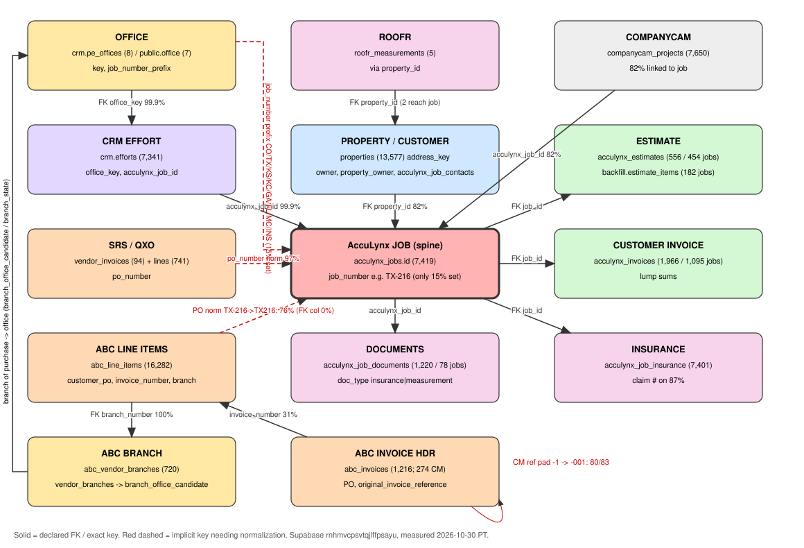

# Supabase index - Pro Exteriors LLC (Agent Workforce)

Built 2026-10-30 ~9 PM PT by Helo · Dev Pair, read-only (catalog + aggregate SELECTs). Project ref `rnhmvcpsvtqjlffpsayu` (us-west-1, PG 17). No secrets or PII rows; counts and shapes only.
Machine-readable copy: `supabase-index-2026-10-30.json` (one row per object).

## 0. At a glance
- **827 objects**: 601 tables/matviews + 226 views across 13 schemas (688 declared foreign keys). 153 tables are empty.
- Schemas: public (330 tables, 163 views, 10 matviews), crm_private 96, crm 74, qbo_registers 58 views, runtime_auth 28, scheduler 19(+4 private), jt_mirror 16(+5 views), hr 14, acculynx_backfill 10.
- The spine is **AccuLynx job** (`public.acculynx_jobs.id`, text). Everything else hangs off it by a declared FK (`job_id`), an implicit key (job number in the PO), or the property (`property_id`).

## 1. How the data links together (centerpiece)



Entity chain: **office -> property/customer -> job -> estimate -> invoices (AccuLynx customer, ABC/SRS material lines, QBO) -> insurance / documents / Roofr / CompanyCam**.

### 1a. Link keys and normalization rules

| # | From | To | Key | Declared? | Normalization rule | Measured match |
|---|---|---|---|---|---|---|
| L1 | `crm.pe_offices.job_number_prefix` | `acculynx_jobs.job_number` | office prefix | implicit | `substring(upper(job_number) from '^([A-Z]+)')`. Prefixes: CO=colorado(Denver), TX=texas(Richardson/Euless), KS=wichita, **KC=kansas_city (not MO)**, GA, FL, MC=multi-family/commercial, INS=insurance program | only **1,100 of 7,419 jobs (15%)** have a prefixed job number; **6,088 have an empty job_number** and ~231 are bare numbers -> office must fall back to `crm.efforts.office_key` (7,336/7,341 set) or `acculynx_jobs.market` / location_state |
| L2 | `crm.efforts.office_key` | `crm.pe_offices.key` | office | **FK** | none | 7,336 / 7,341 efforts (99.9%) |
| L3 | `crm.efforts.acculynx_job_id` | `acculynx_jobs.id` | job | implicit | exact text | 7,332 / 7,341 (99.9%) |
| L4 | `acculynx_jobs.property_id` | `properties.id` | property | **FK** | none (address dedupe via `properties.address_key`) | 6073 / 7419 jobs (82%) |
| L5 | `acculynx_estimates.job_id`, `acculynx_invoices.job_id`, `acculynx_job_insurance.job_id`, `acculynx_job_financials.job_id`, `acculynx_job_contacts.job_id`, `acculynx_job_milestone_history.job_id` | `acculynx_jobs.id` | job | **FK** | none | estimates on 454 jobs (6%); customer invoices on 1095 jobs (15%); claim # on 6425 jobs (87%) |
| L6 | `acculynx_backfill.estimate_items.job_id` | `acculynx_jobs.id` | job | implicit | exact | 182 jobs have estimate line items |
| L7 | `abc_line_items.customer_po` | `acculynx_jobs.job_number` | **PO -> job number** | implicit | `upper(regexp_replace(substring(upper(customer_po) from '^\s*([A-Z]{2,3}-?\d+)'),'[^A-Z0-9]','','g'))` = `upper(regexp_replace(job_number,'[^A-Za-z0-9]','','g'))`. So `TX216`, `TX-216`, `TX-216-1`, `TX-216: CLIENT` -> `TX216`. Free text (`TX-383 & TX-382`) fails closed (docs/119) | parse ok 12759 / 16282 lines; **hits a job 12361 (76%)** across 618 PO keys |
| L7b | `abc_line_items.acculynx_job_id` | `acculynx_jobs.id` | job | **FK, but 0% populated** | - | **0 / 16282**; `acculynx_match_type` also all null. Use L7 until backfilled |
| L8 | `abc_line_items.invoice_number` | `abc_invoices.invoice_number` | invoice | implicit | exact (`NNNNNNNNNN-NNN`) | 871 / 2798 line invoices have a header (31%) - line file (AR import) is wider than the API header table |
| L9 | `abc_invoices.purchase_order_number` | `acculynx_jobs.job_number` | PO -> job | implicit | same as L7 | 920 / 1216 (76%) |
| L10 | `abc_invoices.original_invoice_reference` (credit memo) | `abc_invoices.invoice_number` / `abc_line_items.invoice_number` | credit memo -> original invoice -> its PO/job | implicit | ref is `NNNNNNNNNN-N`; **left-pad suffix to 3**: `split_part(ref,'-',1)||'-'||lpad(split_part(ref,'-',2),3,'0')` | 274 credit memos, 83 carry a ref; exact match 0 -> **padded 80/83**, base-number 83/83 |
| L11 | `abc_line_items.branch_number` / `abc_orders.branch_number` | `abc_vendor_branches.branch_number` -> `vendor_branches` -> `branch_office_candidate.office_id` -> `office` | branch of purchase -> office | FK (lines->branches) + candidate map | exact | 100% of lines hit a branch. Branch state is the office proxy: CO 7,538 · TX 5,430 · KS 2,715 · GA 352 · MO 133 · FL 47 |
| L12 | `abc_orders.purchase_order_number` | job | PO -> job | matview `mv_order_acculynx_match` (mig 316/317) | as L7 | 1987 / 3178 matched; naming_status po_mismatch 1,859 · needs_link 1,191 · aligned 128 |
| L13 | `vendor_invoices.po_number` (SRS/QXO) | job | PO -> job | implicit | as L7 | 91 / 94 (97%); SRS 91, QXO 3 invoices; lines in `vendor_invoice_lines` (741) |
| L14 | `acculynx_job_documents.acculynx_job_id` | job | job | implicit | exact | 1220 docs on only **78 jobs**; doc_type: unsorted 371, measurement 202, contract 134, subcontractor 110, insurance 106, material 105, permit 63 |
| L15 | `roofr_measurements.property_id` | `properties.id` -> jobs | property | **FK** | via job.property_id | 5 rows; only 2 reach a job |
| L16 | `companycam_projects.acculynx_job_id` / `.property_id` | job / property | job, property | implicit (link_method/confidence cols) | exact | 6297 / 7650 with job (82%), 5706 with property |
| L17 | `crm_pipeline.acculynx_job_id` | job | job | implicit | exact | all 7,419 jobs present; 11,924 rows (multiple snapshots - dedupe on acculynx_job_id) |
| L18 | `qbo_invoices.customer_ref/customer_name` | job / contact | customer | implicit, **weak** | name match only | not measured - no job key in QBO |
| L19 | address (`location_street1+zip`, `shipping_address`, `street_address_1`) | `properties.address_key` | address | implicit fallback | `address_key` normalizer already in properties | fallback for L7 misses |

### 1b. Recommended join paths
- **Job -> office:** `coalesce(pe_offices by job_number prefix, efforts.office_key, acculynx_jobs.location_state)`.
- **Job -> ABC lines:** L7 (normalized PO) ∪ credit memos via L10 ∪ (residual) branch office + address (L11/L19). Don't trust `abc_line_items.acculynx_job_id` yet.
- **Job -> insurance:** `acculynx_job_insurance` (structured) + `acculynx_job_documents where doc_type='insurance'` (docs, 78 jobs only).
- **Job -> Roofr/measurement:** `roofr_measurements` via property (5) + docs `doc_type='measurement'` (202 docs). Everything else = placeholder "missing, source AccuLynx".

## 2. Top tables (rows)
| Table | Rows | Source | Use for |
|---|---|---|---|
| `public.collin_cad_appraisal_data` | 479,230 | Property/parcel data |  |
| `public.cp_resources` | 456,026 | Content platform | CenterPoint Connect JSON:API mirror (PEC-110). Full historical extract; files/model_files are metadata only. |
| `public.abc_price_observation_lines` | 444,851 | ABC Supply | ABC Pricing API line-level pricing/status observations by item, Ship-To, and branch. |
| `public.abc_product_catalog` | 331,390 | ABC Supply | ABC Supply production Product API catalog mirror populated from GET /api/product/v1/items. RLS enabled; service-role ing |
| `public.companycam_photos` | 325,270 | CompanyCam |  |
| `public.sedgwick_property_data` | 235,782 | Property/parcel data | Layer 1 — Sedgwick County (Wichita KS) property base. Tax roll + parcel GIS enrichment. Parallel to collin_cad_appraisal |
| `public.lead_list_pre_dedupe_20260420` | 227,723 | Property/parcel data | Snapshot before dedupe routine on 2026-04-20. Safe to drop after verification. |
| `public.acculynx_raw` | 202,930 | AccuLynx | Immutable append-only archive of raw AccuLynx API responses. UPDATE/DELETE/TRUNCATE revoked (mig 178) — never mutate sou |
| `public.integration_source_receipts` | 179,514 | Runtime/integrations |  |
| `public.ihm_webhook_raw` | 177,738 | Hail (IHM/NOAA/StormWatch) | Raw webhook payloads from HailRecon Agent API. Every inbound POST lands here for audit trail. |
| `public.lead_list` | 146,609 | Property/parcel data | Layer 2 — Purchased and acquired property leads keyed by APN (geoid) |
| `public.call_interactions_pre_dedupe_20260420` | 135,267 | Calls | Snapshot before dedupe routine on 2026-04-20. Safe to drop after verification. |
| `public.call_interactions` | 135,266 | Calls | Layer 4 — Call center log. Every inbound and outbound call against a property/APN. |
| `public.ihm_monitoring_alerts` | 106,627 | Hail (IHM/NOAA/StormWatch) | Type 1 — Hail detected at a monitored address. Joins to property data via external_key or lat/lng. |
| `public.noaa_hail_events` | 71,048 | Hail (IHM/NOAA/StormWatch) |  |
| `public.owner_contact_point` | 60,998 | Property/parcel data |  |
| `crm_private.change_log` | 46,960 | CRM app (private) |  |
| `public.ihm_marker_changes` | 43,060 | Hail (IHM/NOAA/StormWatch) | Type 4 — Marker status workflow changes (New→Knocked→Signed→Complete). |
| `public.product_vendor_price_observations` | 42,226 | Vendors (ABC/SRS/QXO) | Every price data point ever seen. Aggregated quarterly by product_vendor_pricing materialized view. |
| `public.zcta_hail_yearly` | 40,653 | Hail (IHM/NOAA/StormWatch) |  |
| `jt_mirror.write_action_log` | 35,422 | JobTread mirror |  |
| `jt_mirror.pending_write` | 34,454 | JobTread mirror |  |
| `public.ihm_hail_alerts` | 28,011 | Hail (IHM/NOAA/StormWatch) | Type 6 — Territory-wide weather alerts. Fires on weather events in service areas regardless of markers. |
| `jt_mirror.crosswalk` | 27,897 | JobTread mirror |  |
| `public.qbo_purchases` | 27,740 | QuickBooks | QuickBooks purchases/expenses. |
| `public.acculynx_job_milestone_history` | 19,083 | AccuLynx | AccuLynx API mirror. UNTRUSTED-CONTENT BOUNDARY (D-10): all free-text (names, descriptions, notes) is untrusted external |
| `public.abc_order_lines` | 18,593 | ABC Supply |  |
| `public.mv_hail_heatzone_coverage` | 17,234 | Hail (IHM/NOAA/StormWatch) | Materialised vw_hail_heatzone_coverage. Read this from any PostgREST client - the view recomputes ~250k regex-normalised |
| `public.zcta_hail_summary` | 17,234 | Hail (IHM/NOAA/StormWatch) |  |
| `public.abc_line_items` | 16,282 | ABC Supply | ABC itemized invoice lines (product, qty, price, branch, PO). Baseline templates / materials by job. |

## 3. Notable gaps / data-quality
- `abc_line_items.acculynx_job_id` FK exists but is **0% filled**; `acculynx_match_type` all null. Join by normalized PO.
- **6,088 of 7,419 AccuLynx jobs have an empty job_number** -> office prefix unknown for 82% of jobs; use `crm.efforts.office_key`.
- Kansas City prefix is **`KC`** (`crm.pe_offices.kansas_city`), not `MO`; ABC branch state for KC work is MO.
- Credit-memo refs use a 1-digit suffix (`-1`) vs invoice 3-digit (`-001`): pad before joining.
- Only 31% of ABC line invoices have a header row in `abc_invoices`.
- Estimates: 556 (454 jobs); estimate line items only 182 jobs; AccuLynx customer invoices are lump sums.
- Documents: 1,220 on 78 jobs; Roofr 5 rows. AccuLynx document extraction is the big gap.
- Backups/quarantine tables (`*_pre_dedupe_20260420`, `_backup_*`, `*_orphan_quarantine`) - never report from them.
- `mv_invoice_audit_summary` matview is **not populated**.
- Empty tables (153): `crm.acculynx_rep_links`, `crm.agreements`, `crm.appointments`, `crm.assignment_requests`, `crm.communication_lifecycle`, `crm.consent_events`, `crm.conversation_messages`, `crm.crew_records`, `crm.crew_workers`, `crm.effort_evidence`, `crm.evidence`, `crm.feature_comments`, `crm.feature_votes`, `crm.interactions`, `crm.journey_events`, `crm.journey_gate_files`, `crm.lien_waivers`, `crm.readiness_checks`, `crm.requirement_exceptions`, `crm.staff_alerts`, `crm.staff_directory_fields`, `crm.title_families`, `crm.weekly_snapshots`, `crm.weekly_source_reviews`, `crm.weekly_submissions`, `crm_private.artifact_document_policy`, `crm_private.artifact_scan_policy`, `crm_private.assignment_history`, `crm_private.change_log_purges`, `crm_private.change_log_undos`, `crm_private.command_receipts`, `crm_private.crew_incidents`, `crm_private.document_preview_pages`, `crm_private.document_preview_policies`, `crm_private.inbound_events`, `crm_private.inspection_drafts`, `crm_private.inspection_reviews`, `crm_private.job_forms`, `crm_private.job_pdf_previews`, `crm_private.job_templates`, `crm_private.legacy_title_mappings`, `crm_private.member_pay_versions`, `crm_private.member_title_versions`, `crm_private.proposals`, `crm_private.provider_accounts`, `crm_private.provider_mappings`, `crm_private.rep_access_receipts`, `crm_private.seat_cost_versions`, `crm_private.source_evidence_decision_receipts`, `crm_private.source_evidence_decisions`, `crm_private.staff_email_outbox`, `crm_private.staff_on_file_versions`, `crm_private.staff_personal_contacts`, `crm_private.staff_photos`, `crm_private.staff_record_log`, `crm_private.team_entries`, `crm_private.title_versions`, `crm_private.weekly_artifact_history`, `crm_private.weekly_artifact_intents`, `crm_private.weekly_artifact_storage`, `crm_private.weekly_draft_receipts`, `crm_private.weekly_drafts`, `crm_private.weekly_held_acknowledgments`, `crm_private.weekly_item_locks`, `crm_private.weekly_pilot_revocations`, `crm_private.weekly_source_artifacts`, `crm_private.weekly_source_failures`, `crm_private.weekly_source_review_receipts`, `crm_private.weekly_workload_receipts`, `hr.asset_assignments`, `hr.asset_records`, `hr.asset_versions`, `hr.assets`, `hr.office_lease_terms`, `hr.office_leases`, `hr.office_opening_events`, `hr.office_opening_tasks`, `hr.office_openings`, `hr.office_profile_versions`, `hr.office_rent_approvals`, `jt_mirror.webhook_events`, `public.abc_favorite_items`, `public.abc_frequent_items`, `public.abc_invoice_pdfs`, `public.abc_order_invoiced_events`, `public.abc_order_status_events`, `public.abc_product_availability`, `public.abc_product_hierarchy`, `public.abc_product_images`, `public.abc_recent_items`, `public.abc_uom_calculations`, `public.abc_webhook_configs`, `public.abc_webhook_events_raw`, `public.acculynx_invoice_lines`, `public.acculynx_sync_cursor`, `public.agent_scraping_jobs`, `public.agreement_package_submissions`, `public.communication_delivery_attempts`, `public.credit_memo_request_lines`, `public.estimate_a3_proposals`, `public.estimate_sop_proposals`, `public.fleet_driver_approvals`, `public.fleet_driver_documents`, `public.fleet_driver_incidents`, `public.fleet_driver_training`, `public.fleet_job_costs`, `public.fleet_maintenance_events`, `public.fleet_vehicle_checkouts`, `public.ihm_recon_pics`, `public.item_roof_system_category`, `public.jurisdiction`, `public.kb_atoms_staging`, `public.kb_finding_sources`, `public.kb_knowledge_conflicts`, `public.kb_promotion_queue`, `public.kb_regulatory_snapshots`, `public.kb_research_charters`, `public.kb_research_digests`, `public.kb_research_findings`, `public.kb_research_questions`, `public.kb_research_runs`, `public.manufacturer_vendor_ranking`, `public.mv_invoice_audit_summary`, `public.price_foundation_review_actions`, `public.product_uom_conversions`, `public.property_identifier`, `public.qbo_credit_memos`, `public.regulatory_snapshot`, `public.review_queue`, `public.stormwatch_company_offices`, `public.wcf_assumption_updates`, `runtime_auth.approvals`, `runtime_auth.channel_deliveries`, `runtime_auth.effects`, `runtime_auth.intake_orchestrations`, `runtime_auth.leases`, `runtime_auth.linear_action_receipts`, `runtime_auth.linear_work_claims`, `runtime_auth.occurrences`, `runtime_auth.receipts`, `runtime_auth.work_items`, `scheduler.acceptance`, `scheduler.crew_documents`, `scheduler.crew_jobtread_links`, `scheduler.evidence`, `scheduler.materials`, `scheduler.member_crews`, `scheduler.phases`, `scheduler.quality_items`, `scheduler.reports`, `scheduler.scope_imports`, `scheduler.templates`, `scheduler_private.command_receipts`

## 4. Quick-reference queries (copy/paste, read-only)

```sql
-- Normalized job key helpers (inline)
-- job side : upper(regexp_replace(j.job_number,'[^A-Za-z0-9]','','g'))
-- PO side  : upper(regexp_replace(substring(upper(po) from '^\s*([A-Z]{2,3}-?\d+)'),'[^A-Z0-9]','','g'))

-- Q1 Jobs by office (prefix, fallback CRM office_key)
select coalesce(o.key, e.office_key, 'unknown') office, count(*) jobs
from public.acculynx_jobs j
left join crm.pe_offices o on o.job_number_prefix = substring(upper(j.job_number) from '^([A-Z]+)')
left join crm.efforts e on e.acculynx_job_id = j.id
group by 1 order by 2 desc;

-- Q2 Estimates by office (count, total, avg margin)
select coalesce(o.key, e.office_key,'unknown') office, count(*) estimates, sum(es.total_price) total, avg(es.profit_margin_rate) avg_margin
from public.acculynx_estimates es join public.acculynx_jobs j on j.id=es.job_id
left join crm.pe_offices o on o.job_number_prefix = substring(upper(j.job_number) from '^([A-Z]+)')
left join crm.efforts e on e.acculynx_job_id=j.id
where es.archived_at is null group by 1 order by 3 desc nulls last;

-- Q3 Invoices by job: AccuLynx customer + ABC material + SRS
with j as (select id, job_number, upper(regexp_replace(job_number,'[^A-Za-z0-9]','','g')) jn from public.acculynx_jobs where job_number<>'')
select j.job_number,
 (select sum(total_price) from public.acculynx_invoices i where i.job_id=j.id) customer_billed,
 (select sum(ext_price) from public.abc_line_items l where upper(regexp_replace(substring(upper(l.customer_po) from '^\s*([A-Z]{2,3}-?\d+)'),'[^A-Z0-9]','','g'))=j.jn) abc_material,
 (select sum(total_due) from public.vendor_invoices v where upper(regexp_replace(substring(upper(v.po_number) from '^\s*([A-Z]{2,3}-?\d+)'),'[^A-Z0-9]','','g'))=j.jn) srs_qxo_material
from j order by 3 desc nulls last limit 50;

-- Q4 ABC line items for one job (incl. credit memos via padded original ref)
with k as (select 'TX216'::text jn),
inv as (select distinct invoice_number from public.abc_line_items, k
        where upper(regexp_replace(substring(upper(customer_po) from '^\s*([A-Z]{2,3}-?\d+)'),'[^A-Z0-9]','','g'))=k.jn),
cm as (select a.invoice_number from public.abc_invoices a join inv on split_part(a.original_invoice_reference,'-',1)||'-'||lpad(split_part(a.original_invoice_reference,'-',2),3,'0')=inv.invoice_number where a.is_credit_memo)
select invoice_number, invoice_date, transaction_type, item_number, item_description, inv_uom, inv_qty, ext_price
from public.abc_line_items where invoice_number in (select invoice_number from inv union select invoice_number from cm)
order by invoice_date, invoice_number;

-- Q5 Top ABC products by office (branch state as office proxy)
select branch_state, product_brand_line, item_description, count(distinct invoice_number) invoices, sum(inv_qty) qty, sum(ext_price) spend
from public.abc_line_items where transaction_type is distinct from 'CM'
group by 1,2,3 order by branch_state, spend desc;

-- Q6 Document coverage per job (insurance / measurement / Roofr placeholders)
select j.job_number,
  bool_or(d.doc_type='insurance') has_ins_doc, bool_or(d.doc_type='measurement') has_measure_doc,
  exists(select 1 from public.roofr_measurements r where r.property_id=j.property_id) has_roofr,
  (select claim_number is not null from public.acculynx_job_insurance i where i.job_id=j.id) has_claim
from public.acculynx_jobs j left join public.acculynx_job_documents d on d.acculynx_job_id=j.id and d.removed_at is null
group by j.id;

-- Q7 ABC order -> job link health
select naming_status, count(*) from public.mv_order_acculynx_match group by 1;
```

## 5. Other Supabase projects (not indexed)
| Project | Ref | Status |
|---|---|---|
| ef-crm | `kxkaovmoakeochqbmozo` | active |
| AIA4 Tier B - Advanced (HWA) | `jnsytduclvvoccmnliqo` | active |
| local775-production | `hcfryjrajqftcnnbnybj` | active |
| AIA4 Client Portal | `bqbrsmuxkroswrttdwwd` | active |
| vehicle-sot | `hasejhnnzjnitxawsgri` | active |
| Homeworks QA | `ftnjajqmgugcglyugzgd` | active |
| cw-field-app | `gdovlvghvphwltnsqztr` | active |
| aia4-church-platform | `bxwzywekbbxdbhikicor` | paused |
| hawc-general-contracting | `nqdqvhzojogrzlnhizox` | paused |
| radiustrades-dev | `fwylstzsmrsbljvftfdo` | paused |

## 6. Full inventory (tables + matviews)
Range = min..max of created_at/inserted_at/invoice_date etc.; Fresh = max updated_at/synced_at (else max date col).

| Object | Kind | Rows | Source | PK | FKs | Key cols | Range | Fresh | Notes |
|---|---|---|---|---|---|---|---|---|---|
| `acculynx_backfill.companycam_projects` | table | 6,229 | CompanyCam | id |  | id:text, matched_acculynx_job_id:text, endpoint:text |  |  |  |
| `acculynx_backfill.contact_emails` | table | 3,636 | AccuLynx backfill | account_key, acculynx_id |  | acculynx_id:text, contact_id:text, parent_contact_id:text, source_endpoint:text |  |  |  |
| `acculynx_backfill.contact_phones` | table | 5,844 | AccuLynx backfill | account_key, acculynx_id |  | acculynx_id:text, contact_id:text, parent_contact_id:text, source_endpoint:text |  |  |  |
| `acculynx_backfill.contact_types` | table | 2 | AccuLynx backfill | account_key, acculynx_id |  | acculynx_id:text, parent_type_id:text, source_endpoint:text |  |  |  |
| `acculynx_backfill.estimate_items` | table | 4,740 | AccuLynx backfill | account_key, acculynx_id |  | acculynx_id:text, estimate_id:text, section_id:text, job_id:text, parent_item_id:text, source_endpoint:text |  |  | Estimate line items (182 jobs). |
| `acculynx_backfill.estimate_sections` | table | 305 | AccuLynx backfill | account_key, acculynx_id |  | acculynx_id:text, estimate_id:text, job_id:text, parent_section_id:text, source_endpoint:text |  |  |  |
| `acculynx_backfill.job_representatives` | table | 6,811 | AccuLynx backfill | account_key, job_id, acculynx_id |  | acculynx_id:text, job_id:text, user_id:text, parent_representative_id:text, source_endpoint:text |  |  |  |
| `acculynx_backfill.milestone_settings` | table | 7 | AccuLynx backfill | account_key, acculynx_id |  | acculynx_id:text, parent_milestone_id:text, status_id:text, source_endpoint:text, endpoint:text |  |  |  |
| `acculynx_backfill.vendors` | table | 1,313 | AccuLynx backfill | account_key, acculynx_id, contact_type_id |  | acculynx_id:text, contact_id:text, parent_contact_id:text, contact_type_id:text, source_endpoint:text, postal_code:text |  |  |  |
| `acculynx_backfill.worksheet_lines` | table | 96 | AccuLynx backfill | account_key, acculynx_id |  | acculynx_id:text, financials_id:text, worksheet_id:text, job_id:text, section_id:text, parent_line_id:text, source_endpoint:text |  |  |  |
| `crm.acculynx_rep_links` | table | 0 | AccuLynx | organization_id, rep_key | organization_id->crm.organizations(id); organization_id, linked_by->crm.memberships(organization_id, id); organization_id, membership_id->crm.memberships(organi | organization_id:uuid, membership_id:uuid |  |  | EMPTY |
| `crm.agreements` | table | 0 | CRM app | id | organization_id, effort_id->crm.efforts(organization_id, id) | id:uuid, organization_id:uuid, effort_id:uuid, provider_envelope_id:text |  |  | EMPTY |
| `crm.ai_agents` | table | 8 | CRM app | key |  |  |  | 2026-10-03 |  |
| `crm.appointments` | table | 0 | CRM app | id | organization_id, effort_id->crm.efforts(organization_id, id) | id:uuid, organization_id:uuid, effort_id:uuid |  |  | EMPTY |
| `crm.assignment_requests` | table | 0 | CRM app | id | organization_id, decided_by->crm.memberships(organization_id, id); organization_id, effort_id->crm.efforts(organization_id, id); organization_id, requested_by-> | id:uuid, organization_id:uuid, effort_id:uuid, to_membership_id:uuid, to_office_key:text |  |  | EMPTY |
| `crm.audit_events` | table | 62 | CRM app | id | actor_id->crm.memberships(id); organization_id, effort_id->crm.efforts(organization_id, id) | id:uuid, organization_id:uuid, effort_id:uuid, actor_id:uuid | 2026-09-24..2026-10-21 | 2026-10-21 |  |
| `crm.collection_milestones` | table | 12 | CRM app | id | organization_id, created_by->crm.memberships(organization_id, id); organization_id, effort_id->crm.collection_plans(organization_id, effort_id); organization_id | id:uuid, organization_id:uuid, effort_id:uuid | 2026-10-16..2026-10-16 | 2026-10-16 |  |
| `crm.collection_plan_changes` | table | 4 | CRM app | id | organization_id, actor_id->crm.memberships(organization_id, id); organization_id, effort_id->crm.efforts(organization_id, id); organization_id, owner_id->crm.me | id:uuid, organization_id:uuid, effort_id:uuid, owner_id:uuid, actor_id:uuid, idempotency_key:text | 2026-10-16..2026-10-16 | 2026-10-16 |  |
| `crm.collection_plan_reviews` | table | 1 | CRM app | id | change_id->crm.collection_plan_changes(id); organization_id, actor_id->crm.memberships(organization_id, id) | id:uuid, organization_id:uuid, change_id:uuid, actor_id:uuid, idempotency_key:text | 2026-10-21..2026-10-21 | 2026-10-21 |  |
| `crm.collection_plans` | table | 4 | CRM app | organization_id, effort_id | organization_id, effort_id->crm.efforts(organization_id, id); organization_id, set_by->crm.memberships(organization_id, id); organization_id, updated_by->crm.me | organization_id:uuid, effort_id:uuid |  | 2026-10-16 |  |
| `crm.communication_followups` | table | 1 | CRM app | request_id | activity_id->crm.job_activity(id); organization_id, effort_id->crm.efforts(organization_id, id); request_id->crm_private.work_request_drafts(id) | activity_id:uuid, request_id:uuid, organization_id:uuid, effort_id:uuid |  |  |  |
| `crm.communication_lifecycle` | table | 0 | CRM app | id | organization_id, effort_id->crm.efforts(organization_id, id) | id:uuid, organization_id:uuid, effort_id:uuid |  |  | EMPTY |
| `crm.communication_people` | table | 2 | CRM app | activity_id, person_id | activity_id->crm.job_activity(id); organization_id, effort_id->crm.efforts(organization_id, id); person_id->crm.people(id) | activity_id:uuid, person_id:uuid, organization_id:uuid, effort_id:uuid |  |  |  |
| `crm.config_values` | table | 1 | CRM app | id | key->crm_private.config_variables(key); office_key->crm.pe_offices(key); organization_id, author_id->crm.memberships(organization_id, id); organization_id, subj | id:uuid, organization_id:uuid, version_id:uuid, office_key:text, subject_id:uuid, author_id:uuid | 2026-10-06..2026-10-06 | 2026-10-06 |  |
| `crm.config_versions` | table | 1 | CRM app | id | organization_id, created_by->crm.memberships(organization_id, id); organization_id->crm.organizations(id); organization_id, reviewed_by->crm.memberships(organiz | id:uuid, organization_id:uuid | 2026-10-06..2026-10-06 | 2026-10-06 |  |
| `crm.consent_events` | table | 0 | CRM app | id | organization_id, actor_id->crm.memberships(organization_id, id); organization_id, contact_point_id->crm.contact_points(organization_id, id); organization_id, ef | id:uuid, organization_id:uuid, effort_id:uuid, person_id:uuid, contact_point_id:uuid, purpose:text, actor_id:uuid, evidence_id:uuid |  |  | EMPTY |
| `crm.contact_points` | table | 14 | CRM app | id | organization_id, person_id->crm.people(organization_id, id) | id:uuid, organization_id:uuid, person_id:uuid |  |  |  |
| `crm.conversation_messages` | table | 0 | CRM app | id | organization_id, actor_id->crm.memberships(organization_id, id); organization_id, contact_point_id->crm.contact_points(organization_id, id); organization_id, ef | id:uuid, organization_id:uuid, effort_id:uuid, person_id:uuid, contact_point_id:uuid, actor_id:uuid, purpose:text |  |  | EMPTY |
| `crm.crew_records` | table | 0 | CRM app | crew_id | organization_id->crm.organizations(id) | crew_id:uuid, organization_id:uuid |  |  | EMPTY |
| `crm.crew_workers` | table | 0 | CRM app | id | organization_id->crm.organizations(id) | id:uuid, organization_id:uuid, crew_id:uuid |  |  | EMPTY |
| `crm.effort_evidence` | table | 0 | CRM app | effort_id, evidence_id | organization_id, effort_id->crm.efforts(organization_id, id); organization_id, evidence_id->crm.evidence(organization_id, id) | organization_id:uuid, effort_id:uuid, evidence_id:uuid |  |  | EMPTY |
| `crm.effort_people` | table | 7,318 | CRM app | effort_id, person_id | organization_id, effort_id->crm.efforts(organization_id, id); organization_id, person_id->crm.people(organization_id, id) | organization_id:uuid, effort_id:uuid, person_id:uuid |  |  |  |
| `crm.effort_roles` | table | 1,157 | CRM app | effort_id, role | organization_id, assigned_by->crm.memberships(organization_id, id); organization_id, effort_id->crm.efforts(organization_id, id); organization_id, membership_id | organization_id:uuid, effort_id:uuid, membership_id:uuid |  |  |  |
| `crm.efforts` | table | 7,341 | CRM app | id | organization_id, journey_phase_set_by->crm.memberships(organization_id, id); office_key->crm.pe_offices(key); organization_id->crm.organizations(id); organizati | id:uuid, organization_id:uuid, property_id:uuid, owner_id:uuid, legacy_disposition:text, office_key:text, job_number:text, acculynx_job_id:text |  | 2026-10-30 | CRM job/effort with office_key FK -> crm.pe_offices. |
| `crm.evidence` | table | 0 | CRM app | id | organization_id, effort_id->crm.efforts(organization_id, id) | id:uuid, organization_id:uuid, effort_id:uuid |  |  | EMPTY |
| `crm.feature_comments` | table | 0 | CRM app | id | organization_id, author_id->crm.memberships(organization_id, id); organization_id, request_id->crm.feature_requests(organization_id, id) | id:uuid, organization_id:uuid, request_id:uuid, author_id:uuid |  |  | EMPTY |
| `crm.feature_requests` | table | 66 | CRM app | id | organization_id->crm.organizations(id); organization_id, merged_into->crm.feature_requests(organization_id, id); organization_id, submitted_by->crm.memberships( | id:uuid, organization_id:uuid, linear_issue_id:text | 2026-09-30..2026-10-03 | 2026-10-03 |  |
| `crm.feature_status_events` | table | 88 | CRM app | id | organization_id, actor_id->crm.memberships(organization_id, id); organization_id, merged_into->crm.feature_requests(organization_id, id); organization_id, reque | id:uuid, organization_id:uuid, request_id:uuid, actor_id:uuid | 2026-09-30..2026-10-03 | 2026-10-03 |  |
| `crm.feature_votes` | table | 0 | CRM app | request_id, member_id | organization_id, member_id->crm.memberships(organization_id, id); organization_id, request_id->crm.feature_requests(organization_id, id) | organization_id:uuid, request_id:uuid, member_id:uuid |  |  | EMPTY |
| `crm.interactions` | table | 0 | CRM app | id | actor_id->crm.memberships(id); organization_id, effort_id->crm.efforts(organization_id, id) | id:uuid, organization_id:uuid, effort_id:uuid, actor_id:uuid |  |  | EMPTY |
| `crm.job_activity` | table | 4 | CRM app | id | organization_id, actor->crm.memberships(organization_id, id); organization_id, contact_point_id->crm.contact_points(organization_id, id); organization_id, effor | id:uuid, organization_id:uuid, effort_id:uuid, contact_point_id:uuid, idempotency_key:text | 2026-10-13..2026-10-15 | 2026-10-15 |  |
| `crm.job_note_files` | table | 1 | CRM app | file_id | activity_id->crm.job_note_threads(activity_id); file_id->crm_private.job_files(id); organization_id, effort_id->crm.efforts(organization_id, id) | file_id:uuid, activity_id:uuid, organization_id:uuid, effort_id:uuid | 2026-10-15..2026-10-15 | 2026-10-15 |  |
| `crm.job_note_reads` | table | 5 | CRM app | membership_id, thread_id | organization_id, membership_id->crm.memberships(organization_id, id); thread_id->crm.job_note_threads(activity_id) | organization_id:uuid, membership_id:uuid, thread_id:uuid |  | 2026-10-21 |  |
| `crm.job_note_recipients` | table | 6 | CRM app | activity_id, membership_id | activity_id->crm.job_note_threads(activity_id); organization_id, membership_id->crm.memberships(organization_id, id) | activity_id:uuid, membership_id:uuid, organization_id:uuid | 2026-10-13..2026-10-13 | 2026-10-13 |  |
| `crm.job_note_threads` | table | 4 | CRM app | activity_id | activity_id->crm.job_activity(id); organization_id, effort_id->crm.efforts(organization_id, id); reply_to->crm.job_note_threads(activity_id); thread_id->crm.job | activity_id:uuid, organization_id:uuid, effort_id:uuid, thread_id:uuid | 2026-10-13..2026-10-15 | 2026-10-15 |  |
| `crm.journey_auto_advances` | table | 1 | CRM app | id | organization_id, actor->crm.memberships(organization_id, id); organization_id, effort_id->crm.efforts(organization_id, id) | id:uuid, organization_id:uuid, effort_id:uuid, idempotency_key:text | 2026-10-16..2026-10-16 | 2026-10-16 |  |
| `crm.journey_events` | table | 0 | CRM app | id | organization_id, actor->crm.memberships(organization_id, id); organization_id, effort_id->crm.efforts(organization_id, id); organization_id, owner_id->crm.membe | id:uuid, organization_id:uuid, effort_id:uuid, owner_id:uuid, idempotency_key:text |  |  | EMPTY |
| `crm.journey_gate_confirmations` | table | 12 | CRM app | id | organization_id, actor->crm.memberships(organization_id, id); organization_id, effort_id->crm.efforts(organization_id, id) | id:uuid, organization_id:uuid, effort_id:uuid, idempotency_key:text | 2026-10-09..2026-10-16 | 2026-10-16 |  |
| `crm.journey_gate_files` | table | 0 | CRM app | file_id | file_id->crm_private.job_files(id); organization_id, effort_id->crm.efforts(organization_id, id); organization_id, linked_by->crm.memberships(organization_id, i | file_id:uuid, organization_id:uuid, effort_id:uuid |  |  | EMPTY |
| `crm.journey_gate_updates` | table | 6 | CRM app | id | organization_id, actor->crm.memberships(organization_id, id); organization_id, effort_id->crm.efforts(organization_id, id) | id:uuid, organization_id:uuid, effort_id:uuid, idempotency_key:text | 2026-10-16..2026-10-21 | 2026-10-21 |  |
| `crm.journey_roles` | table | 16 | CRM app | id | organization_id, created_by->crm.memberships(organization_id, id); organization_id->crm.organizations(id) | id:uuid, organization_id:uuid | 2026-10-03..2026-10-03 | 2026-10-03 |  |
| `crm.lead_closure_reviews` | table | 6 | CRM app | id | closure_id->crm.lead_closures(id); organization_id, actor->crm.memberships(organization_id, id); organization_id, effort_id->crm.efforts(organization_id, id) | id:uuid, organization_id:uuid, closure_id:uuid, effort_id:uuid, idempotency_key:text | 2026-10-21..2026-10-21 | 2026-10-21 |  |
| `crm.lead_closures` | table | 6 | CRM app | id | organization_id, actor->crm.memberships(organization_id, id); organization_id, effort_id->crm.efforts(organization_id, id) | id:uuid, organization_id:uuid, effort_id:uuid, idempotency_key:text | 2026-10-08..2026-10-21 | 2026-10-21 |  |
| `crm.lien_waivers` | table | 0 | CRM app | id | effort_id->crm.efforts(id); organization_id->crm.organizations(id) | id:uuid, organization_id:uuid, effort_id:uuid, crew_id:uuid, job_file_id:uuid |  |  | EMPTY |
| `crm.memberships` | table | 96 | CRM app | id | organization_id->crm.organizations(id) | id:uuid, organization_id:uuid |  |  |  |
| `crm.note_dispositions` | table | 3 | CRM app | id | activity_id->crm.job_activity(id); continuation_id->crm.job_activity(id); membership_id->crm.memberships(id); organization_id, effort_id->crm.efforts(organizati | id:uuid, organization_id:uuid, effort_id:uuid, activity_id:uuid, membership_id:uuid, continuation_id:uuid |  |  |  |
| `crm.office_sales_managers` | table | 8 | Office/territory | organization_id, office_key | office_key->crm.pe_offices(key); organization_id, assigned_by->crm.memberships(organization_id, id); organization_id->crm.organizations(id); organization_id, me | organization_id:uuid, office_key:text, membership_id:uuid |  | 2026-10-02 |  |
| `crm.org_positions` | table | 41 | CRM app | id | agent_key->crm.ai_agents(key); office_key->crm.pe_offices(key); organization_id, created_by->crm.memberships(organization_id, id); organization_id->crm.organiza | id:uuid, organization_id:uuid, membership_id:uuid, parent_position_id:uuid, office_key:text, title_id:uuid | 2026-10-01..2026-10-27 | 2026-10-27 |  |
| `crm.organizations` | table | 1 | CRM app | id |  | id:uuid, workos_org_id:text |  |  |  |
| `crm.pe_offices` | table | 8 | Office/territory | key |  | job_number_prefix:text |  | 2026-09-30 | Office key <-> job_number prefix. |
| `crm.people` | table | 7,260 | CRM app | id | organization_id->crm.organizations(id) | id:uuid, organization_id:uuid |  |  |  |
| `crm.position_titles` | table | 25 | CRM app | id | organization_id, created_by->crm.memberships(organization_id, id); organization_id->crm.organizations(id) | id:uuid, organization_id:uuid | 2026-10-03..2026-10-04 | 2026-10-04 |  |
| `crm.property_details` | table | 8 | Property/parcel data | property_id | property_id->properties(id) | property_id:uuid, address_key:text, companycam_project_id:text |  |  |  |
| `crm.property_links` | table | 6,595 | Property/parcel data | organization_id, property_id | organization_id->crm.organizations(id); property_id->properties(id) | organization_id:uuid, property_id:uuid |  |  |  |
| `crm.readiness_checks` | table | 0 | CRM app | effort_id, gate_key | organization_id, effort_id->crm.efforts(organization_id, id); organization_id, reviewed_by->crm.memberships(organization_id, id) | organization_id:uuid, effort_id:uuid |  |  | EMPTY |
| `crm.requirement_exceptions` | table | 0 | CRM app | id | organization_id, actor_id->crm.memberships(organization_id, id); organization_id, effort_id->crm.efforts(organization_id, id) | id:uuid, organization_id:uuid, effort_id:uuid, requirement_id:text, actor_id:uuid |  |  | EMPTY |
| `crm.scope_grants` | table | 12 | CRM app | membership_id, owner_id | membership_id->crm.memberships(id); owner_id->crm.memberships(id); organization_id, membership_id->crm.memberships(organization_id, id); organization_id, owner_ | membership_id:uuid, owner_id:uuid, organization_id:uuid |  |  |  |
| `crm.staff_alerts` | table | 0 | CRM app | id | organization_id, recipient_id->crm.memberships(organization_id, id); organization_id, subject_membership_id->crm.memberships(organization_id, id) | id:uuid, organization_id:uuid, recipient_id:uuid, subject_membership_id:uuid |  |  | EMPTY |
| `crm.staff_directory_fields` | table | 0 | CRM app | membership_id | organization_id, membership_id->crm.memberships(organization_id, id) | membership_id:uuid, organization_id:uuid |  |  | EMPTY |
| `crm.staff_profiles` | table | 90 | CRM app | membership_id | office_key->crm.pe_offices(key); organization_id, membership_id->crm.memberships(organization_id, id) | membership_id:uuid, organization_id:uuid, photo_asset_id:uuid, office_key:text |  | 2026-10-27 | Work profile (directory card) only. HR or personal fields belong in a separate restricted table keyed by membership_id. |
| `crm.title_families` | table | 0 | CRM app | id | organization_id, created_by->crm.memberships(organization_id, id); organization_id->crm.organizations(id) | id:uuid, organization_id:uuid |  |  | EMPTY |
| `crm.weekly_coverage_issues` | table | 210 | CRM app | id | cycle_id->crm.weekly_cycles(id); workload_item_id->crm.weekly_items(id) | id:uuid, cycle_id:uuid, workload_item_id:uuid |  |  |  |
| `crm.weekly_cycles` | table | 1 | CRM app | id | organization_id->crm.organizations(id) | id:uuid, organization_id:uuid, policy_version:text, population_version:integer, workload_policy:text |  |  |  |
| `crm.weekly_events` | table | 12 | CRM app | id | actor_id->crm.memberships(id); cycle_id->crm.weekly_cycles(id); item_id->crm.weekly_items(id); pilot_authorization_id->crm_private.weekly_pilot_authorizations(i | id:uuid, cycle_id:uuid, item_id:uuid, actor_id:uuid, pilot_authorization_id:uuid |  |  |  |
| `crm.weekly_items` | table | 156 | CRM app | id | accounting_actor_id->crm.memberships(id); accounting_pilot_id->crm_private.weekly_pilot_authorizations(id); cycle_id->crm.weekly_cycles(id); friday_ops_actor_id | id:uuid, cycle_id:uuid, report_id:uuid, ops_actor_id:uuid, accounting_actor_id:uuid, friday_ops_actor_id:uuid, ops_pilot_id:uuid, accounting_pilot_id:uuid |  |  |  |
| `crm.weekly_office_grants` | table | 135 | Office/territory | organization_id, membership_id, office_id | organization_id, membership_id->crm.memberships(organization_id, id) | organization_id:uuid, membership_id:uuid, office_id:uuid |  |  |  |
| `crm.weekly_offices` | table | 8 | Office/territory | cycle_id, office_id | cycle_id->crm.weekly_cycles(id) | cycle_id:uuid, office_id:uuid |  |  |  |
| `crm.weekly_populations` | table | 10 | CRM app | id | cycle_id->crm.weekly_cycles(id) | id:uuid, cycle_id:uuid, population_version:integer |  |  |  |
| `crm.weekly_reports` | table | 1 | CRM app | id | actor_id->crm.memberships(id); item_id->crm.weekly_items(id); represented_rep->crm.memberships(id) | id:uuid, item_id:uuid, actor_id:uuid, report:jsonb |  |  |  |
| `crm.weekly_roster` | table | 34 | CRM app | cycle_id, rep_id | cycle_id->crm.weekly_cycles(id); cycle_id, office_id->crm.weekly_offices(cycle_id, office_id); rep_id->crm.memberships(id) | cycle_id:uuid, rep_id:uuid, office_id:uuid |  |  |  |
| `crm.weekly_roster_offices` | table | 176 | Office/territory | cycle_id, rep_id, office_id | cycle_id, office_id->crm.weekly_offices(cycle_id, office_id); cycle_id, rep_id->crm.weekly_roster(cycle_id, rep_id) | cycle_id:uuid, rep_id:uuid, office_id:uuid |  |  |  |
| `crm.weekly_snapshots` | table | 0 | CRM app | id | cycle_id->crm.weekly_cycles(id) | id:uuid, cycle_id:uuid, report_version:integer |  |  | EMPTY |
| `crm.weekly_source_reviews` | table | 0 | CRM app | id | actor_id->crm.memberships(id); cycle_id->crm.weekly_cycles(id); issue_id->crm.weekly_coverage_issues(id) | id:uuid, cycle_id:uuid, issue_id:uuid, actor_id:uuid |  |  | EMPTY |
| `crm.weekly_submissions` | table | 0 | CRM app | id | actor_id->crm.memberships(id); cycle_id->crm.weekly_cycles(id); rep_id->crm.memberships(id) | id:uuid, cycle_id:uuid, rep_id:uuid, actor_id:uuid, population_version:integer, office_id:uuid, policy_version:text, office_scope:jsonb |  |  | EMPTY |
| `crm_private.acculynx_import_runs` | table | 28 | AccuLynx | id | organization_id->crm.organizations(id) | id:uuid, organization_id:uuid, actor_id:uuid |  |  |  |
| `crm_private.acculynx_import_settings` | table | 1 | AccuLynx | organization_id | organization_id->crm.organizations(id); organization_id, run_as->crm.memberships(organization_id, id) | organization_id:uuid |  | 2026-10-02 |  |
| `crm_private.acculynx_person_map` | table | 7,252 | AccuLynx | organization_id, contact_id | organization_id, person_id->crm.people(organization_id, id) | organization_id:uuid, contact_id:text, person_id:uuid |  |  |  |
| `crm_private.acculynx_property_review` | table | 1,259 | AccuLynx | organization_id, acculynx_job_id | property_id->properties(id) | organization_id:uuid, acculynx_job_id:text, property_id:uuid | 2026-10-02..2026-10-30 | 2026-10-30 |  |
| `crm_private.api_receipts` | table | 230 | CRM app (private) | actor_id, operation, idempotency_key |  | organization_id:uuid, actor_id:uuid, idempotency_key:text, response:jsonb | 2026-09-24..2026-10-21 | 2026-10-21 |  |
| `crm_private.api_schemas` | table | 357 | CRM app (private) | name |  |  |  |  |  |
| `crm_private.artifact_document_policy` | table | 0 | CRM app (private) | singleton |  | policy_sha256:text |  |  | EMPTY |
| `crm_private.artifact_scan_policy` | table | 0 | CRM app (private) | singleton |  | policy_sha256:text |  |  | EMPTY |
| `crm_private.assignment_history` | table | 0 | CRM app (private) | id | organization_id, effort_id->crm.efforts(organization_id, id) | id:uuid, organization_id:uuid, effort_id:uuid, actor_id:uuid, old_owner_id:uuid, new_owner_id:uuid |  |  | EMPTY |
| `crm_private.audit_exclusions` | table | 59 | CRM app (private) | schema_name, table_name |  |  |  |  |  |
| `crm_private.audit_table_policy` | table | 112 | CRM app (private) | schema_name, table_name |  |  |  |  |  |
| `crm_private.change_log` | table | 46,960 | CRM app (private) | id |  | id:bigint, organization_id:uuid, effort_id:uuid, property_id:uuid, actor_membership_id:uuid, session_id:text, request_id:text, viewing_as_membership_id:uuid |  |  |  |
| `crm_private.change_log_outbox` | table | 35 | CRM app (private) | outbox_id |  | outbox_id:uuid |  |  |  |
| `crm_private.change_log_purges` | table | 0 | CRM app (private) | id |  | id:bigint |  |  | EMPTY |
| `crm_private.change_log_undos` | table | 0 | CRM app (private) | undone_txid | organization_id->crm.organizations(id) | organization_id:uuid, admin_membership_id:uuid, idempotency_key:text |  |  | EMPTY |
| `crm_private.command_receipts` | table | 0 | CRM app (private) | actor_id, effort_id, idempotency_key |  | actor_id:uuid, effort_id:uuid, idempotency_key:text, response:jsonb |  |  | EMPTY |
| `crm_private.communication_drafts` | table | 1 | CRM app (private) | membership_id, effort_id, slot | membership_id->crm.memberships(id); organization_id, effort_id->crm.efforts(organization_id, id) | organization_id:uuid, membership_id:uuid, effort_id:uuid, post_key:uuid |  | 2026-10-21 |  |
| `crm_private.communication_job_index` | table | 7,341 | CRM app (private) | effort_id | effort_id->crm.efforts(id) | effort_id:uuid |  |  |  |
| `crm_private.config_variables` | table | 33 | CRM app (private) | key |  |  |  |  |  |
| `crm_private.crew_incidents` | table | 0 | CRM app (private) | id | organization_id->crm.organizations(id); worker_id->crm.crew_workers(id) | id:uuid, organization_id:uuid, crew_id:uuid, worker_id:uuid |  |  | EMPTY |
| `crm_private.crew_record_log` | table | 1 | CRM app (private) | id | organization_id->crm.organizations(id) | id:uuid, organization_id:uuid, crew_id:uuid, worker_id:uuid, membership_id:uuid, actor_id:uuid | 2026-10-15..2026-10-15 | 2026-10-15 |  |
| `crm_private.document_preview_pages` | table | 0 | CRM app (private) | artifact_id, page | artifact_id->crm_private.weekly_source_artifacts(id) | artifact_id:uuid |  |  | EMPTY |
| `crm_private.document_preview_policies` | table | 0 | CRM app (private) | policy_sha256 |  | policy_sha256:text |  |  | EMPTY |
| `crm_private.effort_role_history` | table | 2 | CRM app (private) | id | organization_id, effort_id->crm.efforts(organization_id, id) | id:uuid, organization_id:uuid, effort_id:uuid, actor_id:uuid, request_id:uuid | 2026-10-12..2026-10-12 | 2026-10-12 |  |
| `crm_private.inbound_events` | table | 0 | CRM app (private) | id |  | id:uuid, organization_id:uuid |  |  | EMPTY |
| `crm_private.inspection_drafts` | table | 0 | CRM app (private) | effort_id, actor_id | organization_id, actor_id->crm.memberships(organization_id, id); organization_id, effort_id->crm.efforts(organization_id, id) | organization_id:uuid, effort_id:uuid, actor_id:uuid |  |  | EMPTY |
| `crm_private.inspection_events` | table | 10 | CRM app (private) | id | organization_id, effort_id->crm.efforts(organization_id, id) | id:uuid, organization_id:uuid, effort_id:uuid |  |  |  |
| `crm_private.inspection_media_policy` | table | 1 | CRM app (private) | singleton |  |  |  |  |  |
| `crm_private.inspection_reviews` | table | 0 | CRM app (private) | id | organization_id, effort_id->crm.efforts(organization_id, id) | id:uuid, organization_id:uuid, effort_id:uuid |  |  | EMPTY |
| `crm_private.intake_reviews` | table | 25 | CRM app (private) | token_hash |  | actor_id:uuid, organization_id:uuid |  |  |  |
| `crm_private.job_file_policy` | table | 1 | CRM app (private) | singleton |  | policy_sha256:text, document_policy_sha256:text |  |  |  |
| `crm_private.job_files` | table | 1 | CRM app (private) | id | organization_id, actor_id->crm.memberships(organization_id, id); organization_id, effort_id->crm.efforts(organization_id, id); organization_id, owner_id->crm.me | id:uuid, organization_id:uuid, effort_id:uuid, property_id:uuid, actor_id:uuid, owner_id:uuid, lease_policy_sha256:text, lease_document_policy_sha256:text | 2026-10-15..2026-10-15 | 2026-10-15 |  |
| `crm_private.job_forms` | table | 0 | CRM app (private) | id | organization_id, actor_id->crm.memberships(organization_id, id); organization_id, effort_id->crm.efforts(organization_id, id) | id:uuid, organization_id:uuid, effort_id:uuid, actor_id:uuid |  |  | EMPTY |
| `crm_private.job_number_counters` | table | 2 | CRM app (private) | organization_id, office_key | office_key->crm.pe_offices(key); organization_id->crm.organizations(id) | organization_id:uuid, office_key:text |  | 2026-10-13 |  |
| `crm_private.job_pdf_previews` | table | 0 | CRM app (private) | id | actor_id->crm.memberships(id); effort_id->crm.efforts(id); file_id->crm_private.job_files(id); organization_id->crm.organizations(id); owner_id->crm.memberships | id:uuid, file_id:uuid, organization_id:uuid, effort_id:uuid, property_id:uuid, actor_id:uuid, owner_id:uuid, policy_sha256:text |  |  | EMPTY |
| `crm_private.job_preview_policy` | table | 1 | CRM app (private) | singleton |  | policy_sha256:text |  |  |  |
| `crm_private.job_templates` | table | 0 | CRM app (private) | id, version | organization_id, actor_id->crm.memberships(organization_id, id) | id:uuid, organization_id:uuid, actor_id:uuid |  |  | EMPTY |
| `crm_private.legacy_title_mappings` | table | 0 | CRM app (private) | id | organization_id, created_by->crm.memberships(organization_id, id); organization_id->crm.organizations(id); organization_id, title_id->crm.position_titles(organi | id:uuid, organization_id:uuid, title_id:uuid |  |  | EMPTY |
| `crm_private.member_access_roles` | table | 37 | CRM app (private) | id | organization_id, created_by->crm.memberships(organization_id, id); organization_id, membership_id->crm.memberships(organization_id, id) | id:uuid, organization_id:uuid, membership_id:uuid, all_offices:boolean, offices:text[] | 2026-10-22..2026-10-22 | 2026-10-22 |  |
| `crm_private.member_office_versions` | table | 17 | Office/territory | id | organization_id, created_by->crm.memberships(organization_id, id); organization_id, membership_id->crm.memberships(organization_id, id) | id:uuid, organization_id:uuid, membership_id:uuid, primary_office:text, offices:jsonb | 2026-10-03..2026-10-07 | 2026-10-07 |  |
| `crm_private.member_pay_versions` | table | 0 | CRM app (private) | id | organization_id, created_by->crm.memberships(organization_id, id); organization_id, membership_id->crm.memberships(organization_id, id) | id:uuid, organization_id:uuid, membership_id:uuid |  |  | EMPTY |
| `crm_private.member_title_versions` | table | 0 | CRM app (private) | id | organization_id, created_by->crm.memberships(organization_id, id); organization_id, mapping_id->crm_private.legacy_title_mappings(organization_id, id); organiza | id:uuid, organization_id:uuid, membership_id:uuid, title_id:uuid, mapping_id:uuid |  |  | EMPTY |
| `crm_private.membership_identity_aliases` | table | 1 | CRM app (private) | organization_id, subject | organization_id, membership_id->crm.memberships(organization_id, id) | organization_id:uuid, membership_id:uuid | 2026-09-09..2026-09-09 | 2026-09-09 | Verified external identity aliases for one existing CRM actor. Email/name are not identity authority; revoke independent |
| `crm_private.outbox` | table | 41 | CRM app (private) | id | organization_id, effort_id->crm.efforts(organization_id, id) | id:uuid, organization_id:uuid, effort_id:uuid | 2026-09-24..2026-10-15 | 2026-10-15 |  |
| `crm_private.pending_memberships` | table | 7 | CRM app (private) | membership_id | organization_id, membership_id->crm.memberships(organization_id, id) | membership_id:uuid, organization_id:uuid, invitation_id:text | 2026-10-02..2026-10-27 | 2026-10-27 |  |
| `crm_private.proposals` | table | 0 | CRM app (private) | id | organization_id, effort_id->crm.efforts(organization_id, id) | id:uuid, organization_id:uuid, effort_id:uuid |  |  | EMPTY |
| `crm_private.provider_accounts` | table | 0 | CRM app (private) | organization_id, provider | organization_id->crm.organizations(id) | organization_id:uuid, external_account_id:text |  |  | EMPTY |
| `crm_private.provider_mappings` | table | 0 | CRM app (private) | organization_id, provider, entity_kind, local_key | organization_id, provider->crm_private.provider_accounts(organization_id, provider) | organization_id:uuid, external_id:text |  |  | EMPTY |
| `crm_private.rep_access_log` | table | 14 | CRM app (private) | id | organization_id->crm.organizations(id) | id:uuid, organization_id:uuid, actor_id:uuid, supervisor_id:uuid |  |  |  |
| `crm_private.rep_access_receipts` | table | 0 | CRM app (private) | actor_id, idempotency_key |  | actor_id:uuid, idempotency_key:text, response:jsonb |  |  | EMPTY |
| `crm_private.request_handling_events` | table | 3 | CRM app (private) | request_id, version | request_id, revision->crm_private.work_request_reviews(request_id, revision) | request_id:uuid |  |  |  |
| `crm_private.residential_intake_drafts` | table | 6 | CRM app (private) | id | organization_id, actor_id->crm.memberships(organization_id, id); organization_id, effort_id->crm.efforts(organization_id, id); organization_id->crm.organization | id:uuid, organization_id:uuid, actor_id:uuid, effort_id:uuid | 2026-10-10..2026-10-13 | 2026-10-13 |  |
| `crm_private.residential_intakes` | table | 6 | CRM app (private) | effort_id | draft_id->crm_private.residential_intake_drafts(id); organization_id, accepted_by->crm.memberships(organization_id, id); organization_id, assigned_id->crm.membe | effort_id:uuid, organization_id:uuid, draft_id:uuid, assigned_id:uuid | 2026-10-10..2026-10-13 | 2026-10-13 |  |
| `crm_private.scheduler_role_grants` | table | 2 | CRM app (private) | membership_id | organization_id->crm.organizations(id) | membership_id:uuid, organization_id:uuid, previous_crew_id:uuid |  |  |  |
| `crm_private.seat_cost_versions` | table | 0 | CRM app (private) | id | organization_id, created_by->crm.memberships(organization_id, id); organization_id, position_id->crm.org_positions(organization_id, id) | id:uuid, organization_id:uuid, position_id:uuid |  |  | EMPTY |
| `crm_private.site_inspection_access` | table | 2 | CRM app (private) | inspection_id | inspection_id->crm_private.site_inspections(id); organization_id, updated_by->crm.memberships(organization_id, id) | inspection_id:uuid, organization_id:uuid |  | 2026-10-12 |  |
| `crm_private.site_inspections` | table | 5 | CRM app (private) | id | organization_id, begun_by->crm.memberships(organization_id, id); organization_id, created_by->crm.memberships(organization_id, id); organization_id, effort_id-> | id:uuid, organization_id:uuid, effort_id:uuid, property_id:uuid, inspector_id:uuid, visit_id:uuid | 2026-10-12..2026-10-13 | 2026-10-13 |  |
| `crm_private.source_evidence_decision_receipts` | table | 0 | CRM app (private) | review_id, actor_id, idempotency_key | actor_id->crm.memberships(id); review_id->crm.weekly_source_reviews(id) | review_id:uuid, actor_id:uuid, idempotency_key:text, response:jsonb |  |  | EMPTY |
| `crm_private.source_evidence_decisions` | table | 0 | CRM app (private) | id | actor_id->crm.memberships(id); review_id->crm.weekly_source_reviews(id) | id:uuid, review_id:uuid, actor_id:uuid |  |  | EMPTY |
| `crm_private.staff_devices` | table | 2 | CRM app (private) | membership_id | organization_id, membership_id->crm.memberships(organization_id, id) | membership_id:uuid, organization_id:uuid, reported_on_device:boolean, reported_at:timestamp with time zone |  |  |  |
| `crm_private.staff_email_outbox` | table | 0 | CRM app (private) | id | alert_id->crm.staff_alerts(id); organization_id, recipient_id->crm.memberships(organization_id, id) | id:uuid, organization_id:uuid, alert_id:uuid, recipient_id:uuid |  |  | EMPTY |
| `crm_private.staff_on_file_versions` | table | 0 | CRM app (private) | id | organization_id->crm.organizations(id) | id:uuid, organization_id:uuid, membership_id:uuid |  |  | EMPTY |
| `crm_private.staff_personal_contacts` | table | 0 | CRM app (private) | membership_id | organization_id, membership_id->crm.memberships(organization_id, id) | membership_id:uuid, organization_id:uuid |  |  | EMPTY |
| `crm_private.staff_photos` | table | 0 | CRM app (private) | id | organization_id, created_by->crm.memberships(organization_id, id); organization_id, membership_id->crm.memberships(organization_id, id) | id:uuid, organization_id:uuid, membership_id:uuid |  |  | EMPTY |
| `crm_private.staff_plan_applications` | table | 1 | CRM app (private) | organization_id, plan_sha256 | organization_id->crm.organizations(id) | organization_id:uuid, office_grant_count:integer |  |  |  |
| `crm_private.staff_profile_log` | table | 32 | CRM app (private) | id |  | id:uuid, organization_id:uuid, membership_id:uuid, actor_id:uuid |  |  |  |
| `crm_private.staff_provider_identities` | table | 192 | CRM app (private) | organization_id, provider_account, provider_company_id, provider_user_id | organization_id, membership_id->crm.memberships(organization_id, id) | organization_id:uuid, provider_company_id:uuid, provider_user_id:uuid, membership_id:uuid |  |  |  |
| `crm_private.staff_provider_observations` | table | 192 | CRM app (private) | id | organization_id, provider_account, provider_company_id, provider_user_id->crm_private.staff_provider_identities(organization_id, provider_account, provider_comp | id:uuid, organization_id:uuid, provider_company_id:uuid, provider_user_id:uuid, office_id:uuid | 2026-09-08..2026-09-08 | 2026-09-08 |  |
| `crm_private.staff_record_log` | table | 0 | CRM app (private) | id | organization_id->crm.organizations(id) | id:uuid, organization_id:uuid, membership_id:uuid, actor_id:uuid, intent_id:uuid |  |  | EMPTY |
| `crm_private.team_change_log` | table | 141 | CRM app (private) | id | organization_id->crm.organizations(id) | id:uuid, organization_id:uuid, actor_id:uuid, membership_id:uuid, position_id:uuid |  |  |  |
| `crm_private.team_entries` | table | 0 | CRM app (private) | id | organization_id, author_id->crm.memberships(organization_id, id); organization_id, member_id->crm.memberships(organization_id, id) | id:uuid, organization_id:uuid, author_id:uuid, member_id:uuid |  |  | EMPTY |
| `crm_private.title_versions` | table | 0 | CRM app (private) | id | organization_id, created_by->crm.memberships(organization_id, id); organization_id, family_id->crm.title_families(organization_id, id); organization_id, title_i | id:uuid, organization_id:uuid, title_id:uuid, family_id:uuid |  |  | EMPTY |
| `crm_private.view_as_log` | table | 621 | CRM app (private) | id | organization_id->crm.organizations(id) | id:uuid, organization_id:uuid, admin_membership_id:uuid, target_membership_id:uuid | 2026-09-30..2026-10-15 | 2026-10-15 |  |
| `crm_private.weekly_artifact_history` | table | 0 | CRM app (private) | intent_id, ordinal | intent_id->crm_private.weekly_artifact_intents(id) | intent_id:uuid, organization_id:uuid, cycle_id:uuid, issue_id:uuid, owner_id:uuid, request_membership_id:uuid |  |  | EMPTY |
| `crm_private.weekly_artifact_intents` | table | 0 | CRM app (private) | id | actor_id->crm.memberships(id); artifact_id->crm_private.weekly_source_artifacts(id); cycle_id->crm.weekly_cycles(id); issue_id->crm.weekly_coverage_issues(id);  | id:uuid, organization_id:uuid, cycle_id:uuid, issue_id:uuid, actor_id:uuid, idempotency_key:text, policy_sha256:text, artifact_id:uuid |  |  | EMPTY |
| `crm_private.weekly_artifact_storage` | table | 0 | CRM app (private) | intent_id | intent_id->crm_private.weekly_artifact_intents(id); organization_id->crm.organizations(id) | intent_id:uuid, organization_id:uuid, token_id:uuid |  |  | EMPTY |
| `crm_private.weekly_census_proofs` | table | 1 | CRM app (private) | id | cycle_id->crm.weekly_cycles(id) | id:uuid, cycle_id:uuid | 2026-09-09..2026-09-09 | 2026-09-09 |  |
| `crm_private.weekly_change_log` | table | 6 | CRM app (private) | id | actor_id->crm.memberships(id); cycle_id->crm.weekly_cycles(id); item_id->crm.weekly_items(id); organization_id->crm.organizations(id) | id:integer, organization_id:uuid, cycle_id:uuid, item_id:uuid, actor_id:uuid, scope_offices:uuid[] |  |  |  |
| `crm_private.weekly_coverage_publications` | table | 10 | CRM app (private) | id | cycle_id->crm.weekly_cycles(id) | id:uuid, cycle_id:uuid |  |  |  |
| `crm_private.weekly_draft_receipts` | table | 0 | CRM app (private) | item_id, actor_id, idempotency_key | item_id, actor_id->crm_private.weekly_drafts(item_id, actor_id) | item_id:uuid, actor_id:uuid, idempotency_key:text, response:jsonb |  |  | EMPTY |
| `crm_private.weekly_drafts` | table | 0 | CRM app (private) | item_id, actor_id | actor_id->crm.memberships(id); cycle_id, item_id->crm.weekly_items(cycle_id, id) | cycle_id:uuid, item_id:uuid, actor_id:uuid |  |  | EMPTY |
| `crm_private.weekly_held_acknowledgments` | table | 0 | CRM app (private) | id | actor_id->crm.memberships(id); cycle_id->crm.weekly_cycles(id); item_id->crm.weekly_items(id) | id:uuid, cycle_id:uuid, item_id:uuid, actor_id:uuid, pilot_authorization_id:uuid |  |  | EMPTY |
| `crm_private.weekly_item_locks` | table | 0 | CRM app (private) | item_id | cycle_id->crm.weekly_cycles(id); item_id->crm.weekly_items(id); unlocked_by->crm.memberships(id) | item_id:uuid, cycle_id:uuid |  |  | EMPTY |
| `crm_private.weekly_outbox` | table | 12 | CRM app (private) | id | cycle_id->crm.weekly_cycles(id); event_id->crm.weekly_events(id) | id:uuid, cycle_id:uuid, event_id:uuid |  |  |  |
| `crm_private.weekly_pilot_authorizations` | table | 1 | CRM app (private) | id | organization_id, actor_id->crm.memberships(organization_id, id); organization_id, cycle_id->crm.weekly_cycles(organization_id, id) | id:uuid, organization_id:uuid, cycle_id:uuid, actor_id:uuid | 2026-09-09..2026-09-09 | 2026-09-09 |  |
| `crm_private.weekly_pilot_revocations` | table | 0 | CRM app (private) | authorization_id | authorization_id->crm_private.weekly_pilot_authorizations(id) | authorization_id:uuid |  |  | EMPTY |
| `crm_private.weekly_source_artifacts` | table | 0 | CRM app (private) | id | organization_id->crm.organizations(id) | id:uuid, organization_id:uuid |  |  | EMPTY |
| `crm_private.weekly_source_corrections` | table | 9 | CRM app (private) | id | actor_id->crm.memberships(id); cycle_id->crm.weekly_cycles(id); item_id->crm.weekly_items(id) | id:uuid, cycle_id:uuid, item_id:uuid, actor_id:uuid, idempotency_key:text, response:jsonb |  |  |  |
| `crm_private.weekly_source_failures` | table | 0 | CRM app (private) | id | cycle_id->crm.weekly_cycles(id) | id:uuid, cycle_id:uuid |  |  | EMPTY |
| `crm_private.weekly_source_review_receipts` | table | 0 | CRM app (private) | issue_id, actor_id, idempotency_key | actor_id->crm.memberships(id); issue_id->crm.weekly_coverage_issues(id) | issue_id:uuid, actor_id:uuid, idempotency_key:text, response:jsonb |  |  | EMPTY |
| `crm_private.weekly_workload_publications` | table | 1 | CRM app (private) | id | cycle_id->crm.weekly_cycles(id) | id:uuid, cycle_id:uuid, idempotency_key:text, response:jsonb | 2026-09-09..2026-09-09 | 2026-09-09 |  |
| `crm_private.weekly_workload_receipts` | table | 0 | CRM app (private) | id | actor_id->crm.memberships(id); cycle_id->crm.weekly_cycles(id); item_id->crm.weekly_items(id) | id:uuid, cycle_id:uuid, item_id:uuid, actor_id:uuid, idempotency_key:text, response:jsonb |  |  | EMPTY |
| `crm_private.work_request_definitions` | table | 23 | CRM app (private) | kind, version |  |  |  |  |  |
| `crm_private.work_request_drafts` | table | 1 | CRM app (private) | id | kind, schema_version->crm_private.work_request_definitions(kind, version); organization_id, actor_id->crm.memberships(organization_id, id); organization_id, eff | id:uuid, organization_id:uuid, effort_id:uuid, actor_id:uuid |  | 2026-10-15 |  |
| `crm_private.work_request_reviews` | table | 1 | CRM app (private) | request_id, revision | organization_id, effort_id->crm.efforts(organization_id, id); request_id->crm_private.work_request_drafts(id) | request_id:uuid, organization_id:uuid, effort_id:uuid |  |  |  |
| `crm_private.workforce_change_log` | table | 41 | CRM app (private) | id | organization_id->crm.organizations(id) | id:uuid, organization_id:uuid, actor_id:uuid, subject_id:uuid |  |  |  |
| `hr.asset_assignments` | table | 0 | HR / office openings | id | organization_id, asset_id->hr.assets(organization_id, id); organization_id, holder_id->crm.memberships(organization_id, id); organization_id, recorded_by->crm.m | id:uuid, organization_id:uuid, asset_id:uuid, holder_id:uuid |  |  | EMPTY |
| `hr.asset_records` | table | 0 | HR / office openings | id | organization_id, asset_id->hr.assets(organization_id, id); organization_id, recorded_by->crm.memberships(organization_id, id) | id:uuid, organization_id:uuid, asset_id:uuid |  |  | EMPTY |
| `hr.asset_versions` | table | 0 | HR / office openings | id | home_office->crm.pe_offices(key); organization_id, asset_id->hr.assets(organization_id, id); organization_id, recorded_by->crm.memberships(organization_id, id) | id:uuid, organization_id:uuid, asset_id:uuid, home_office:text |  |  | EMPTY |
| `hr.assets` | table | 0 | HR / office openings | id | organization_id, created_by->crm.memberships(organization_id, id); organization_id->crm.organizations(id) | id:uuid, organization_id:uuid |  |  | EMPTY |
| `hr.office_document_requirements` | table | 12 | Office/territory | document_key |  | position:integer |  |  |  |
| `hr.office_lease_terms` | table | 0 | Office/territory | id | organization_id, lease_id->hr.office_leases(organization_id, id); organization_id, recorded_by->crm.memberships(organization_id, id) | id:uuid, organization_id:uuid, lease_id:uuid |  |  | EMPTY |
| `hr.office_leases` | table | 0 | Office/territory | id | organization_id->crm.organizations(id); organization_id, opening_id->hr.office_openings(organization_id, id); organization_id, uploaded_by->crm.memberships(orga | id:uuid, organization_id:uuid, office_key:text, opening_id:uuid |  |  | EMPTY |
| `hr.office_opening_events` | table | 0 | Office/territory | id | organization_id, actor_id->crm.memberships(organization_id, id); organization_id, opening_id->hr.office_openings(organization_id, id) | id:uuid, organization_id:uuid, opening_id:uuid, actor_id:uuid |  |  | EMPTY |
| `hr.office_opening_tasks` | table | 0 | Office/territory | id | organization_id, opening_id->hr.office_openings(organization_id, id); organization_id, owner_id->crm.memberships(organization_id, id); task_key->hr.office_openi | id:uuid, organization_id:uuid, opening_id:uuid, owner_id:uuid, record_id:uuid |  |  | EMPTY |
| `hr.office_opening_template_tasks` | table | 18 | Office/territory | task_key | record_type->hr.office_record_types(record_type) | position:integer |  |  |  |
| `hr.office_openings` | table | 0 | Office/territory | id | organization_id, created_by->crm.memberships(organization_id, id); organization_id->crm.organizations(id); organization_id, lead_id->crm.memberships(organizatio | id:uuid, organization_id:uuid, office_key:text, lead_id:uuid |  |  | EMPTY |
| `hr.office_profile_versions` | table | 0 | Office/territory | id | office_key->crm.pe_offices(key); organization_id->crm.organizations(id); organization_id, recorded_by->crm.memberships(organization_id, id) | id:uuid, organization_id:uuid, office_key:text, postal_code:text |  |  | EMPTY |
| `hr.office_record_types` | table | 3 | Office/territory | record_type |  |  |  |  |  |
| `hr.office_rent_approvals` | table | 0 | Office/territory | id | organization_id, approved_by->crm.memberships(organization_id, id); organization_id, lease_id->hr.office_leases(organization_id, id) | id:uuid, organization_id:uuid, lease_id:uuid |  |  | EMPTY |
| `jt_mirror.accounts` | table | 7,899 | JobTread mirror | jt_id |  | jt_id:text, jt_organization_id:text |  | 2026-08-05 |  |
| `jt_mirror.conflict_review` | table | 6 | JobTread mirror | id |  | id:bigint, jt_id:text, run_id:bigint |  |  |  |
| `jt_mirror.cost_codes` | table | 25 | JobTread mirror | jt_id |  | jt_id:text, jt_organization_id:text, parent_jt_id:text |  | 2026-08-05 |  |
| `jt_mirror.cost_items` | table | 4,887 | JobTread mirror | jt_id |  | jt_id:text, jt_organization_id:text, job_jt_id:text, document_jt_id:text, cost_code_jt_id:text, cost_type_jt_id:text, unit_jt_id:text |  | 2026-08-05 |  |
| `jt_mirror.crosswalk` | table | 27,897 | JobTread mirror | id |  | id:bigint, source_id:text, jt_organization_id:text, jt_id:text, disposition:text | 2026-07-27..2026-07-28 | 2026-08-05 |  |
| `jt_mirror.custom_fields` | table | 5 | JobTread mirror | jt_id |  | jt_id:text, jt_organization_id:text |  | 2026-07-28 |  |
| `jt_mirror.daily_logs` | table | 6,467 | JobTread mirror | jt_id |  | jt_id:text, jt_organization_id:text, job_jt_id:text |  | 2026-08-05 |  |
| `jt_mirror.documents` | table | 213 | JobTread mirror | jt_id |  | jt_id:text, jt_organization_id:text, job_jt_id:text, account_jt_id:text, external_id:text |  | 2026-08-05 |  |
| `jt_mirror.jobs` | table | 6,575 | JobTread mirror | jt_id |  | jt_id:text, jt_organization_id:text, account_jt_id:text, location_jt_id:text |  | 2026-08-05 |  |
| `jt_mirror.locations` | table | 6,561 | JobTread mirror | jt_id |  | jt_id:text, jt_organization_id:text, account_jt_id:text |  | 2026-08-05 |  |
| `jt_mirror.pending_write` | table | 34,454 | JobTread mirror | id |  | id:bigint, idempotency_key:text, jt_id:text | 2026-07-27..2026-07-28 | 2026-07-28 |  |
| `jt_mirror.pilot_jobs` | table | 25 | JobTread mirror | acculynx_job_id |  | acculynx_job_id:text, job_name:text, job_number:text, branch_key:text | 2026-07-27..2026-07-27 | 2026-07-27 |  |
| `jt_mirror.sync_runs` | table | 3 | JobTread mirror | id |  | id:bigint |  |  |  |
| `jt_mirror.sync_watermarks` | table | 7 | JobTread mirror | entity |  | last_run_id:bigint |  | 2026-08-05 |  |
| `jt_mirror.webhook_events` | table | 0 | Runtime/integrations | id |  | id:bigint, jt_id:text |  |  | EMPTY |
| `jt_mirror.write_action_log` | table | 35,422 | JobTread mirror | id | pending_write_id->jt_mirror.pending_write(id) | id:bigint, pending_write_id:bigint, idempotency_key:text, response_body:jsonb, jt_id:text | 2026-07-27..2026-07-28 | 2026-07-28 |  |
| `public._backup_abc_regions_20260605` | table | 8 | Office/territory |  |  | id:integer | 2026-05-20..2026-05-20 | 2026-05-20 | backup/quarantine - do not report from |
| `public._backup_abc_vendor_branches_20260605` | table | 71 | Vendors (ABC/SRS/QXO) |  |  | id:integer, branch_number:text, branch_name:text | 2026-05-20..2026-05-26 | 2026-05-26 | backup/quarantine - do not report from |
| `public._backup_vendor_branches_20260527` | table | 71 | Vendors (ABC/SRS/QXO) |  |  | id:uuid, legacy_id:integer, vendor_id:uuid, branch_number:text, branch_name:text, region_id:uuid | 2026-05-20..2026-05-26 | 2026-05-26 | backup/quarantine - do not report from |
| `public.abc_api_sync_runs` | table | 132 | ABC Supply | id |  | id:uuid | 2026-06-05..2026-10-30 | 2026-10-30 |  |
| `public.abc_change_log` | table | 2,130 | ABC Supply | id |  | id:bigint, source_endpoint:text |  |  | Append-only audit/history of ABC Supply table changes. One row per applied insert/update where business data actually ch |
| `public.abc_endpoint_access_log` | table | 11,481 | ABC Supply | id | run_id->abc_api_sync_runs(id) | id:uuid, run_id:uuid, response_summary:jsonb | 2026-06-05..2026-10-30 | 2026-10-30 |  |
| `public.abc_favorite_items` | table | 0 | ABC Supply |  |  | id:uuid |  |  | EMPTY |
| `public.abc_frequent_items` | table | 0 | ABC Supply |  |  | id:uuid |  |  | EMPTY |
| `public.abc_invoice_ar_import` | table | 971 | ABC Supply | invoice_number |  | invoice_number:text, imported_at:timestamp with time zone | 2025-04-13..2026-06-18 | 2026-06-18 |  |
| `public.abc_invoice_ar_line_import` | table | 12,061 | ABC Supply | invoice_number, line_seq |  | invoice_number:text |  |  |  |
| `public.abc_invoice_history` | table | 803 | ABC Supply | invoice_number | run_id->abc_api_sync_runs(id) | invoice_number:text, run_id:uuid, purchase_order_number:text, source_endpoint:text | 2026-06-05..2026-10-30 | 2026-10-30 | ABC Invoice API paginated history mirror keyed by invoice_number. |
| `public.abc_invoice_lines` | table | 4,317 | ABC Supply | id | invoice_number->abc_invoices(invoice_number) | id:uuid, invoice_number:text | 2026-06-05..2026-10-30 | 2026-10-30 |  |
| `public.abc_invoice_lines_full` | table | 4,620 | ABC Supply | id |  | id:uuid, invoice_number:text | 2026-06-20..2026-06-20 | 2026-06-20 |  |
| `public.abc_invoice_matches` | table | 2,070 | ABC Supply | id | abc_invoice_number->abc_invoices(invoice_number); invoice_document_id->invoice_documents(id) | id:uuid, invoice_number:text, abc_invoice_number:text, invoice_document_id:uuid | 2026-06-05..2026-10-30 | 2026-10-30 |  |
| `public.abc_invoice_pdfs` | table | 0 | ABC Supply | invoice_number |  | invoice_number:text, invoice_id:text |  |  | EMPTY |
| `public.abc_invoices` | table | 1,216 | ABC Supply | invoice_number | run_id->abc_api_sync_runs(id); vendor_branch_id->vendor_branches(id) | invoice_number:text, invoice_id:text, run_id:uuid, purchase_order_number:text, source_endpoint:text, branch_number_extracted:text, branch_name_extracted:text, b | 2026-06-05..2026-10-30 | 2026-10-30 | ABC invoice headers incl. credit memos, branch, PO, AR status. |
| `public.abc_invoices_quarantine` | table | 1 | ABC Supply |  |  | invoice_number:text, invoice_id:text, run_id:uuid, purchase_order_number:text, source_endpoint:text, branch_number_extracted:text, branch_name_extracted:text, b | 2026-06-20..2026-06-20 | 2026-06-20 | backup/quarantine - do not report from |
| `public.abc_line_items` | table | 16,282 | ABC Supply | id | acculynx_job_id->acculynx_jobs(id); branch_number->abc_vendor_branches(branch_number); manufacturer_id->abc_manufacturers(id); product_category_id->abc_product_ | id:integer, branch_number:text, branch_state:text, invoice_number:text, customer_po:text, job_name:text, acculynx_job_id:text, manufacturer_id:integer | 2026-05-20..2026-05-26 | 2026-05-26 | ABC itemized invoice lines (product, qty, price, branch, PO). Baseline templates / materials by job. |
| `public.abc_manufacturers` | table | 105 | ABC Supply | id |  | id:integer | 2026-05-20..2026-05-26 | 2026-05-26 | Manufacturer lookup from ABC Supply purchase data |
| `public.abc_order_history` | table | 3,178 | ABC Supply | order_number | run_id->abc_api_sync_runs(id) | run_id:uuid, branch_number:text, branch_city_state:text, source_endpoint:text | 2026-06-05..2026-06-18 | 2026-06-18 | ABC Order API paginated history mirror keyed by order_number. |
| `public.abc_order_invoice_matches` | table | 803 | ABC Supply | id |  | id:uuid, invoice_number:text | 2026-06-05..2026-10-30 | 2026-10-30 |  |
| `public.abc_order_invoiced_events` | table | 0 | ABC Supply | id | webhook_event_id->abc_webhook_events_raw(id) | id:uuid, webhook_event_id:uuid, invoice_number:text |  |  | EMPTY |
| `public.abc_order_lines` | table | 18,593 | ABC Supply | id | order_number->abc_orders(order_number) | id:uuid | 2026-06-05..2026-06-18 | 2026-06-18 |  |
| `public.abc_order_shipments` | table | 3,143 | ABC Supply | id | order_number->abc_orders(order_number) | id:uuid | 2026-06-05..2026-06-18 | 2026-06-18 |  |
| `public.abc_order_status_events` | table | 0 | ABC Supply | id | webhook_event_id->abc_webhook_events_raw(id) | id:uuid, webhook_event_id:uuid |  |  | EMPTY |
| `public.abc_orders` | table | 3,178 | ABC Supply | order_number | run_id->abc_api_sync_runs(id) | run_id:uuid, purchase_order_number:text, branch_number:text, source_endpoint:text | 2026-06-05..2026-06-18 | 2026-06-18 | ABC orders by PO; use mv_order_acculynx_match for the job link. |
| `public.abc_price_agreement_branch_matches` | table | 887 | ABC Supply | id | abc_price_agreement_id->abc_price_agreements(id) | id:uuid, branch_number:text, abc_price_agreement_id:integer | 2026-06-05..2026-06-05 | 2026-06-05 |  |
| `public.abc_price_agreements` | table | 105 | ABC Supply | id | branch_number->abc_vendor_branches(branch_number); region_code->abc_regions(region_code) | id:integer, branch_number:text | 2026-05-20..2026-10-20 | 2026-10-20 | ABC Supply price list agreements. Versioned for change tracking. Staleness status auto-updated. |
| `public.abc_price_change_log` | table | 47 | ABC Supply | id | v1_agreement_id->abc_price_agreements(id); v2_agreement_id->abc_price_agreements(id) | id:integer, branch_number:text, v1_agreement_id:integer, v2_agreement_id:integer |  |  | Auto-detected price changes between agreement versions (e.g. Wichita v1 Sep-2025 vs v2 Apr-2026) |
| `public.abc_price_list_items` | table | 2,003 | ABC Supply | id | agreement_id->abc_price_agreements(id); product_id->products(id) | id:integer, agreement_id:integer, product_id:uuid | 2026-05-26..2026-10-20 | 2026-10-20 | Individual line items from PDF price lists. SKU availability varies by region/version. |
| `public.abc_price_list_pdf_import` | table | 129 | ABC Supply | source_doc, item_description |  |  |  |  |  |
| `public.abc_price_observation_lines` | table | 444,851 | ABC Supply | id | matched_price_list_item_id->abc_price_list_items(id); observation_id->abc_price_observations(id); product_catalog_item_number->abc_product_catalog(item_number) | id:uuid, observation_id:uuid, line_id:text, response_uom:text, matched_price_list_item_id:integer | 2026-06-05..2026-06-06 | 2026-06-06 | ABC Pricing API line-level pricing/status observations by item, Ship-To, and branch. |
| `public.abc_price_observations` | table | 9,049 | ABC Supply | id | abc_price_agreement_id->abc_price_agreements(id); run_id->abc_api_sync_runs(id) | id:uuid, run_id:uuid, abc_price_agreement_id:integer, branch_number:text, purpose:text, request_id:text, response_raw:jsonb, source_endpoint:text | 2026-06-05..2026-06-06 | 2026-06-06 | ABC Pricing API request-level observations. Pricing API is request-based; this is not a bulk price-list export. |
| `public.abc_product_availability` | table | 0 | ABC Supply | id |  | id:uuid, branch_number:text, source_endpoint:text |  |  | EMPTY |
| `public.abc_product_catalog` | table | 331,390 | ABC Supply | item_number |  | family_id:text, source_endpoint:text |  |  | ABC Supply production Product API catalog mirror populated from GET /api/product/v1/items. RLS enabled; service-role ing |
| `public.abc_product_categories` | table | 171 | ABC Supply | id |  | id:integer, composition:text |  |  | Product classification hierarchy: Major Group > Category > Composition > Type |
| `public.abc_product_hierarchy` | table | 0 | ABC Supply | hierarchy_key |  |  |  |  | EMPTY |
| `public.abc_product_images` | table | 0 | ABC Supply | asset_id |  | asset_id:text |  |  | EMPTY |
| `public.abc_recent_items` | table | 0 | ABC Supply | id |  | id:uuid |  |  | EMPTY |
| `public.abc_regions` | table | 40 | ABC Supply | id |  | id:integer, branch_numbers:text[], source_endpoint:text | 2026-05-20..2026-06-05 | 2026-06-05 | ABC Supply region/account table. Existing operational region rows preserved; production Account API mirror columns added |
| `public.abc_review_queue` | table | 3,402 | ABC Supply | id | assigned_region_code->abc_regions(region_code); source_id->abc_line_items(id) | id:integer, source_id:integer, invoice_number:text, customer_po:text, job_name:text, assigned_acculynx_job_id:text | 2026-05-21..2026-05-21 | 2026-05-21 | Human-in-the-loop review queue. queue_type: must_review (ambiguous POs), mc_commercial (commercial jobs needing location |
| `public.abc_ship_to_branch_access` | table | 887 | ABC Supply | id |  | id:uuid, branch_number:text, branch_name:text, home_branch:boolean, branch_status:text, source_endpoint:text | 2026-06-05..2026-06-05 | 2026-06-05 |  |
| `public.abc_ship_to_contacts` | table | 20 | ABC Supply | id |  | id:uuid, contact_id:text, source_endpoint:text | 2026-06-05..2026-06-05 | 2026-06-05 |  |
| `public.abc_uom_calculations` | table | 0 | ABC Supply | id | item_number->abc_product_catalog(item_number) | id:uuid |  |  | EMPTY |
| `public.abc_vendor_branches` | table | 720 | ABC Supply | id | region_code->abc_regions(region_code) | id:integer, branch_number:text, branch_name:text, branch_status:text, branch_type:text, postal:text, nearby_branches_json:jsonb, source_endpoint:text | 2026-05-20..2026-06-05 | 2026-06-05 | ABC branch master (branch_number -> city/state -> office). |
| `public.abc_webhook_configs` | table | 0 | ABC Supply | webhook_id |  | webhook_id:text |  |  | EMPTY |
| `public.abc_webhook_events_raw` | table | 0 | ABC Supply | id |  | id:uuid, event_id:text, invoice_number:text |  |  | EMPTY |
| `public.acculynx_accounts` | table | 9 | AccuLynx | id |  | id:bigint, acculynx_company_id:uuid | 2026-06-30..2026-06-30 | 2026-06-30 | Registry of AccuLynx per-account API keys (8 production locations/programs + 1 sandbox). Phase 1 (REQ-02). Phase 2 fans  |
| `public.acculynx_api_catalog` | table | 28 | AccuLynx | id |  | id:integer, endpoint_pattern:text, response_keys:text[] | 2026-05-08..2026-05-08 | 2026-05-08 | Catalog of known AccuLynx API v2 endpoints with probe history and sync mapping. Use acculynx_fetch(endpoint) to call any |
| `public.acculynx_api_probe` | table | 542 | AccuLynx | id |  | id:bigint, probe_batch_id:text, api_endpoint:text, response_ms:integer, reported_count:integer |  |  | Diagnostic log for AccuLynx v2 API discovery probes. Each row = one endpoint call. |
| `public.acculynx_archive_backfill_325` | table | 157 | AccuLynx | table_name, row_id |  | row_id:text |  |  | Previous archive stamps of rows restored by 325-acculynx-unarchive-reseen.sql (exact rollback source). |
| `public.acculynx_contact_emails` | table | 1 | AccuLynx | id | contact_id->acculynx_contacts(id) | id:text, contact_id:text |  | 2026-05-08 | AccuLynx contact email addresses. INTENTIONALLY UNSYNCED in Phase 2 (emails are inlined in the /contacts response; extra |
| `public.acculynx_contact_phones` | table | 3 | AccuLynx | id | contact_id->acculynx_contacts(id) | id:text, contact_id:text |  | 2026-05-19 | AccuLynx contact phone numbers. INTENTIONALLY UNSYNCED in Phase 2 (phones are inlined in the /contacts response; extract |
| `public.acculynx_contacts` | table | 7,618 | AccuLynx | id |  | id:text |  | 2026-10-31 | AccuLynx API mirror. UNTRUSTED-CONTENT BOUNDARY (D-10): all free-text (names, descriptions, notes) is untrusted external |
| `public.acculynx_cron_dispatch` | table | 5,566 | AccuLynx | request_id |  | request_id:bigint, response_preview:text |  |  | Owned cron-dispatch log for the AccuLynx hourly sync. One row per pg_net request_id, inserted at dispatch time by trigge |
| `public.acculynx_document_collection_jobs` | table | 104 | AccuLynx | collection_id, acculynx_job_id |  | collection_id:text, acculynx_job_id:text, load_run_id:text |  |  |  |
| `public.acculynx_document_load_runs` | table | 4 | AccuLynx | run_id |  | run_id:text, collection_id:text |  |  |  |
| `public.acculynx_estimates` | table | 556 | AccuLynx | id | job_id->acculynx_jobs(id) | id:text, job_id:text, created_by_user_id:text, modified_by_user_id:text |  | 2026-10-31 | AccuLynx estimates (totals, margin); ~6% of jobs. |
| `public.acculynx_fetch_queue` | table | 17 | AccuLynx | id |  | id:integer, request_id:bigint, endpoint:text, contact_id:text, purpose:text, response:jsonb |  |  |  |
| `public.acculynx_get_checklist` | table | 86 | AccuLynx | operation_id |  | operation_id:text, includes_supported:boolean | 2026-06-30..2026-06-30 | 2026-06-30 | Spec-driven checklist of the 86 documented AccuLynx GET operations. Drives the sandbox read sweep (Phase 1, REQ-05); swe |
| `public.acculynx_insurance_carriers` | table | 49 | AccuLynx | id |  | id:text |  | 2026-10-31 | AccuLynx insurance carrier lookup (company settings). Shared reference table across all accounts; ingested in Plan 03. |
| `public.acculynx_invoice_lines` | table | 0 | AccuLynx | id | invoice_id->acculynx_invoices(id) | id:text, invoice_id:text, section_id:text |  |  | EMPTY; AccuLynx API mirror. UNTRUSTED-CONTENT BOUNDARY (D-10): all free-text (names, descriptions, notes) is untrusted external |
| `public.acculynx_invoices` | table | 1,966 | AccuLynx | id | job_id->acculynx_jobs(id) | id:text, job_id:text, invoice_number:text | 2022-04-11..2026-11-06 | 2026-10-31 | AccuLynx customer invoices (lump sums). |
| `public.acculynx_job_contacts` | table | 7,472 | AccuLynx | id | contact_id->acculynx_contacts(id); job_id->acculynx_jobs(id) | id:text, job_id:text, contact_id:text |  | 2026-10-31 | AccuLynx API mirror. UNTRUSTED-CONTENT BOUNDARY (D-10): all free-text (names, descriptions, notes) is untrusted external |
| `public.acculynx_job_document_links` | table | 1,220 | AccuLynx | document_id, acculynx_job_id | document_id->acculynx_job_documents(id) | document_id:uuid, acculynx_job_id:text, property_id:uuid |  |  |  |
| `public.acculynx_job_documents` | table | 1,220 | AccuLynx | id |  | id:uuid, acculynx_job_id:text, collection_id:text, load_run_id:text |  |  | Document index (doc_type, text_content) for 78 jobs. |
| `public.acculynx_job_financials` | table | 7,419 | AccuLynx | job_id | job_id->acculynx_jobs(id) | job_id:text, insurance_claim_total:numeric |  | 2026-10-31 | Contract / claim totals per job. |
| `public.acculynx_job_insurance` | table | 7,406 | AccuLynx | job_id | insurance_company_id->acculynx_insurance_carriers(id); job_id->acculynx_jobs(id) | job_id:text, insurance_company_id:text, claim_filed:boolean, claim_filed_date:timestamp with time zone, claim_number:text |  | 2026-10-31 | Carrier, claim #, date of loss per job. |
| `public.acculynx_job_milestone_history` | table | 19,083 | AccuLynx | id | job_id->acculynx_jobs(id) | id:bigint, job_id:text |  | 2026-10-31 | AccuLynx API mirror. UNTRUSTED-CONTENT BOUNDARY (D-10): all free-text (names, descriptions, notes) is untrusted external |
| `public.acculynx_job_property_review` | table | 1,157 | AccuLynx | job_id | job_id->acculynx_jobs(id); resolved_property_id->properties(id); suggested_property_id->properties(id) | job_id:text, suggested_property_id:uuid, resolved_property_id:uuid | 2026-09-29..2026-09-29 | 2026-09-30 |  |
| `public.acculynx_job_walk_errors` | table | 424 | AccuLynx | id |  | id:bigint, job_id:text, sync_batch_id:text | 2026-07-02..2026-10-29 | 2026-10-29 | Counted, queryable surface for job-walk sub-resource upsert failures (job_contacts/job_financials/job_insurance/mileston |
| `public.acculynx_jobs` | table | 7,419 | AccuLynx | id | lead_source_id->acculynx_lead_sources(id); property_id->properties(id) | id:text, job_name:text, job_number:text, job_category_id:integer, lead_source_id:text, initial_appointment_start:timestamp with time zone, initial_appointment_e |  | 2026-10-31 | Job master: office (job_number prefix), milestone, address, property_id. Start every job report here. |
| `public.acculynx_lead_sources` | table | 143 | AccuLynx | id |  | id:text |  | 2026-10-31 |  |
| `public.acculynx_pending_write` | table | 7 | AccuLynx | id |  | id:integer, endpoint:text, idempotency_key:text | 2026-07-01..2026-07-01 | 2026-07-01 | Phase 5 (REQ-08) pending-write lifecycle: enqueue -> preview -> approve -> execute -> audit. AccuLynx-specific write sta |
| `public.acculynx_raw` | table | 202,930 | AccuLynx | id |  | id:bigint, sync_batch_id:text, resource_id:text, api_endpoint:text |  |  | Immutable append-only archive of raw AccuLynx API responses. UPDATE/DELETE/TRUNCATE revoked (mig 178) — never mutate sou |
| `public.acculynx_sync_cursor` | table | 0 | AccuLynx | id |  | id:bigint, sync_batch_id:text |  |  | EMPTY; Chunked-sync cursor so edge functions can resume across 150s timeout boundary. |
| `public.acculynx_sync_runs` | table | 1,795 | AccuLynx | run_id |  | run_id:uuid, request_id:bigint, claimed_at:timestamp with time zone, observation_id:bigint |  |  |  |
| `public.acculynx_sync_watermark` | table | 39 | AccuLynx | account_key, resource_type |  | last_sync_batch_id:text, last_walked_job_id:text |  | 2026-10-31 | Per-(account_key, resource_type) incremental sync watermark for the AccuLynx fan-out. Migration 171 promoted the PK to ( |
| `public.acculynx_users` | table | 466 | AccuLynx | id |  | id:text, role_id:integer |  | 2026-10-31 |  |
| `public.acculynx_webhook_events` | table | 2,228 | AccuLynx | id |  | id:bigint, event_id:text, job_id:text | 2026-07-02..2026-10-30 | 2026-10-30 | D-17 webhook trigger event log: one row per inbound acculynx-webhook POST (verified or not), for audit and for driving t |
| `public.acculynx_write_action_log` | table | 5 | AccuLynx | id | pending_write_id->acculynx_pending_write(id) | id:integer, pending_write_id:integer, idempotency_key:text, response_body:jsonb | 2026-07-01..2026-07-01 | 2026-07-01 | Phase 5 (REQ-08) immutable audit row per executed AccuLynx write (SC2). Distinct from the consent-domain atom_access_log |
| `public.acculynx_write_catalog` | table | 38 | AccuLynx | id |  | id:integer, endpoint_pattern:text | 2026-07-01..2026-07-01 | 2026-07-01 |  |
| `public.acculynx_write_checklist` | table | 38 | AccuLynx | operation_id |  | operation_id:text | 2026-07-01..2026-07-01 | 2026-07-01 | Spec-driven checklist of the 38 documented AccuLynx write operations (19 POST/15 PUT/4 DELETE). Drives the sandbox write |
| `public.acculynx_write_probe` | table | 219 | AccuLynx | id |  | id:bigint, probe_batch_id:text, api_endpoint:text, response_ms:integer, created_entity_id:text |  |  |  |
| `public.agent_fix_approvals` | table | 83 | App/other | id |  | id:bigint, proposal_text:text, proposal_slack_ts:text, channel_id:text, proposed_at:timestamp with time zone, approved_by_slack_id:text | 2026-08-07..2026-09-28 | 2026-09-28 |  |
| `public.agent_intake_notices` | table | 86 | App/other | issue_identifier |  |  |  |  |  |
| `public.agent_scraping_jobs` | table | 0 | App/other | id | vendor_id->vendors(id) | id:uuid, vendor_id:uuid, orgo_session_id:text |  |  | EMPTY; Job log for scraping agents (Iris primarily). |
| `public.agent_service_token_registry` | table | 1 | App/other | id |  | id:uuid, agent_id:text, purpose:text | 2026-08-06..2026-08-06 | 2026-08-06 | Server-only hash registry for named-agent bearer authentication; never stores raw tokens. |
| `public.agreement_gap_queue` | table | 409 | App/other | id |  | id:bigint, office:text |  | 2026-10-30 |  |
| `public.agreement_package_items` | table | 10 | App/other | id | package_id->agreement_packages(id) | id:uuid, package_id:uuid, family_id:text, proposed_price:numeric | 2026-06-20..2026-06-20 | 2026-08-10 |  |
| `public.agreement_package_submissions` | table | 0 | App/other | id | package_id->agreement_packages(id) | id:uuid, package_id:uuid, price_refresh_request_id:uuid, response_action:text, claimed_by:text, claimed_at:timestamp with time zone, response_note:text |  |  | EMPTY |
| `public.agreement_packages` | table | 1 | App/other | id |  | id:uuid, branch_number:text, branch_name:text, office:text | 2026-06-20..2026-06-20 | 2026-08-10 |  |
| `public.agreement_version_review` | table | 173 | App/other | id |  | id:uuid, agreement_id:integer | 2026-06-20..2026-06-20 | 2026-06-20 |  |
| `public.app_setting` | table | 12 | App/other | key |  |  |  | 2026-06-02 | Editable admin dashboard settings (guardrails/config). Saved from the Settings view. |
| `public.branch_office_candidate` | table | 72 | Office/territory | id | office_id->office(id); vendor_branch_id->vendor_branches(id) | id:uuid, vendor_branch_id:uuid, office_id:uuid | 2026-06-01..2026-06-01 | 2026-06-01 | Every office whose drive-time boundary contains a given vendor branch. Multiple rows for one branch = overlap requiring  |
| `public.call_interactions` | table | 135,266 | Calls | id | hail_event_id->hail_events(id); lead_list_id->lead_list(id) | id:integer, lead_list_id:integer, hail_event_id:integer | 2026-04-10..2026-04-18 | 2026-04-18 | Layer 4 — Call center log. Every inbound and outbound call against a property/APN. |
| `public.call_interactions_pre_dedupe_20260420` | table | 135,267 | Calls |  |  | id:integer, lead_list_id:integer, hail_event_id:integer | 2026-04-10..2026-04-18 | 2026-04-18 | backup/quarantine - do not report from; Snapshot before dedupe routine on 2026-04-20. Safe to drop after verification. |
| `public.call_priority_today` | table | 500 | Calls |  |  | property_value_usd:integer |  |  |  |
| `public.city_permit_lookup` | table | 20 | App/other | id |  | id:integer |  |  |  |
| `public.city_permits` | table | 32 | App/other | id |  | id:integer | 2026-04-10..2026-04-10 | 2026-04-10 |  |
| `public.client_records` | table | 2 | App/other | id | field_estimate_id->field_estimates(id) | id:integer, field_estimate_id:integer, job_number:text, insurance_claim_number:text, review_posted_at:timestamp with time zone | 2026-04-10..2026-04-10 | 2026-04-10 | Layer 6 — Closed job / client records. The apex of the 6-layer pipeline. |
| `public.code_scans` | table | 6 | App/other | id | marketing_code_id->marketing_codes(id) | id:integer, marketing_code_id:integer |  |  | Marketing — Every QR code scan event. Enables closed-loop offline attribution. |
| `public.collin_cad_appraisal_data` | table | 479,230 | Property/parcel data | id |  | id:bigint, imprvpoolflag:boolean |  |  |  |
| `public.command_center_activity_rollups` | table | 6,979 | App/other | id |  | id:bigint | 2026-06-28..2026-10-31 | 2026-10-31 | Hourly route counts by actor type for UX/session analysis. No user ids or PII. |
| `public.communication_delivery_attempts` | table | 0 | App/other | id | message_id->communication_messages(id); thread_id->communication_threads(id) | id:uuid, thread_id:uuid, message_id:uuid |  |  | EMPTY; Delivery verification ledger; does not send external messages. |
| `public.communication_events` | table | 9 | App/other | id | thread_id->communication_threads(id) | id:uuid, thread_id:uuid, actor_id:text | 2026-06-23..2026-07-15 | 2026-07-15 | Immutable full-fidelity event ledger for communication validation and execution. |
| `public.communication_messages` | table | 18 | App/other | id | route_id->communication_routes(id); thread_id->communication_threads(id) | id:uuid, thread_id:uuid, route_id:uuid | 2026-06-23..2026-07-15 | 2026-07-15 | Channel-specific message drafts (Slack + email) for each communication thread. |
| `public.communication_routes` | table | 12 | App/other | id |  | id:uuid, target_channel_id:text | 2026-06-23..2026-06-23 | 2026-06-23 | DB-backed routing table for communication previews and release queues. |
| `public.communication_threads` | table | 9 | App/other | id |  | id:uuid, invoice_number:text, invoice_line_id:uuid, owner_actor_id:text, last_event_id:uuid | 2026-06-23..2026-07-15 | 2026-07-15 | Workflow-level communication preview state anchored to an originating source row. |
| `public.companycam_photos` | table | 325,270 | CompanyCam | id |  | id:text, project_id:text, company_id:text, creator_id:text, seen_run_id:text, copy_claimed_at:timestamp with time zone |  | 2026-10-30 |  |
| `public.companycam_projects` | table | 7,650 | CompanyCam | id |  | id:text, company_id:text, postal_code:text, seen_run_id:text, acculynx_job_id:text, property_id:uuid, property_link_method:text, property_link_confidence:numeri |  | 2026-10-30 | Photos projects linked to job/property. |
| `public.companycam_sync_state` | table | 3 | CompanyCam | stream |  |  |  |  |  |
| `public.companycam_videos` | table | 577 | CompanyCam | id |  | id:text, project_id:text, company_id:text, creator_id:text, seen_run_id:text, copy_claimed_at:timestamp with time zone |  | 2026-10-30 |  |
| `public.companycam_webhook_events` | table | 12,918 | CompanyCam | id |  | id:bigint, webhook_id:text, resource_id:text | 2026-10-01..2026-10-20 | 2026-10-20 |  |
| `public.county_permit_lookup` | table | 1 | App/other | id |  | id:integer |  |  |  |
| `public.county_permits` | table | 254 | App/other | id |  | id:integer | 2026-04-10..2026-04-10 | 2026-04-10 |  |
| `public.county_ref` | table | 3,235 | App/other | county_fips |  |  |  |  |  |
| `public.cp_resources` | table | 456,026 | Content platform | resource_type, cp_id |  | cp_id:text |  | 2026-07-27 | CenterPoint Connect JSON:API mirror (PEC-110). Full historical extract; files/model_files are metadata only. |
| `public.cp_sync_runs` | table | 10 | Content platform | id |  | id:uuid, app_id:text | 2026-07-27..2026-07-27 | 2026-07-27 |  |
| `public.cp_sync_watermarks` | table | 28 | Content platform | resource_type |  |  |  | 2026-07-27 |  |
| `public.credit_memo_receipts` | table | 40 | ABC Supply | cm_invoice_number | matched_request_id->credit_memo_requests(id) | cm_invoice_number:text, matched_request_id:uuid, original_invoice_number:text | 2026-08-13..2026-10-29 | 2026-10-29 |  |
| `public.credit_memo_request_lines` | table | 0 | ABC Supply | id | request_id->credit_memo_requests(id) | id:uuid, request_id:uuid |  |  | EMPTY; Line-level evidence attached to a credit memo request. |
| `public.credit_memo_requests` | table | 137 | ABC Supply | id |  | id:uuid, invoice_number:text, last_action_id:uuid | 2026-06-22..2026-10-23 | 2026-10-31 | Accounting credit memo packet state. Source invoice/line facts remain in ABC mirror tables and dashboard-derived packet  |
| `public.crm_lead_sources` | table | 15 | App/other | id |  | id:bigint | 2026-04-18..2026-04-18 | 2026-04-18 | Lead source lookup — normalizes AccuLynx lead sources into categories for ROI and conversion KPIs. |
| `public.crm_pipeline` | table | 11,924 | AccuLynx | id |  | id:bigint, acculynx_job_id:text, job_name:text, sync_batch_id:text, initial_appointment_start:timestamp with time zone, initial_appointment_end:timestamp with t | 2026-04-18..2026-10-31 | 2026-10-31 | Flattened AccuLynx pipeline snapshot (sales, stage days, insurance). |
| `public.crm_pipeline_leadstage_orphan_quarantine` | table | 295 | AccuLynx |  |  | id:bigint, acculynx_job_id:text, job_name:text, sync_batch_id:text, initial_appointment_start:timestamp with time zone, initial_appointment_end:timestamp with t | 2026-04-18..2026-04-18 | 2026-05-08 | backup/quarantine - do not report from |
| `public.crm_pipeline_orphan_quarantine` | table | 969 | AccuLynx |  |  | id:bigint, acculynx_job_id:text, job_name:text, sync_batch_id:text, initial_appointment_start:timestamp with time zone, initial_appointment_end:timestamp with t | 2026-04-18..2026-04-18 | 2026-05-08 | backup/quarantine - do not report from |
| `public.crm_pipeline_pre_dedupe_20260420` | table | 6,698 | AccuLynx |  |  | id:bigint, acculynx_job_id:text, job_name:text, sync_batch_id:text, initial_appointment_start:timestamp with time zone, initial_appointment_end:timestamp with t | 2026-04-18..2026-04-20 | 2026-04-20 | backup/quarantine - do not report from; Snapshot before dedupe routine on 2026-04-20. Safe to drop after verification. |
| `public.crm_sync_log` | table | 9,422 | Runtime/integrations | id |  | id:bigint, sync_batch_id:text, api_endpoint:text, api_response_ms:integer | 2026-04-20..2026-10-31 | 2026-10-31 | Sync audit log for AccuLynx API. Tracks each daily run for database health dashboard. |
| `public.dashboard_action_log` | table | 370 | App/other | id | work_item_id->dashboard_work_items(id) | id:uuid, work_item_id:uuid, actor_id:text, slack_channel_id:text, idempotency_key:text | 2026-06-08..2026-10-30 | 2026-10-30 | Immutable audit trail for dashboard and Slack mirrored human/agent workflow actions. |
| `public.dashboard_work_items` | table | 146 | App/other | id |  | id:uuid, slack_channel_id:text, last_action_id:uuid | 2026-06-08..2026-09-28 | 2026-10-23 | Durable state for work items derived from live dashboard sources. The source row remains canonical; this table stores hu |
| `public.estimate_a3_proposals` | table | 0 | App/other | id | sop_proposal_id->estimate_sop_proposals(id) | id:uuid, sop_proposal_id:uuid |  |  | EMPTY |
| `public.estimate_acculynx_handoffs` | table | 5 | AccuLynx | id | run_id->estimate_runs(id) | id:uuid, run_id:uuid, response_record_ids:jsonb | 2026-06-10..2026-06-10 | 2026-06-10 |  |
| `public.estimate_approval_tasks` | table | 5 | App/other | id | run_id->estimate_runs(id); work_item_id->dashboard_work_items(id) | id:uuid, run_id:uuid, work_item_id:uuid, artifact_id:uuid | 2026-06-10..2026-06-10 | 2026-06-10 |  |
| `public.estimate_audit_edits` | table | 26 | App/other | id |  | id:uuid, estimate_id:text, run_id:text, line_id:text | 2026-06-23..2026-06-23 | 2026-06-23 |  |
| `public.estimate_branch_evaluations` | table | 25 | App/other | id | run_id->estimate_runs(id) | id:uuid, run_id:uuid, branch_code:text, branch_name:text | 2026-06-10..2026-06-10 | 2026-06-10 |  |
| `public.estimate_cost_components` | table | 180 | App/other | id | option_id->estimate_scenario_options(id) | id:uuid, option_id:uuid, component:text | 2026-06-10..2026-06-10 | 2026-06-10 |  |
| `public.estimate_invoice_drafts` | table | 5 | ABC Supply | id | proposal_id->estimate_proposals(id); run_id->estimate_runs(id) | id:uuid, run_id:uuid, proposal_id:uuid | 2026-06-10..2026-06-10 | 2026-06-10 |  |
| `public.estimate_learning_events` | table | 1 | App/other | id | acculynx_job_id->acculynx_jobs(id); run_id->estimate_runs(id) | id:uuid, run_id:uuid, acculynx_job_id:text, artifact_id:uuid, responsible_role:text, proposed_action:text | 2026-06-10..2026-06-10 | 2026-06-10 |  |
| `public.estimate_margin_checks` | table | 20 | App/other | id | option_id->estimate_scenario_options(id) | id:uuid, option_id:uuid | 2026-06-10..2026-06-10 | 2026-06-10 |  |
| `public.estimate_material_order_drafts` | table | 5 | App/other | id | option_id->estimate_scenario_options(id); run_id->estimate_runs(id) | id:uuid, run_id:uuid, option_id:uuid, branch_code:text | 2026-06-10..2026-06-10 | 2026-06-10 |  |
| `public.estimate_measurement_fields` | table | 127 | Roofr/measurements | id | measurement_id->estimate_measurements(id); source_document_id->estimate_source_documents(id) | id:uuid, measurement_id:uuid, source_document_id:uuid | 2026-06-10..2026-06-10 | 2026-06-10 |  |
| `public.estimate_measurements` | table | 5 | Roofr/measurements | id | run_id->estimate_runs(id); source_document_id->estimate_source_documents(id) | id:uuid, run_id:uuid, source_document_id:uuid | 2026-06-10..2026-06-10 | 2026-06-10 |  |
| `public.estimate_package_templates` | table | 4 | App/other | id | source_document_id->estimate_source_documents(id) | id:uuid, source_document_id:uuid | 2026-06-10..2026-06-10 | 2026-06-10 |  |
| `public.estimate_pricing_lines` | table | 73 | App/other | id | pricing_request_id->estimate_pricing_requests(id) | id:uuid, pricing_request_id:uuid, vendor_item_id:text | 2026-06-10..2026-06-10 | 2026-06-10 |  |
| `public.estimate_pricing_requests` | table | 5 | App/other | id | run_id->estimate_runs(id) | id:uuid, run_id:uuid, branch_code:text | 2026-06-10..2026-06-10 | 2026-06-10 |  |
| `public.estimate_product_mappings` | table | 102 | Vendors (ABC/SRS/QXO) | id | template_line_id->estimate_template_lines(id) | id:uuid, template_line_id:uuid, vendor_item_id:text | 2026-06-10..2026-06-10 | 2026-06-10 |  |
| `public.estimate_proposals` | table | 5 | App/other | id | run_id->estimate_runs(id) | id:uuid, run_id:uuid | 2026-06-10..2026-06-10 | 2026-06-10 |  |
| `public.estimate_runs` | table | 5 | App/other | id | acculynx_job_id->acculynx_jobs(id); property_id->properties(id) | id:uuid, property_id:uuid, acculynx_job_id:text | 2026-06-10..2026-06-10 | 2026-06-10 | One end-to-end pre-sale estimate pass: intake through proposal, handoff, order and schedule drafts (docs/33 §4). |
| `public.estimate_scenario_lines` | table | 510 | App/other | id | option_id->estimate_scenario_options(id); pricing_line_id->estimate_pricing_lines(id); product_mapping_id->estimate_product_mappings(id); template_line_id->esti | id:uuid, option_id:uuid, template_line_id:uuid, product_mapping_id:uuid, pricing_line_id:uuid | 2026-06-10..2026-06-10 | 2026-06-10 |  |
| `public.estimate_scenario_options` | table | 20 | App/other | id | run_id->estimate_runs(id); template_id->estimate_package_templates(id) | id:uuid, run_id:uuid, template_id:uuid | 2026-06-10..2026-06-10 | 2026-06-10 |  |
| `public.estimate_schedule_recommendations` | table | 5 | App/other | id | option_id->estimate_scenario_options(id); run_id->estimate_runs(id) | id:uuid, run_id:uuid, option_id:uuid, proposed_start:date, proposed_end:date | 2026-06-10..2026-06-10 | 2026-06-10 |  |
| `public.estimate_sop_proposals` | table | 0 | App/other | id |  | id:uuid, proposal_type:text, proposed_behavior:text |  |  | EMPTY |
| `public.estimate_source_documents` | table | 10 | App/other | id | run_id->estimate_runs(id) | id:uuid, run_id:uuid | 2026-06-10..2026-06-10 | 2026-06-10 |  |
| `public.estimate_template_lines` | table | 102 | App/other | id | template_id->estimate_package_templates(id) | id:uuid, template_id:uuid | 2026-06-10..2026-06-10 | 2026-06-10 |  |
| `public.estimate_verification_checks` | table | 55 | App/other | id | run_id->estimate_runs(id) | id:uuid, run_id:uuid, work_product_id:uuid | 2026-06-10..2026-06-10 | 2026-06-10 |  |
| `public.field_estimates` | table | 4 | App/other | id | call_interaction_id->call_interactions(id); hail_event_id->hail_events(id) | id:integer, hail_event_id:integer, call_interaction_id:integer, proposed_material:text, insurance_claim_number:text | 2026-04-10..2026-04-10 | 2026-04-10 | Layer 5 — Field estimate records. One row per estimate visit. |
| `public.fixed_cost_register` | table | 59 | App/other | id |  | id:bigint, cost_pool:text | 2026-08-26..2026-08-26 | 2026-08-26 | Overhead account classification register (Fixed-Cost Register artifact). basis_version 0 = pre-CPA-ruling draft; provisi |
| `public.fleet_compliance_items` | table | 9 | App/other | id | vehicle_id->fleet_vehicles(id) | id:uuid, vehicle_id:uuid | 2026-06-02..2026-06-02 | 2026-06-02 |  |
| `public.fleet_driver_approvals` | table | 0 | App/other | id | driver_id->fleet_drivers(id) | id:uuid, driver_id:uuid, mvr_points:integer |  |  | EMPTY |
| `public.fleet_driver_documents` | table | 0 | App/other | id | driver_id->fleet_drivers(id) | id:uuid, driver_id:uuid |  |  | EMPTY |
| `public.fleet_driver_incidents` | table | 0 | App/other | id | driver_id->fleet_drivers(id); vehicle_id->fleet_vehicles(id) | id:uuid, driver_id:uuid, vehicle_id:uuid |  |  | EMPTY |
| `public.fleet_driver_training` | table | 0 | App/other | id | driver_id->fleet_drivers(id); training_type->fleet_training_catalog(training_type) | id:uuid, driver_id:uuid |  |  | EMPTY |
| `public.fleet_drivers` | table | 6 | App/other | id | rep_id->reps(id) | id:uuid, rep_id:integer, wex_driver_prompt_id:text | 2026-06-02..2026-06-02 | 2026-06-02 | Drivers (reps + crew). approved_to_drive gates vehicle check-out; personal-use policy stored as markdown in fleet_driver |
| `public.fleet_fuel_cards` | table | 5 | App/other | id | vehicle_id->fleet_vehicles(id) | id:uuid, custom_asset_id:text, vehicle_id:uuid | 2026-06-02..2026-06-02 | 2026-06-02 | WEX fuel cards. status=unmapped when a card has no matching fleet vehicle yet. |
| `public.fleet_fuel_raw` | table | 6 | App/other | id |  | id:uuid, trans_id:text, imported_at:timestamp with time zone |  |  | Raw WEX transaction payloads. CSV adapter now; WEX-API adapter later lands here unchanged. |
| `public.fleet_fuel_transactions` | table | 6 | App/other | id | card_id->fleet_fuel_cards(id); driver_id->fleet_drivers(id); vehicle_id->fleet_vehicles(id) | id:uuid, trans_id:text, post_date:date, card_id:uuid, vehicle_id:uuid, driver_id:uuid, custom_asset_id:text, merchant_postal:text | 2026-06-02..2026-06-02 | 2026-06-02 | Parsed WEX fuel transactions; flag_* columns are Layer A per-transaction guardrails. |
| `public.fleet_job_costs` | table | 0 | App/other | id | job_id->acculynx_jobs(id); vehicle_id->fleet_vehicles(id) | id:uuid, job_id:text, vehicle_id:uuid |  |  | EMPTY |
| `public.fleet_maintenance_events` | table | 0 | App/other | id | vehicle_id->fleet_vehicles(id) | id:uuid, vehicle_id:uuid |  |  | EMPTY |
| `public.fleet_maintenance_schedules` | table | 9 | App/other | id |  | id:uuid | 2026-06-02..2026-06-02 | 2026-06-02 | OEM-sourced service intervals per make/model/year; resolved to a vehicle by make/model/year. |
| `public.fleet_odometer_readings` | table | 2 | App/other | id | fuel_transaction_id->fleet_fuel_transactions(id); vehicle_id->fleet_vehicles(id) | id:uuid, vehicle_id:uuid, fuel_transaction_id:uuid | 2026-06-02..2026-06-02 | 2026-06-02 |  |
| `public.fleet_training_catalog` | table | 6 | App/other | id |  | id:uuid | 2026-06-02..2026-06-02 | 2026-06-02 |  |
| `public.fleet_variance_alerts` | table | 6 | App/other | id | driver_id->fleet_drivers(id); fuel_transaction_id->fleet_fuel_transactions(id); vehicle_id->fleet_vehicles(id) | id:uuid, vehicle_id:uuid, driver_id:uuid, fuel_transaction_id:uuid | 2026-06-02..2026-06-02 | 2026-06-02 | Fuel/odometer anomaly alerts. status resolves open->explained->approved->violation with resolver + note (append-only aud |
| `public.fleet_vehicle_assignments` | table | 5 | App/other | id | driver_id->fleet_drivers(id); vehicle_id->fleet_vehicles(id) | id:uuid, vehicle_id:uuid, driver_id:uuid | 2026-06-02..2026-06-02 | 2026-06-02 | Effective-dated driver<->vehicle assignments; every fuel/cost row resolves to who held the unit then. |
| `public.fleet_vehicle_checkouts` | table | 0 | App/other | id | driver_id->fleet_drivers(id); opened_maintenance_event_id->fleet_maintenance_events(id); vehicle_id->fleet_vehicles(id) | id:uuid, vehicle_id:uuid, driver_id:uuid, opened_maintenance_event_id:uuid |  |  | EMPTY |
| `public.fleet_vehicles` | table | 7 | App/other | id | exclusive_job_id->acculynx_jobs(id); home_office_id->office(id) | id:uuid, home_office_id:uuid, exclusive_job_id:text | 2026-06-02..2026-06-02 | 2026-06-02 | Fleet vehicle master. verified_tank_gallons drives the per-fill fuel guardrail (>tank x1.10). |
| `public.frequently_ordered_import` | table | 390 | App/other | source_label, item_number |  | imported_at:timestamp with time zone |  |  |  |
| `public.frequently_ordered_office_map` | table | 6 | Office/territory | source_label | office_id->office(id) | office_id:uuid |  |  |  |
| `public.geocode_request` | table | 149 | Property/parcel data | request_id | branch_id->vendor_branches(id) | request_id:bigint, branch_id:uuid | 2026-06-01..2026-06-01 | 2026-06-01 |  |
| `public.geocode_result` | table | 8,108 | Property/parcel data | target_kind, target_id, query |  | target_id:text, place_id:text, postal_code:text |  |  |  |
| `public.hail_events` | table | 3 | Hail (IHM/NOAA/StormWatch) | id |  | id:integer, noaa_event_id:text | 2026-04-10..2026-04-10 | 2026-04-10 | Layer 3 — Hail and storm event registry. Each row = one discrete event. |
| `public.hanger_drops` | table | 3 | App/other | id | client_record_id->client_records(id); hail_event_id->hail_events(id) | id:integer, client_record_id:integer, hail_event_id:integer | 2026-04-10..2026-04-10 | 2026-04-10 | Marketing — Field material deployment log. Tracks every hanger drop for flywheel cost attribution. |
| `public.hoa_directory` | table | 4 | App/other | id |  | id:integer | 2026-04-10..2026-04-10 | 2026-04-10 |  |
| `public.hoa_lookup` | table | 3 | App/other | id |  | id:integer |  |  |  |
| `public.hoa_subdivision_map` | table | 327 | App/other | id | trec_hoa_id->trec_hoa_registry(id) | id:integer, trec_hoa_id:integer | 2026-04-10..2026-04-10 | 2026-04-10 |  |
| `public.ihm_hail_alerts` | table | 28,011 | Hail (IHM/NOAA/StormWatch) | id | raw_id->ihm_webhook_raw(id) | id:bigint, raw_id:bigint | 2026-04-18..2026-10-31 | 2026-10-31 | Type 6 — Territory-wide weather alerts. Fires on weather events in service areas regardless of markers. |
| `public.ihm_hail_alerts_pre_dedupe_20260420` | table | 55 | Hail (IHM/NOAA/StormWatch) |  |  | id:bigint, raw_id:bigint | 2026-04-18..2026-04-20 | 2026-04-20 | backup/quarantine - do not report from; Snapshot before dedupe routine on 2026-04-20. Safe to drop after verification. |
| `public.ihm_impact_report_history` | table | 77 | Hail (IHM/NOAA/StormWatch) | id |  | id:bigint, recon_marker_report_id:bigint, recon_marker_id:bigint, report_token:uuid, report_title:text, report_created_by:text | 2026-04-18..2026-04-18 | 2026-04-18 | Historical HailRecon impact report export — weather event layer in the property enrichment cake. Complements ihm_impact_ |
| `public.ihm_impact_reports` | table | 7 | Hail (IHM/NOAA/StormWatch) | id | raw_id->ihm_webhook_raw(id) | id:bigint, raw_id:bigint, recon_marker_id:integer, report_url:text, recon_marker_report_id:bigint, report_pdf_len:integer | 2026-05-29..2026-05-29 | 2026-05-29 | Type 3 — Finalized Hail Impact Reports with PDF. |
| `public.ihm_marker_changes` | table | 43,060 | Hail (IHM/NOAA/StormWatch) | id | raw_id->ihm_webhook_raw(id) | id:bigint, raw_id:bigint, recon_marker_id:integer | 2026-04-24..2026-10-28 | 2026-10-28 | Type 4 — Marker status workflow changes (New→Knocked→Signed→Complete). |
| `public.ihm_monitoring_alerts` | table | 106,627 | Hail (IHM/NOAA/StormWatch) | id | raw_id->ihm_webhook_raw(id) | id:bigint, raw_id:bigint, monitoring_alert_id:integer, recon_marker_id:integer | 2026-04-18..2026-10-14 | 2026-10-14 | Type 1 — Hail detected at a monitored address. Joins to property data via external_key or lat/lng. |
| `public.ihm_recon_pics` | table | 0 | Hail (IHM/NOAA/StormWatch) | id | raw_id->ihm_webhook_raw(id) | id:bigint, raw_id:bigint, recon_marker_id:integer |  |  | EMPTY; Type 2 — Field photos from ReconPics. Photo URLs are temporary. |
| `public.ihm_webhook_raw` | table | 177,738 | Hail (IHM/NOAA/StormWatch) | id |  | id:bigint | 2026-04-18..2026-10-31 | 2026-10-31 | Raw webhook payloads from HailRecon Agent API. Every inbound POST lands here for audit trail. |
| `public.ihm_webhook_subscriptions` | table | 5 | Hail (IHM/NOAA/StormWatch) | id |  | id:bigint, webhook_type_id:integer |  |  | Registry of active HailRecon webhook subscriptions. |
| `public.integration_monitor_state` | table | 1 | App/other | key |  |  |  | 2026-10-31 |  |
| `public.integration_retired_components` | table | 4 | App/other | component_key |  | component_key:text |  |  |  |
| `public.integration_source_receipts` | table | 179,514 | Runtime/integrations | source, source_id |  | source_id:bigint |  |  |  |
| `public.integration_sync_events` | table | 427 | App/other | event_id |  | event_id:uuid, component_key:text, incident_id:uuid, request_id:bigint, source_id:bigint | 2026-10-23..2026-10-31 | 2026-10-31 |  |
| `public.integration_sync_expectations` | table | 37 | App/other | component_key |  | component_key:text | 2026-10-23..2026-10-25 | 2026-10-25 |  |
| `public.integration_sync_health` | table | 86 | App/other | component_key |  | component_key:text, incident_id:uuid, last_source_id:bigint |  | 2026-10-31 |  |
| `public.invoice_action_log` | table | 410 | ABC Supply | id | invoice_id->invoice_documents(id) | id:uuid, invoice_id:uuid | 2026-06-01..2026-06-06 | 2026-06-06 | Append-only audit of invoice actions (pay, gate override, price set). Records actor for future audits; agents will also  |
| `public.invoice_audit_closeout` | table | 7 | ABC Supply | vendor_slug, invoice_number |  | invoice_number:text |  |  | Invoices a human has declared complete and processed: never brought back into the invoice audit workflow. invoice_audit_ |
| `public.invoice_documents` | table | 3,225 | ABC Supply | id | override_agreement_id->price_agreements(id); vendor_id->vendors(id) | id:uuid, vendor_id:uuid, invoice_number:text, override_agreement_id:uuid | 2023-01-16..2026-10-28 | 2026-10-28 | Source-of-truth PDF invoices. Join to abc_line_items via invoice_number. Phase 1 MVP: ABC Supply backfill (2026-05-27). |
| `public.invoice_line_audit` | table | 9,012 | ABC Supply | id | price_agreement_id->abc_price_agreements(id) | id:uuid, invoice_line_id:uuid, invoice_number:text, price_agreement_id:integer, communication_thread_id:uuid | 2026-06-18..2026-10-30 | 2026-10-30 |  |
| `public.invoice_line_reaudit` | table | 2,082 | ABC Supply | id |  | id:bigint, invoice_number:text, line_id:text, office_id:uuid, office_name:text, agreement_id:text, office_price:numeric(12,4) | 2026-08-05..2026-10-23 | 2026-10-23 |  |
| `public.invoice_payment_processed` | table | 206 | ABC Supply | id |  | id:uuid, batch_id:uuid, invoice_number:text, purchase_order_number:text | 2026-06-26..2026-10-23 | 2026-10-23 | One row per invoice exported through the Command Center Invoice Audit to-be-paid CSV workflow. Two-phase lifecycle (expo |
| `public.invoice_pipeline_status` | table | 192 | ABC Supply | id |  | id:bigint, invoice_number:text | 2026-08-05..2026-10-23 | 2026-10-23 |  |
| `public.invoice_register_export` | table | 766 | ABC Supply | invoice_number |  | invoice_number:text, register_exported_at:timestamp with time zone, batch_id:uuid, disposition:text, exported_by:text, exported_by_actor:jsonb |  |  | QuickBooks register export ledger (docs/63 Change 1b). One row per invoice loaded to the accounting register (incl. held |
| `public.item_roof_system_category` | table | 0 | App/other | item_number | category_key->roof_system_category(key) |  |  |  | EMPTY |
| `public.job_completion` | table | 2 | App/other | id | job_id->acculynx_jobs(id); property_id->properties(id) | id:uuid, job_id:text, property_id:uuid, insurance_claim_total:numeric | 2026-05-08..2026-05-08 | 2026-05-08 | Completion record per job. Anchor for replacement quote and warranty claim views. Margin is computed automatically from  |
| `public.job_document_requirements` | table | 21 | App/other | milestone, doc_type, job_number_prefix |  | job_number_prefix:text |  |  |  |
| `public.job_document_type_map` | table | 42 | App/other | source_system, source_folder_key |  |  |  |  |  |
| `public.job_insurance_detail` | table | 1 | App/other | id | job_id->acculynx_jobs(id); property_id->properties(id) | id:uuid, job_id:text, property_id:uuid, claim_number:text, net_claim_acv:numeric, net_claim_rcv:numeric | 2026-05-08..2026-05-08 | 2026-05-08 | Insurance financials per job. ACV/RCV/adjuster from carrier docs — fills the gap in AccuLynx job_insurance which has no  |
| `public.job_products` | table | 7 | App/other | id | job_id->acculynx_jobs(id); property_id->properties(id) | id:uuid, property_id:uuid, job_id:text, acculynx_estimate_id:text, acculynx_invoice_id:text | 2026-05-08..2026-05-08 | 2026-05-08 | Products installed per job. Drives replacement quotes (what was put on last time) and warranty claims (what to look up). |
| `public.job_supplements` | table | 2 | App/other | id | job_id->acculynx_jobs(id); property_id->properties(id) | id:uuid, job_id:text, property_id:uuid | 2026-05-08..2026-05-08 | 2026-05-08 | Supplement line items per job. AccuLynx financials only stores the total — this captures the breakdown. |
| `public.jurisdiction` | table | 0 | Property/parcel data | id |  | id:uuid |  |  | EMPTY |
| `public.kb_atoms_staging` | table | 0 | App/other | id | finding_id->kb_research_findings(id); jurisdiction_id->jurisdiction(id); property_id->properties(id); regulatory_snapshot_id->regulatory_snapshot(id) | id:uuid, finding_id:uuid, property_id:uuid, jurisdiction_id:uuid, regulatory_snapshot_id:uuid, promoted_thought_id:uuid |  |  | EMPTY |
| `public.kb_finding_sources` | table | 0 | App/other | id | finding_id->kb_research_findings(id) | id:uuid, finding_id:uuid |  |  | EMPTY |
| `public.kb_knowledge_conflicts` | table | 0 | App/other | id | finding_id->kb_research_findings(id) | id:uuid, finding_id:uuid |  |  | EMPTY |
| `public.kb_promotion_queue` | table | 0 | App/other | id | finding_id->kb_research_findings(id); staging_atom_id->kb_atoms_staging(id) | id:uuid, staging_atom_id:uuid, finding_id:uuid |  |  | EMPTY |
| `public.kb_regulatory_snapshots` | table | 0 | App/other | id | finding_id->kb_research_findings(id); jurisdiction_id->jurisdiction(id); promoted_snapshot_id->regulatory_snapshot(id) | id:uuid, finding_id:uuid, jurisdiction_id:uuid, promoted_snapshot_id:uuid |  |  | EMPTY |
| `public.kb_research_charters` | table | 0 | App/other | id |  | id:uuid |  |  | EMPTY |
| `public.kb_research_digests` | table | 0 | App/other | id | run_id->kb_research_runs(id) | id:uuid, run_id:uuid |  |  | EMPTY |
| `public.kb_research_findings` | table | 0 | App/other | id | jurisdiction_id->jurisdiction(id); question_id->kb_research_questions(id); regulatory_snapshot_id->regulatory_snapshot(id); run_id->kb_research_runs(id) | id:uuid, run_id:uuid, question_id:uuid, claim:text, jurisdiction_id:uuid, regulatory_snapshot_id:uuid, score_components:jsonb |  |  | EMPTY |
| `public.kb_research_questions` | table | 0 | App/other | id | charter_id->kb_research_charters(id); jurisdiction_id->jurisdiction(id); learning_event_id->estimate_learning_events(id) | id:uuid, charter_id:uuid, jurisdiction_id:uuid, learning_event_id:uuid |  |  | EMPTY |
| `public.kb_research_runs` | table | 0 | App/other | id | charter_id->kb_research_charters(id) | id:uuid, charter_id:uuid |  |  | EMPTY |
| `public.labor_observations` | table | 30 | App/other | id | acculynx_job_id->acculynx_jobs(id); office_id->office(id) | id:uuid, office_id:uuid, office_name:text, acculynx_job_id:text, property_address:text | 2026-06-10..2026-06-10 | 2026-06-10 | Append-only labor cost facts from completed-job sub invoices. Source of truth for labor_rates derivation and per-office  |
| `public.labor_rates` | table | 10 | App/other | id | office_id->office(id) | id:uuid, office_id:uuid, office_name:text | 2026-06-10..2026-06-10 | 2026-06-10 | Per-office labor rate table for the estimating engine. Derived rates are proposed until Ops approval; rate changes close |
| `public.lead_list` | table | 146,609 | Property/parcel data | id |  | id:integer | 2026-04-10..2026-04-18 | 2026-04-18 | Layer 2 — Purchased and acquired property leads keyed by APN (geoid) |
| `public.lead_list_pre_dedupe_20260420` | table | 227,723 | Property/parcel data |  |  | id:integer | 2026-04-10..2026-04-18 | 2026-04-18 | backup/quarantine - do not report from; Snapshot before dedupe routine on 2026-04-20. Safe to drop after verification. |
| `public.manufacturer_vendor_ranking` | table | 0 | Vendors (ABC/SRS/QXO) | id | manufacturer_id->manufacturers(id); vendor_id->vendors(id) | id:uuid, manufacturer_id:uuid, vendor_id:uuid, set_by_user_id:uuid |  |  | EMPTY; Ops manager-set sourcing decision per manufacturer. |
| `public.manufacturers` | table | 105 | App/other | id |  | id:uuid, legacy_id:integer, primary_distributor_vendor_id:uuid | 2026-05-20..2026-05-26 | 2026-05-26 | Product manufacturers. Source of truth for brand-level sourcing decisions. |
| `public.marketing_codes` | table | 8 | App/other | id | rep_id->reps(id) | id:integer, rep_id:integer | 2026-04-10..2026-04-10 | 2026-04-10 | Marketing — Smart code registry. Each code maps to one rep/crew. Drives QR attribution. |
| `public.matview_refresh_request` | table | 1 | App/other | matview_name |  |  |  |  | One row per matview that can be rebuilt on demand. A row is PENDING when requested_at > coalesce(last_refreshed_at, '-in |
| `public.monday_invoice_queue` | table | 27 | ABC Supply | invoice_number |  | invoice_number:text |  |  |  |
| `public.mv_hail_heatzone_coverage` | matview | 17,234 | Hail (IHM/NOAA/StormWatch) |  |  | ihm_reports:bigint |  |  | Materialised vw_hail_heatzone_coverage. Read this from any PostgREST client - the view recomputes ~250k regex-normalised |
| `public.mv_invoice_audit_line` | matview | 8,126 | ABC Supply |  |  | line_id:uuid, invoice_number:text, negotiated_agreement_id:integer |  |  | Materialised v_invoice_audit_line. Read this from any PostgREST client - the underlying view costs ~8.8s, over the 8s st |
| `public.mv_invoice_audit_summary` | matview | 0 | ABC Supply |  |  | invoice_number:text |  |  | EMPTY; Cached invoice-level audit rollups; refresh after ABC invoice sync. |
| `public.mv_invoice_pricing_office` | matview | 1,193 | ABC Supply |  |  | invoice_number:text, office_id:uuid |  |  |  |
| `public.mv_office_agreement_versions` | matview | 11 | Office/territory |  |  | office_id:uuid, agreement_id:integer |  |  |  |
| `public.mv_order_acculynx_match` | matview | 3,178 | AccuLynx |  |  | purchase_order:text, acculynx_job_id:text, pe_job_number:text |  |  | Pre-built ABC order -> AccuLynx job match (naming_status). |
| `public.mv_overhead_account_month` | matview | 1,156 | App/other |  |  |  |  |  |  |
| `public.mv_vendor_office_item_history` | matview | 1,337 | Vendors (ABC/SRS/QXO) |  |  | office_id:uuid, vendor_id:uuid |  |  |  |
| `public.neighborhood_scores` | table | 2,310 | App/other | id |  | id:bigint | 2026-04-18..2026-04-18 | 2026-04-18 | Neighborhood-level scoring for lead acquisition prioritization. Score 0-100 composite of affluence, owner-occupancy, lot |
| `public.noaa_hail_events` | table | 71,048 | Hail (IHM/NOAA/StormWatch) | id |  | id:bigint, noaa_event_id:bigint, episode_id:bigint |  |  |  |
| `public.oem_product_reference` | table | 47 | Vendors (ABC/SRS/QXO) | id |  | id:uuid | 2026-08-22..2026-08-22 | 2026-08-22 | Manufacturer-stated product facts, used to decide whether a price-sheet description and an invoice description name the  |
| `public.office` | table | 7 | Office/territory | id | region_id->regions(id) | id:uuid, office_type:text, region_id:uuid, postal_code:text | 2026-06-01..2026-10-20 | 2026-10-20 | 7 physical offices (geo, boundary). |
| `public.office_vendor_agreement_status` | table | 9 | Vendors (ABC/SRS/QXO) | office_id, vendor_id | office_id->office(id); vendor_id->vendors(id) | office_id:uuid, vendor_id:uuid |  | 2026-10-20 | Per (PE office, vendor) negotiated-agreement posture. active = in-force book exists; pending = being negotiated; no_book |
| `public.owner` | table | 10,392 | Property/parcel data | id |  | id:uuid | 2026-09-29..2026-09-29 | 2026-09-29 | Legal owner of one or more properties (docs/113 §1). Owners tie multi-parcel sites and portfolios together; properties n |
| `public.owner_contact_point` | table | 60,998 | Property/parcel data | owner_id, kind, value | owner_id->owner(id) | owner_id:uuid | 2026-09-29..2026-09-29 | 2026-09-29 |  |
| `public.price_agreement_item_candidates` | table | 414 | Vendors (ABC/SRS/QXO) | id | agreement_id->price_agreements(id); agreement_item_id->price_agreement_items(id) | id:uuid, agreement_id:uuid, agreement_item_id:uuid, proposed_item_number:text, last_run_id:uuid, own_office_amount:numeric, own_office_lines:integer, office_id: | 2026-08-21..2026-08-21 | 2026-08-21 | PEC-226 review queue: proposed description->item-number bindings for description-only vendor price sheets. Rows here pri |
| `public.price_agreement_items` | table | 705 | Vendors (ABC/SRS/QXO) | id | agreement_id->price_agreements(id); color_variant_id->product_color_variants(id); product_id->products(id) | id:uuid, agreement_id:uuid, product_id:uuid, color_variant_id:uuid | 2026-06-04..2026-10-20 | 2026-10-20 | Line items from price agreement PDFs with product FKs. |
| `public.price_agreement_proposals` | table | 1 | Vendors (ABC/SRS/QXO) | id |  | id:uuid, office_id:uuid, vendor_id:uuid, proposed_price:numeric(12,4), proposed_by:text, proposed_at:timestamp with time zone | 2026-08-06..2026-08-06 | 2026-08-06 |  |
| `public.price_agreement_requests` | table | 2 | Vendors (ABC/SRS/QXO) | id |  | id:uuid, vendor_id:uuid | 2026-08-06..2026-10-23 | 2026-10-23 |  |
| `public.price_agreements` | table | 14 | Vendors (ABC/SRS/QXO) | id | region_id->regions(id); vendor_branch_id->vendor_branches(id); vendor_id->vendors(id) | id:uuid, legacy_id:integer, vendor_id:uuid, vendor_branch_id:uuid, region_id:uuid | 2026-05-20..2026-10-20 | 2026-10-20 | Negotiated agreements per vendor with vendor_id added for multi-vendor support. |
| `public.price_foundation_review_actions` | table | 0 | Vendors (ABC/SRS/QXO) | id | action_log_id->dashboard_action_log(id) | id:uuid, proposed_by_agent:boolean, action_log_id:uuid |  |  | EMPTY; Resolution overlay for the price-foundation review queues. Queues are derived live from abc_price_list_items and abc_pri |
| `public.price_list_pdf_staging` | table | 221 | Vendors (ABC/SRS/QXO) | id |  | id:uuid, office:text, branch_number:text | 2026-06-20..2026-06-20 | 2026-06-20 |  |
| `public.price_refresh_request` | table | 2 | Vendors (ABC/SRS/QXO) | id | agreement_id->abc_price_agreements(id); vendor_id->vendors(id) | id:uuid, vendor_id:uuid, vendor_branch_id:uuid, branch_number:text, pe_office_id:uuid, branch_manager_name:text, branch_manager_email:text, agreement_id:integer | 2026-06-01..2026-06-18 | 2026-06-18 | Queue of price-list refresh emails. Generated when a territory has no current price list; Lucinda verifies (awaiting_ver |
| `public.product_color_term` | table | 73 | Vendors (ABC/SRS/QXO) | term |  |  | 2026-08-21..2026-08-21 | 2026-08-21 | Single-word colour terms used to decide whether two item descriptions are the same product in different colours. Seeded  |
| `public.product_color_variants` | table | 220 | Vendors (ABC/SRS/QXO) | id | product_id->products(id) | id:uuid, product_id:uuid | 2026-05-26..2026-05-26 | 2026-05-26 | Color variants per base product. |
| `public.product_match_candidate` | table | 956 | Vendors (ABC/SRS/QXO) | id | proposed_product_id->products(id) | id:uuid, source_id:text, proposed_product_id:uuid, last_run_id:uuid | 2026-08-21..2026-08-21 | 2026-08-21 | Proposed bindings from a vendor price-line to a PE product. Nothing here categorizes anything - only an approved row is  |
| `public.product_taxonomy` | table | 172 | Vendors (ABC/SRS/QXO) | id |  | id:uuid, legacy_id:integer, composition:text | 2026-05-21..2026-06-04 | 2026-06-04 | 4-level product hierarchy preserved from abc_product_categories. |
| `public.product_uom_conversions` | table | 0 | Vendors (ABC/SRS/QXO) | id | product_id->products(id) | id:uuid, product_id:uuid |  |  | EMPTY; Per-product UOM conversion ratios stored as directional pairs. |
| `public.product_vendor_branch_pricing` | matview | 827 | Vendors (ABC/SRS/QXO) |  |  | product_id:uuid, vendor_id:uuid, vendor_branch_id:uuid, branch_number:text, branch_name:text, region_id:uuid |  |  |  |
| `public.product_vendor_price_observations` | table | 42,226 | Vendors (ABC/SRS/QXO) | id | color_variant_id->product_color_variants(id); product_id->products(id); region_id->regions(id); vendor_branch_id->vendor_branches(id); vendor_id->vendors(id) | id:uuid, product_id:uuid, color_variant_id:uuid, vendor_id:uuid, vendor_branch_id:uuid, region_id:uuid, observer_id:text | 2026-05-26..2026-06-29 | 2026-06-29 | Every price data point ever seen. Aggregated quarterly by product_vendor_pricing materialized view. |
| `public.product_vendor_pricing` | matview | 1,117 | Vendors (ABC/SRS/QXO) |  |  | product_id:uuid, vendor_id:uuid |  |  | Quarterly price aggregates per product per vendor. |
| `public.products` | table | 750 | App/other | id | manufacturer_id->manufacturers(id); taxonomy_id->product_taxonomy(id) | id:uuid, manufacturer_id:uuid, taxonomy_id:uuid | 2026-05-26..2026-06-20 | 2026-10-01 | Vendor-agnostic canonical products. One row per base manufacturer SKU. |
| `public.properties` | table | 13,577 | Property/parcel data | id | jurisdiction_id->jurisdiction(id); merged_into_property_id->properties(id); property_type, property_class->property_type_ref(property_type, property_class) | id:uuid, acculynx_job_id:text, address_key:text, jurisdiction_id:uuid, property_class:text, property_type:text, merged_into_property_id:uuid | 2026-05-08..2026-10-30 | 2026-10-30 | Property/address master (address_key). |
| `public.property_assessment` | table | 12,442 | Property/parcel data | property_id, source, as_of | property_id->properties(id) | property_id:uuid, vendor_property_type:text, property_status:text | 2026-09-29..2026-09-29 | 2026-09-29 |  |
| `public.property_hail_exposure` | table | 12 | Hail (IHM/NOAA/StormWatch) | id | hail_event_id->hail_events(id) | id:integer, hail_event_id:integer | 2026-04-10..2026-04-10 | 2026-04-10 | Layer 3 — Junction: which APNs were exposed to which hail events, with damage tier and outreach priority. |
| `public.property_identifier` | table | 0 | Property/parcel data | id_type, id_value | property_id->properties(id) | property_id:uuid |  |  | EMPTY |
| `public.property_list_import` | table | 12,806 | Property/parcel data | import_batch, source_file, row_number | property_id->properties(id) | import_batch:text, property_id:uuid, postcards:integer | 2026-09-29..2026-09-29 | 2026-09-29 |  |
| `public.property_owner` | table | 12,474 | Property/parcel data | property_id, owner_id, role | owner_id->owner(id); property_id->properties(id) | property_id:uuid, owner_id:uuid | 2026-09-29..2026-09-29 | 2026-09-29 |  |
| `public.property_type_ref` | table | 32 | Property/parcel data | property_type |  | property_type:text, property_class:text |  |  |  |
| `public.qb_bank_export_log` | table | 275 | App/other | id |  | id:uuid, batch_id:uuid, exported_by:text, exported_at:timestamp with time zone |  |  | Dedupe/audit ledger for the per-vendor QB bank CSV export (mig 226). Row kinds: invoice (Spent, VENDOR-INV#n), cm_tbd (R |
| `public.qbo_accounts` | table | 213 | QuickBooks | realm_id, qbo_id |  | realm_id:text, qbo_id:text | 2026-07-27..2026-10-10 | 2026-10-31 |  |
| `public.qbo_bill_payments` | table | 1,702 | QuickBooks | realm_id, qbo_id |  | realm_id:text, qbo_id:text | 2026-07-27..2026-10-31 | 2026-10-31 |  |
| `public.qbo_bills` | table | 3,369 | QuickBooks | realm_id, qbo_id |  | realm_id:text, qbo_id:text | 2026-07-27..2026-10-31 | 2026-10-31 |  |
| `public.qbo_classes` | table | 2 | QuickBooks | realm_id, qbo_id |  | realm_id:text, qbo_id:text | 2026-07-27..2026-07-27 | 2026-10-31 |  |
| `public.qbo_company_info` | table | 1 | QuickBooks | realm_id, qbo_id |  | realm_id:text, qbo_id:text | 2026-07-27..2026-07-27 | 2026-10-31 |  |
| `public.qbo_credit_memos` | table | 0 | ABC Supply | realm_id, qbo_id |  | realm_id:text, qbo_id:text |  |  | EMPTY |
| `public.qbo_customers` | table | 3,312 | QuickBooks | realm_id, qbo_id |  | realm_id:text, qbo_id:text | 2026-07-27..2026-10-31 | 2026-10-31 |  |
| `public.qbo_deposits` | table | 200 | QuickBooks | realm_id, qbo_id |  | realm_id:text, qbo_id:text, deposit_to_account_ref:text, deposit_to_account_name:text | 2026-07-27..2026-10-30 | 2026-10-31 |  |
| `public.qbo_invoices` | table | 2,299 | QuickBooks | realm_id, qbo_id |  | realm_id:text, qbo_id:text | 2026-07-27..2026-10-31 | 2026-10-31 | QuickBooks invoices by customer. |
| `public.qbo_journal_entries` | table | 150 | QuickBooks | realm_id, qbo_id |  | realm_id:text, qbo_id:text | 2026-07-27..2026-10-21 | 2026-10-31 |  |
| `public.qbo_payments` | table | 2,975 | QuickBooks | realm_id, qbo_id |  | realm_id:text, qbo_id:text, deposit_to_account_ref:text | 2026-07-27..2026-10-30 | 2026-10-31 |  |
| `public.qbo_purchases` | table | 27,740 | QuickBooks | realm_id, qbo_id |  | realm_id:text, qbo_id:text | 2026-07-27..2026-10-31 | 2026-10-31 | QuickBooks purchases/expenses. |
| `public.qbo_report_snapshots` | table | 528 | QuickBooks | id |  | id:uuid, realm_id:text, report_name:text | 2026-07-27..2026-10-31 | 2026-10-31 |  |
| `public.qbo_sync_runs` | table | 89 | QuickBooks | id |  | id:uuid, realm_id:text | 2026-07-27..2026-10-31 | 2026-10-31 | QBO mirror run ledger. Production QBO is read-only (PEC-98). |
| `public.qbo_sync_watermarks` | table | 16 | QuickBooks | realm_id, entity |  | realm_id:text |  | 2026-10-31 |  |
| `public.qbo_transfers` | table | 104 | QuickBooks | realm_id, qbo_id |  | realm_id:text, qbo_id:text | 2026-07-27..2026-10-30 | 2026-10-31 |  |
| `public.qbo_vendor_credits` | table | 56 | Vendors (ABC/SRS/QXO) | realm_id, qbo_id |  | realm_id:text, qbo_id:text | 2026-07-27..2026-07-27 | 2026-10-31 |  |
| `public.qbo_vendors` | table | 1,574 | QuickBooks | realm_id, qbo_id |  | realm_id:text, qbo_id:text | 2026-07-27..2026-10-31 | 2026-10-31 |  |
| `public.regions` | table | 10 | Office/territory | id |  | id:uuid, legacy_id:integer | 2026-05-20..2026-10-20 | 2026-10-20 | Pro Exteriors operating regions decoded from Customer PO prefix. |
| `public.regulatory_snapshot` | table | 0 | App/other | id | jurisdiction_id->jurisdiction(id) | id:uuid, jurisdiction_id:uuid |  |  | EMPTY |
| `public.reps` | table | 7 | App/other | id |  | id:integer | 2026-04-10..2026-04-10 | 2026-04-10 | Marketing — Sales rep and crew lead master. rep_code prefix drives smart code generation. |
| `public.review_queue` | table | 0 | App/other | id | assigned_region_id->regions(id); product_id->products(id); vendor_id->vendors(id) | id:uuid, legacy_id:integer, source_id:uuid, vendor_id:uuid, product_id:uuid, invoice_number:text, customer_po:text, job_name:text |  |  | EMPTY; Human review queue. Receives items from all agents when human judgment is needed. |
| `public.roof_system_category` | table | 13 | App/other | key |  |  | 2026-06-19..2026-06-19 | 2026-06-19 |  |
| `public.roofr_measurements` | table | 5 | Roofr/measurements | id | property_id->properties(id) | id:uuid, property_id:uuid, report_source:text, report_id:text, report_date:date, eagleview_report_id:text | 2026-05-08..2026-05-08 | 2026-05-08 | Roofr measurements by property (5 rows). |
| `public.runtime_heartbeats` | table | 19 | Runtime/integrations | component_key |  | component_key:text, betterstack_id:text | 2026-09-11..2026-09-11 | 2026-10-31 |  |
| `public.runtime_job_runs` | table | 13,961 | Runtime/integrations | id |  | id:bigint, component_key:text | 2026-09-11..2026-10-31 | 2026-10-31 |  |
| `public.sedgwick_property_data` | table | 235,782 | Property/parcel data | id |  | id:bigint | 2026-04-18..2026-04-18 | 2026-04-18 | Layer 1 — Sedgwick County (Wichita KS) property base. Tax roll + parcel GIS enrichment. Parallel to collin_cad_appraisal |
| `public.sedgwick_subdivisions` | table | 8,192 | Property/parcel data | id |  | id:bigint, plat_sub_id:text | 2026-04-18..2026-04-18 | 2026-04-18 | Sedgwick County platted subdivisions. Links to properties via subdivision_name or geographic association. |
| `public.service_warranty_audit_queue` | table | 16 | App/other | id |  | id:uuid, invoice_number:text | 2026-04-21..2026-06-16 | 2026-06-16 | Invoices routed from the pricing Invoice Audit to the Service/Warranty Audit (Commercial ship-to). Append-only ledger; s |
| `public.slack_mirror_events` | table | 13 | App/other | id | action_log_id->dashboard_action_log(id) | id:uuid, action_log_id:uuid, channel_id:text | 2026-06-08..2026-07-01 | 2026-07-01 | Slack mirror outbox/audit rows. Dashboard remains the source of truth. |
| `public.spatial_ref_sys` | table | 8,500 | App/other | srid |  |  |  |  |  |
| `public.stormwatch_commercial_call_list` | table | 500 | Hail (IHM/NOAA/StormWatch) | id |  | id:uuid, property_address:text, property_sqft:numeric, maintenance_office_email:text, maintenance_office_phone:text, commercial_property_count:integer, zoominfo |  |  |  |
| `public.stormwatch_company_offices` | table | 0 | Hail (IHM/NOAA/StormWatch) | id | office_id->office(id) | id:uuid, office_id:uuid, zoominfo_company_id:text, office_key:text, office_display_name:text, office_street:text, office_city:text, office_state:text |  |  | EMPTY |
| `public.stormwatch_company_resolution` | table | 42 | Hail (IHM/NOAA/StormWatch) | id | office_id->office(id); storm_event_id->stormwatch_storm_events(id) | id:uuid, storm_event_id:uuid, office_id:uuid | 2026-06-25..2026-06-25 | 2026-06-25 |  |
| `public.stormwatch_field_contract` | table | 22 | Hail (IHM/NOAA/StormWatch) | id |  | id:uuid, ghl_field_id:text | 2026-06-25..2026-06-25 | 2026-06-25 |  |
| `public.stormwatch_ghl_custom_fields` | table | 24 | Hail (IHM/NOAA/StormWatch) | id |  | id:uuid, ghl_location_id:text, field_id:text | 2026-06-25..2026-06-25 | 2026-06-25 |  |
| `public.stormwatch_ghl_property_object_map` | table | 8 | Hail (IHM/NOAA/StormWatch) | id | office_id->office(id); run_id->stormwatch_zoominfo_runs(id) | id:uuid, run_id:uuid, office_id:uuid, zoominfo_contact_id:text, ghl_contact_id:text, ghl_opportunity_id:text, business_record_id:text, office_display_name:text | 2026-06-25..2026-06-25 | 2026-06-25 |  |
| `public.stormwatch_ghl_sync` | table | 10 | Hail (IHM/NOAA/StormWatch) | id | office_id->office(id); run_id->stormwatch_zoominfo_runs(id); supabase_contact_row_id->stormwatch_zoominfo_contacts(id) | id:uuid, run_id:uuid, office_id:uuid, zoominfo_contact_id:text, ghl_location_id:text, ghl_contact_id:text, ghl_opportunity_id:text, opportunity_name:text | 2026-06-24..2026-06-24 | 2026-06-25 |  |
| `public.stormwatch_property_research` | table | 14 | Hail (IHM/NOAA/StormWatch) | id | office_id->office(id); storm_event_id->stormwatch_storm_events(id) | id:uuid, storm_event_id:uuid, office_id:uuid, external_property_id:text, property_name:text, property_street:text, property_city:text, property_state:text | 2026-06-25..2026-06-25 | 2026-06-25 |  |
| `public.stormwatch_storm_event_runs` | table | 24 | Hail (IHM/NOAA/StormWatch) | id | office_id->office(id); storm_event_id->stormwatch_storm_events(id); stormwatch_run_id->stormwatch_zoominfo_runs(id) | id:uuid, storm_event_id:uuid, office_id:uuid, stormwatch_run_id:uuid | 2026-06-25..2026-06-25 | 2026-06-25 |  |
| `public.stormwatch_storm_events` | table | 8 | Hail (IHM/NOAA/StormWatch) | id | office_id->office(id) | id:uuid, office_id:uuid, external_event_id:text | 2026-06-25..2026-06-25 | 2026-06-25 |  |
| `public.stormwatch_zoominfo_companies` | table | 22 | Hail (IHM/NOAA/StormWatch) | id | office_id->office(id); run_id->stormwatch_zoominfo_runs(id) | id:uuid, run_id:uuid, office_id:uuid, zoominfo_company_id:text | 2026-06-24..2026-06-25 | 2026-06-25 |  |
| `public.stormwatch_zoominfo_contacts` | table | 10 | Hail (IHM/NOAA/StormWatch) | id | office_id->office(id); run_id->stormwatch_zoominfo_runs(id) | id:uuid, run_id:uuid, office_id:uuid, zoominfo_company_id:text, zoominfo_contact_id:text, office_street:text, office_city:text, office_state:text | 2026-06-24..2026-06-24 | 2026-06-24 |  |
| `public.stormwatch_zoominfo_rejections` | table | 35 | Hail (IHM/NOAA/StormWatch) | id | office_id->office(id); run_id->stormwatch_zoominfo_runs(id) | id:uuid, run_id:uuid, office_id:uuid, zoominfo_contact_id:text, zoominfo_company_id:text | 2026-06-25..2026-06-25 | 2026-06-25 |  |
| `public.stormwatch_zoominfo_runs` | table | 7 | Hail (IHM/NOAA/StormWatch) | id | office_id->office(id); storm_event_id->stormwatch_storm_events(id) | id:uuid, office_id:uuid, office_name:text, storm_event_id:uuid | 2026-06-24..2026-06-25 | 2026-06-25 |  |
| `public.trec_hoa_registry` | table | 917 | App/other | id |  | id:integer | 2026-04-10..2026-04-10 | 2026-04-10 |  |
| `public.vendor_branch_alias` | table | 1,470 | Vendors (ABC/SRS/QXO) | id | vendor_branch_id->vendor_branches(id); vendor_id->vendors(id) | id:uuid, vendor_id:uuid, vendor_branch_id:uuid |  |  | Vendor-side branch label -> vendor_branches.id, resolved ONCE at ingest. alias_key is upper/trimmed/alnum-only. status=a |
| `public.vendor_branch_code_map` | table | 4 | Vendors (ABC/SRS/QXO) | id | vendor_branch_id->vendor_branches(id); vendor_id->vendors(id) | id:uuid, vendor_id:uuid, branch_code:text, vendor_branch_id:uuid | 2026-08-04..2026-08-04 | 2026-08-04 |  |
| `public.vendor_branches` | table | 1,780 | Vendors (ABC/SRS/QXO) | id | pricing_territory_office_id->office(id); region_id->regions(id); suggested_office_id->office(id); vendor_id->vendors(id) | id:uuid, legacy_id:integer, vendor_id:uuid, branch_number:text, branch_name:text, region_id:uuid, pricing_territory_office_id:uuid, suggested_office_id:uuid | 2026-05-20..2026-08-20 | 2026-10-20 | Branch locations per vendor. |
| `public.vendor_invoice_lines` | table | 741 | ABC Supply | id | invoice_id->vendor_invoices(id); vendor_id->vendors(id) | id:uuid, vendor_id:uuid, invoice_id:uuid, invoice_number:text | 2026-08-05..2026-10-23 | 2026-10-23 | SRS/QXO itemized lines. |
| `public.vendor_invoice_uploads` | table | 33 | ABC Supply | id | vendor_id->vendors(id) | id:uuid, vendor_id:uuid | 2026-08-04..2026-10-23 | 2026-10-23 |  |
| `public.vendor_invoices` | table | 94 | Vendors (ABC/SRS/QXO) | id | upload_id->vendor_invoice_uploads(id); vendor_branch_id->vendor_branches(id); vendor_id->vendors(id) | id:uuid, vendor_id:uuid, invoice_number:text, branch_key:text, vendor_branch_id:uuid, po_number:text, job_name:text, vendor_job_number:text | 2026-08-04..2026-10-23 | 2026-10-23 | Non-ABC vendor invoice headers (SRS 91, QXO 3). |
| `public.vendor_item_uom_map` | table | 28 | Vendors (ABC/SRS/QXO) | id | vendor_id->vendors(id) | id:uuid, vendor_id:uuid | 2026-08-04..2026-10-23 | 2026-10-23 |  |
| `public.vendor_payment_memo_lines` | table | 189 | Vendors (ABC/SRS/QXO) | id | memo_id->vendor_payment_memos(id) | id:bigint, memo_id:uuid, invoice_number:text, po_number:text | 2026-08-07..2026-10-23 | 2026-10-23 |  |
| `public.vendor_payment_memos` | table | 4 | Vendors (ABC/SRS/QXO) | id |  | id:uuid | 2026-08-07..2026-10-23 | 2026-10-23 |  |
| `public.vendors` | table | 5 | App/other | id |  | id:uuid, portal_url:text, portal_credentials_secret_ref:text | 2026-05-21..2026-05-21 | 2026-06-01 | Top-level vendor companies. Multi-vendor model superseding the implicit ABC-only assumption. |
| `public.wcf_assumption_updates` | table | 0 | App/other | id |  | id:bigint |  |  | EMPTY |
| `public.wcf_assumptions` | table | 10 | App/other | key |  |  |  | 2026-08-26 | 13-week cash flow forecast drivers, editable from /accounting/cash-flow. Values seeded from TTM actuals 2026-08-26; ever |
| `public.website_crm_contacts` | table | 61 | GHL/ZoomInfo/web | id |  | id:uuid, property_type:text, insurance_claim:text, cta_id:text, ad_click_id:text, ghl_location_id:text, ghl_contact_id:text, ghl_opportunity_id:text | 2026-06-16..2026-10-30 | 2026-10-03 | Pro Exteriors website CTA form submissions. Durable buffer before GHL sync (four-lane intake). RLS: service_role only —  |
| `public.wip_ar_master` | table | 426 | AccuLynx | acculynx_job_id |  | acculynx_job_id:text, job_number:text, job_name:text, in_ar_population:boolean, population_reason:text | 2026-08-06..2026-10-30 | 2026-10-30 | WIP/AR working list by job. |
| `public.wip_ar_master_updates` | table | 787 | AccuLynx | id |  | id:bigint, acculynx_job_id:text |  | 2026-10-30 |  |
| `public.wip_office_margin` | table | 2 | Office/territory | location |  |  | 2026-08-21..2026-08-21 | 2026-08-25 | Per-office gross-margin override for WIP budgeting, set from the board's office filter bar. Persisted for everyone (Chri |
| `public.zcta_hail_summary` | table | 17,234 | Hail (IHM/NOAA/StormWatch) | zcta_geoid |  |  |  |  |  |
| `public.zcta_hail_yearly` | table | 40,653 | Hail (IHM/NOAA/StormWatch) | zcta_geoid, year |  |  |  |  |  |
| `public.zip_coverage_summary` | table | 101 | App/other | id |  | id:bigint | 2026-04-18..2026-04-18 | 2026-04-18 | Zip-level lead coverage summary for storm alert sizing and lead purchase planning. |
| `runtime_auth.activation_authorizations` | table | 6 | Agent runtime / Linear | id | principal_id->runtime_auth.principals(id); source_id->runtime_auth.ingress_sources(id) | id:uuid, principal_id:uuid, source_id:text, approver_user_id:text, runtime_instance_id:uuid, fence_epoch:bigint, trigger_id:text, channel_id:text |  |  |  |
| `runtime_auth.activation_budgets` | table | 1 | Agent runtime / Linear | id | principal_id->runtime_auth.principals(id) | id:text, principal_id:uuid, model_route_id:text |  |  |  |
| `runtime_auth.approvals` | table | 0 | Agent runtime / Linear | id | effect_id->runtime_auth.effects(id) | id:uuid, effect_id:uuid, approver_user_id:text, approver_org_id:text |  |  | EMPTY |
| `runtime_auth.capability_grants` | table | 16 | Agent runtime / Linear | id | principal_id->runtime_auth.principals(id) | id:uuid, principal_id:uuid |  |  |  |
| `runtime_auth.channel_deliveries` | table | 0 | Agent runtime / Linear | id | principal_id->runtime_auth.principals(id) | id:uuid, principal_id:uuid, external_delivery_id:text |  |  | EMPTY |
| `runtime_auth.credentials` | table | 1 | Agent runtime / Linear | id | principal_id->runtime_auth.principals(id) | id:uuid, principal_id:uuid, credential_id:uuid, runtime_instance_id:uuid | 2026-07-28..2026-07-28 | 2026-07-28 |  |
| `runtime_auth.destination_grants` | table | 1 | Agent runtime / Linear | id | capability_grant_id->runtime_auth.capability_grants(id) | id:uuid, capability_grant_id:uuid |  |  |  |
| `runtime_auth.effects` | table | 0 | Agent runtime / Linear | id | credential_id->runtime_auth.credentials(id); destination_grant_id->runtime_auth.destination_grants(id); occurrence_id->runtime_auth.occurrences(id); principal_i | id:uuid, work_id:uuid, occurrence_id:uuid, principal_id:uuid, destination_grant_id:uuid, model_route_id:text, effect_idempotency_key:text, provider_message_id:t |  |  | EMPTY |
| `runtime_auth.event_leases` | table | 1 | Agent runtime / Linear | id | credential_id->runtime_auth.credentials(id); event_id->runtime_auth.inbound_events(id) | id:uuid, event_id:uuid, credential_id:uuid, runtime_instance_id:uuid, runtime_owner_id:text, fence_epoch:bigint, lease_epoch:bigint |  |  |  |
| `runtime_auth.event_receipts` | table | 8 | Agent runtime / Linear | id | credential_id->runtime_auth.credentials(id); effect_id->runtime_auth.slack_effects(id); event_id->runtime_auth.inbound_events(id); lease_id->runtime_auth.event_ | id:uuid, trace_id:uuid, principal_id:uuid, event_id:uuid, lease_id:uuid, effect_id:uuid, credential_id:uuid, fence_epoch:bigint | 2026-07-28..2026-07-28 | 2026-07-28 |  |
| `runtime_auth.inbound_events` | table | 3 | Agent runtime / Linear | id | principal_id->runtime_auth.principals(id); source_id->runtime_auth.ingress_sources(id) | id:uuid, principal_id:uuid, source_id:text, provider_event_id:text, lease_epoch:bigint | 2026-07-28..2026-07-28 | 2026-07-28 |  |
| `runtime_auth.ingress_sources` | table | 1 | Agent runtime / Linear | id | principal_id->runtime_auth.principals(id) | id:text, principal_id:uuid, trigger_id:text, connected_account_id:text, composio_user_id:text, slack_team_id:text, slack_channel_id:text, slack_bot_user_id:text | 2026-07-28..2026-07-28 | 2026-07-28 |  |
| `runtime_auth.intake_orchestrations` | table | 0 | Agent runtime / Linear | id | principal_id->runtime_auth.principals(id) | id:uuid, principal_id:uuid |  |  | EMPTY; One channel/thread/content orchestration rooted in CODEX AGENT TEAM and optionally linked to one downstream accounting i |
| `runtime_auth.kill_switches` | table | 1 | Agent runtime / Linear | id |  | id:uuid | 2026-10-23..2026-10-23 | 2026-10-23 |  |
| `runtime_auth.leases` | table | 0 | Agent runtime / Linear | id | credential_id->runtime_auth.credentials(id); occurrence_id->runtime_auth.occurrences(id) | id:uuid, occurrence_id:uuid, credential_id:uuid, runtime_owner_id:text, runtime_instance_id:uuid, epoch:bigint |  |  | EMPTY |
| `runtime_auth.linear_action_receipts` | table | 0 | Linear | id | orchestration_id->runtime_auth.intake_orchestrations(id); principal_id->runtime_auth.principals(id) | id:uuid, principal_id:uuid, orchestration_id:uuid |  |  | EMPTY; Append-only actor/action/result ledger for Maya Linear orchestration. Raw message bodies and PII are prohibited; retain  |
| `runtime_auth.linear_work_claims` | table | 0 | Linear | id | orchestration_id->runtime_auth.intake_orchestrations(id); principal_id->runtime_auth.principals(id) | id:uuid, principal_id:uuid, orchestration_id:uuid, lease_epoch:bigint |  |  | EMPTY |
| `runtime_auth.occurrences` | table | 0 | Agent runtime / Linear | id | principal_id->runtime_auth.principals(id); schedule_id->runtime_auth.schedules(id) | id:uuid, principal_id:uuid, schedule_id:text, lease_epoch:bigint |  |  | EMPTY |
| `runtime_auth.principals` | table | 1 | Agent runtime / Linear | id |  | id:uuid, persona_id:text, runtime_owner_id:text, fence_epoch:bigint | 2026-07-27..2026-07-27 | 2026-07-27 |  |
| `runtime_auth.production_gates` | table | 4 | Agent runtime / Linear | id | principal_id->runtime_auth.principals(id) | id:uuid, principal_id:uuid, credential_id:uuid, approver_user_id:text, approver_org_id:text |  |  |  |
| `runtime_auth.receipts` | table | 0 | Agent runtime / Linear | id |  | id:uuid, trace_id:uuid, principal_id:uuid, credential_id:uuid, occurrence_id:uuid, work_id:uuid, lease_id:uuid, lease_epoch:bigint |  |  | EMPTY |
| `runtime_auth.recurring_loops` | table | 8 | Agent runtime / Linear | id | principal_id->runtime_auth.principals(id) | id:text, principal_id:uuid | 2026-08-06..2026-08-06 | 2026-10-23 | Canonical daily-through-annual Maya accounting loop registry. Rows remain defined until an explicit production activatio |
| `runtime_auth.replay_claims` | table | 126 | Agent runtime / Linear | id | credential_id->runtime_auth.credentials(id) | id:uuid, credential_id:uuid | 2026-07-28..2026-07-28 | 2026-07-28 |  |
| `runtime_auth.request_claims` | table | 126 | Agent runtime / Linear | id | credential_id->runtime_auth.credentials(id) | id:uuid, credential_id:uuid, route_id:text, idempotency_key:text, response_status:integer, response_body:jsonb | 2026-07-28..2026-07-28 | 2026-07-28 |  |
| `runtime_auth.schedules` | table | 1 | Agent runtime / Linear | id | principal_id->runtime_auth.principals(id) | id:text, principal_id:uuid, runtime_owner_id:text, fence_epoch:bigint |  |  |  |
| `runtime_auth.slack_effects` | table | 1 | Agent runtime / Linear | id | credential_id->runtime_auth.credentials(id); destination_grant_id->runtime_auth.destination_grants(id); event_id->runtime_auth.inbound_events(id); lease_id->run | id:uuid, event_id:uuid, lease_id:uuid, principal_id:uuid, credential_id:uuid, runtime_instance_id:uuid, fence_epoch:bigint, lease_epoch:bigint |  |  |  |
| `runtime_auth.token_issue_claims` | table | 126 | Agent runtime / Linear | id | credential_id->runtime_auth.credentials(id) | id:uuid, credential_id:uuid | 2026-07-28..2026-07-28 | 2026-07-28 |  |
| `runtime_auth.work_items` | table | 0 | Agent runtime / Linear | id | occurrence_id->runtime_auth.occurrences(id) | id:uuid, occurrence_id:uuid, persona_id:text, provider_message_id:text, model_route_id:text |  |  | EMPTY |
| `scheduler.acceptance` | table | 0 | Scheduler | id | job_id->scheduler.jobs(id) | id:uuid, job_id:uuid |  |  | EMPTY |
| `scheduler.crew_capabilities` | table | 3 | Scheduler | id | crew_id->scheduler.crews(id) | id:uuid, crew_id:uuid |  |  |  |
| `scheduler.crew_certificates` | table | 3 | Scheduler | id | crew_id->scheduler.crews(id); document_id->scheduler.crew_documents(id) | id:uuid, crew_id:uuid, document_id:uuid |  |  |  |
| `scheduler.crew_documents` | table | 0 | Scheduler | id | crew_id->scheduler.crews(id) | id:uuid, crew_id:uuid |  |  | EMPTY |
| `scheduler.crew_jobtread_links` | table | 0 | Scheduler | crew_id | crew_id->scheduler.crews(id) | crew_id:uuid, account_id:text, organization_id:text |  |  | EMPTY |
| `scheduler.crews` | table | 3 | Scheduler | id |  | id:uuid, organization_id:uuid, office:text | 2026-10-04..2026-10-04 | 2026-10-04 |  |
| `scheduler.evidence` | table | 0 | Scheduler | id | job_id->scheduler.jobs(id); phase_id->scheduler.phases(id); report_id->scheduler.reports(id) | id:uuid, job_id:uuid, report_id:uuid, phase_id:uuid |  |  | EMPTY |
| `scheduler.jobs` | table | 470 | Scheduler | id | parent_job_id->scheduler.jobs(id); project_id->scheduler.projects(id) | id:uuid, organization_id:uuid, source_id:text, office:text, parent_job_id:uuid, project_id:uuid | 2026-09-14..2026-10-30 | 2026-10-30 |  |
| `scheduler.links` | table | 374 | Scheduler | job_id, provider, source_id | job_id->scheduler.jobs(id) | job_id:uuid, source_id:text |  | 2026-08-05 |  |
| `scheduler.materials` | table | 0 | Scheduler | id | job_id->scheduler.jobs(id); phase_id->scheduler.phases(id); source_import_id->scheduler.scope_imports(id) | id:uuid, job_id:uuid, phase_id:uuid, source_import_id:uuid, source_line_id:text |  |  | EMPTY |
| `scheduler.member_crews` | table | 0 | Scheduler | membership_id, crew_id | crew_id->scheduler.crews(id); membership_id->scheduler.memberships(id) | membership_id:uuid, crew_id:uuid |  |  | EMPTY |
| `scheduler.memberships` | table | 3 | Scheduler | id | crew_id->scheduler.crews(id) | id:uuid, organization_id:uuid, crew_id:uuid | 2026-09-14..2026-10-15 | 2026-10-15 |  |
| `scheduler.phases` | table | 0 | Scheduler | id | depends_on->scheduler.phases(id); job_id->scheduler.jobs(id); template_id->scheduler.templates(id) | id:uuid, job_id:uuid, position:integer, template_id:uuid |  |  | EMPTY |
| `scheduler.projects` | table | 379 | Scheduler | id |  | id:uuid, organization_id:uuid, source_id:text, office:text | 2026-09-15..2026-10-30 | 2026-10-30 |  |
| `scheduler.quality_items` | table | 0 | Scheduler | id | checklist_report_id->scheduler.reports(id); job_id->scheduler.jobs(id); parent_id->scheduler.quality_items(id); phase_id->scheduler.phases(id) | id:uuid, job_id:uuid, phase_id:uuid, parent_id:uuid, checklist_item_id:uuid, checklist_report_id:uuid |  |  | EMPTY |
| `scheduler.reports` | table | 0 | Scheduler | id | job_id->scheduler.jobs(id); phase_id->scheduler.phases(id) | id:uuid, job_id:uuid, phase_id:uuid |  |  | EMPTY |
| `scheduler.scope_imports` | table | 0 | Scheduler | id | job_id->scheduler.jobs(id) | id:uuid, job_id:uuid, document_id:text |  |  | EMPTY |
| `scheduler.templates` | table | 0 | Scheduler | id |  | id:uuid, organization_id:uuid |  |  | EMPTY |
| `scheduler.visits` | table | 3 | Scheduler | id | crew_id->scheduler.crews(id); job_id->scheduler.jobs(id); phase_id->scheduler.phases(id) | id:uuid, job_id:uuid, crew_id:uuid, phase_id:uuid |  |  |  |
| `scheduler_private.command_receipts` | table | 0 | Scheduler | actor, idempotency_key |  | idempotency_key:text |  |  | EMPTY |
| `scheduler_private.events` | table | 1 | Scheduler | id | job_id->scheduler.jobs(id) | id:uuid, organization_id:uuid, job_id:uuid | 2026-10-15..2026-10-15 | 2026-10-15 |  |
| `scheduler_private.outbox` | table | 1 | Scheduler | id | event_id->scheduler_private.events(id) | id:uuid, event_id:uuid |  |  |  |
| `scheduler_private.source_state` | table | 7 | Scheduler | provider |  |  |  |  |  |

## 7. Views
- `jt_mirror.v_recon_documents_totals` (JobTread mirror)
- `jt_mirror.v_recon_jobs_by_branch` (JobTread mirror)
- `jt_mirror.v_recon_jobs_by_milestone` (JobTread mirror)
- `jt_mirror.v_recon_summary` (JobTread mirror)
- `jt_mirror.v_recon_unmirrored` (JobTread mirror)
- `public.crm_pipeline_merged` (AccuLynx) - Unified CSV+API feed of crm_pipeline. Merge key: (client_job_number, client_name). Rule: COALESCE(api, csv) on every field (API wins when non-null, CSV fills ga
- `public.fleet_baselines` (App/other)
- `public.fleet_data_gaps` (App/other)
- `public.fleet_driver_scorecard` (App/other)
- `public.fleet_fuel_monthly` (App/other)
- `public.geography_columns` (App/other)
- `public.geometry_columns` (App/other)
- `public.job_property_client_summary` (Property/parcel data) - Single-row view: AccuLynx Job → Property → Roofr Measurements → Primary Client contact.
- `public.marketing_dashboard` (App/other)
- `public.property_enrichment` (Property/parcel data)
- `public.property_profile` (Property/parcel data)
- `public.replacement_quote_ready` (App/other)
- `public.v_13wcf_receipts_week` (App/other)
- `public.v_13wcf_undated_pool` (App/other)
- `public.v_abc_2026_ap_register` (App/other)
- `public.v_abc_catalog_review_due` (App/other)
- `public.v_abc_invoice_history_with_pdf` (ABC Supply)
- `public.v_abc_invoice_lines_with_pdf` (ABC Supply)
- `public.v_abc_invoice_matches_with_pdf` (ABC Supply)
- `public.v_abc_invoices_with_pdf` (App/other)
- `public.v_abc_line_items_with_pdf` (App/other)
- `public.v_abc_order_invoice_matches_with_pdf` (ABC Supply)
- `public.v_abc_price_review_due` (Vendors (ABC/SRS/QXO))
- `public.v_abc_review_summary` (App/other)
- `public.v_acculynx_cron_outcomes` (AccuLynx) - AccuLynx cron outcomes sourced from the owned acculynx_cron_dispatch table (never the transient pg_net response table), so reconciled runs never revert to pendi
- `public.v_acculynx_duplicate_guids` (AccuLynx) - Rot guard (D-12): live rows sharing an AccuLynx GUID (double-ingest). Zero rows = healthy.
- `public.v_acculynx_job_property_review_queue` (AccuLynx)
- `public.v_acculynx_null_provenance` (AccuLynx) - Rot guard (D-12): live rows missing account_key provenance. Zero rows = healthy (mig 178 enforces NOT NULL).
- `public.v_acculynx_orphan_subresources` (AccuLynx) - Rot guard (D-12): live sub-resource rows whose parent job/invoice is missing or archived (torn/partial sweep). Zero rows = healthy.
- `public.v_acculynx_reconciliation` (AccuLynx) - Compares the API grand total (coalesce(last_api_total, last_api_count)) against brain non-archived row count per (account_key, resource_type). last_api_total ca
- `public.v_acculynx_stale_tail` (AccuLynx) - Rot guard (D-12): live rows not re-seen by the AccuLynx API in ~7 days. Zero rows = healthy.
- `public.v_agreement_unreachable` (App/other) - Active agreements that reach no branch in any active office ring, so the OFFICE-RING path cannot price from them and the pair reads priced_items = 0. This is a 
- `public.v_agreement_version` (App/other)
- `public.v_agreement_version_delta` (App/other)
- `public.v_audit_2026` (App/other)
- `public.v_best_vendor_price` (Vendors (ABC/SRS/QXO)) - Estimate-time vendor selection: the single lowest base_uom price per canonical product across all vendors, the winning vendor, and vendors_priced (competition d
- `public.v_branch_item_api_price` (App/other) - Current ABC API price per (item_number, branch) from the monthly price seed (product_vendor_price_observations source=api). Joined into every line dashboard as 
- `public.v_branch_item_spend` (App/other)
- `public.v_branch_price_list` (Vendors (ABC/SRS/QXO))
- `public.v_branch_recent_price_observations` (Vendors (ABC/SRS/QXO)) - Per-branch count of ABC price-observation lines in the last 90 days. Read path for the vendor territory map invoice-history evidence tier.
- `public.v_branch_territory` (App/other) - Per-branch territory + pricing-gate status for the Territories map and the invoice gate.
- `public.v_cash_position` (App/other)
- `public.v_commercial_prospect` (App/other)
- `public.v_communication_event_timeline` (App/other) - Chronological immutable event timeline across communication threads.
- `public.v_communication_preview_queue` (App/other) - Preview queue with thread state and channel drafts.
- `public.v_companycam_clone_progress` (CompanyCam)
- `public.v_companycam_photo_feed` (CompanyCam)
- `public.v_companycam_property_summary` (CompanyCam)
- `public.v_cp_budget` (Content platform)
- `public.v_cp_budget_types` (Content platform)
- `public.v_cp_companies` (Content platform)
- `public.v_cp_cost_codes` (Content platform)
- `public.v_cp_employees` (Content platform)
- `public.v_cp_files` (Content platform)
- `public.v_cp_invoices` (Content platform)
- `public.v_cp_locations` (Content platform)
- `public.v_cp_materials` (Content platform)
- `public.v_cp_model_files` (Content platform)
- `public.v_cp_opportunities` (Content platform)
- `public.v_cp_product_template_tags` (Vendors (ABC/SRS/QXO))
- `public.v_cp_product_templates` (Vendors (ABC/SRS/QXO))
- `public.v_cp_production_days` (Content platform)
- `public.v_cp_production_items` (Content platform)
- `public.v_cp_production_materials` (Content platform)
- `public.v_cp_productions` (Content platform)
- `public.v_cp_products` (Content platform)
- `public.v_cp_profiles` (Content platform)
- `public.v_cp_properties` (Property/parcel data)
- `public.v_cp_purchase_orders` (Content platform)
- `public.v_cp_service_agreements` (Content platform)
- `public.v_cp_services` (Content platform)
- `public.v_cp_tasks` (Content platform)
- `public.v_cp_tax_codes` (Content platform)
- `public.v_cp_transactions` (Content platform)
- `public.v_cp_warranties` (Content platform)
- `public.v_cp_work_time_entries` (Content platform)
- `public.v_credit_memo_audit` (ABC Supply)
- `public.v_credit_memo_match` (ABC Supply) - Credit memo -> original invoice matching protocol (migration 236). Four tiers with explicit confidence: reference (exact) > po_item (confident) > po_only (proba
- `public.v_credit_memo_tbd` (ABC Supply) - Cross-vendor credit-memo reconciliation queue (migration 280). Every negative-total document from either mirror, with the original invoice where one can be iden
- `public.v_current_negotiated_pricing` (App/other) - Latest active negotiated price per product per vendor per branch.
- `public.v_database_saturation` (App/other) - Database health — saturation % of Layer 1 properties enriched by CRM and pipeline layers. Target: 65%.
- `public.v_estimate_audit_estimate` (App/other)
- `public.v_estimate_audit_job` (App/other)
- `public.v_estimate_audit_line` (App/other)
- `public.v_inv_processed_weekly` (App/other) - The Tuesday QB export set (docs/81 Phase 6, migs 278/280/295): non-credit invoices with ≥ 1 auditable line, no VISIBLE discrepancy line left undecided (the app'
- `public.v_invoice_acculynx_match` (AccuLynx) - ABC invoice → AccuLynx job. Tiers: job name (mig 237) → job token in the job box → job token in the PO → unique client name (mig 294). Prefix allowlist ks|kc|mc
- `public.v_invoice_audit_invoice` (ABC Supply) - Invoice-level audit rollup (ABC + vendor_invoices). at_risk = overcharge on lines not yet accepted as correct (audit_status <> 'passed'); disputed lines stay AT
- `public.v_invoice_audit_invoice_vendor` (ABC Supply)
- `public.v_invoice_audit_line` (ABC Supply) - Per-line price audit, UOM-aligned (docs/46), vendor/office/time/UOM silo-gated (docs/105). Version supersession is ITEM-AWARE on every vendor arm (migrations 27
- `public.v_invoice_audit_line_cascade` (ABC Supply) - Benchmark cascade per invoice line. Reads mv_invoice_audit_line, not the live view: deriving from the view cost 8.59s for a single invoice because the planner m
- `public.v_invoice_line_audit_current` (ABC Supply)
- `public.v_invoice_line_audit_eval` (ABC Supply)
- `public.v_invoice_lines_complete` (ABC Supply) - Canonical complete invoice-line source: API lines for un-truncated invoices + full CSV lines (abc_invoice_lines_full) for invoices flagged lines_truncated_by_ap
- `public.v_invoice_payment_reconciliation` (ABC Supply) - Ledger rows joined to live ABC AR state; drift_flag surfaces export/payment disagreements for the reconciliation panel.
- `public.v_invoice_pdf` (ABC Supply)
- `public.v_invoice_pricing_gate` (ABC Supply) - Per-invoice pricing-gate status. pricing_ok=false means payment is blocked until an approved price list exists.
- `public.v_invoice_pricing_office` (ABC Supply) - ABC invoice -> PE pricing office, via abc_invoices.vendor_branch_id (resolved at ingest, migration 243). Was a text join on branch_number until migration 244; A
- `public.v_item_api_price` (App/other) - One row per item number: the lowest, highest and latest ABC API-observed price across branches. v_branch_item_api_price is keyed (item, branch) and callers that
- `public.v_item_uom_map` (App/other) - Per-item canonical UOM map from the ABC invoice feed: ship_uom (stocking unit), price_uom (pricing/agreement unit), units_per_price_uom (shipped units per price
- `public.v_job_document_coverage` (App/other)
- `public.v_job_document_feed` (App/other)
- `public.v_job_document_gaps` (App/other)
- `public.v_negotiable_items` (App/other)
- `public.v_negotiated_catalog` (App/other)
- `public.v_no_price_repeats` (Vendors (ABC/SRS/QXO))
- `public.v_office_agreement_versions` (Office/territory)
- `public.v_office_ground_price` (Office/territory)
- `public.v_office_vendor_agreement_coverage` (Vendors (ABC/SRS/QXO)) - Standing version of the docs/98 audit: covered branches vs live agreements vs recorded posture, per (office, vendor). status=unrecorded means nobody has ruled o
- `public.v_office_vendor_agreements` (Vendors (ABC/SRS/QXO))
- `public.v_office_vendor_branch` (Vendors (ABC/SRS/QXO))
- `public.v_office_vendor_gap_exposure` (Vendors (ABC/SRS/QXO)) - Coverage gaps with the ruling (mig 245) AND the dollars (mig 296), gated on whether the pair can actually be audited (priced_items), not on whether paperwork ex
- `public.v_office_vendor_inheritance` (Vendors (ABC/SRS/QXO))
- `public.v_office_vendor_price_item` (Vendors (ABC/SRS/QXO))
- `public.v_office_vendor_spend` (Vendors (ABC/SRS/QXO)) - Invoice count + spend per (office x vendor), resolved through vendor_branch_id (mig 244). Join to v_office_vendor_inheritance on (office_id, vendor_id) to rank 
- `public.v_order_acculynx_match` (AccuLynx)
- `public.v_order_audit_line` (App/other)
- `public.v_order_audit_order` (App/other)
- `public.v_owner_callable_phone` (Property/parcel data)
- `public.v_owner_portfolio` (Property/parcel data)
- `public.v_pe_job_label_parse` (App/other)
- `public.v_pl_branch_office` (Office/territory)
- `public.v_price_agreement_audit` (Vendors (ABC/SRS/QXO))
- `public.v_price_agreement_item_review` (Vendors (ABC/SRS/QXO)) - PEC-226 review surface, ranked by own_office_amount — the invoiced dollars behind the proposed item number AT THIS AGREEMENT'S OWN OFFICE, which is what approvi
- `public.v_price_list_branch` (Vendors (ABC/SRS/QXO))
- `public.v_price_list_branch_agreements` (Vendors (ABC/SRS/QXO)) - Branch agreement history for the Price List Review hierarchy: every agreement matched to a normalized branch, newest→oldest (recency_rank=1 is current). Flags a
- `public.v_price_list_branch_item` (Vendors (ABC/SRS/QXO))
- `public.v_price_list_branch_pricing` (Vendors (ABC/SRS/QXO)) - Branch level of the Price List Review hierarchy: per (normalized branch, item) the current negotiated price and the immediate-prior (last-archived) negotiated p
- `public.v_price_list_currency` (Vendors (ABC/SRS/QXO)) - Per office × contractor-supply vendor: latest active price agreement and its currency. needs_refresh = currency_status <> 'current'.
- `public.v_price_list_global` (Vendors (ABC/SRS/QXO)) - Global Price List level: per PE office + GPA item, lowest OPEN invoice / API / min|max|mean negotiated across the office 2-hour territory; all in canonical pric
- `public.v_price_list_ingest_review` (Vendors (ABC/SRS/QXO)) - OCR price-list ingest review queue: each staged item with match_status (matched_clean | matched_uom_review | no_canonical_product). no_canonical_product rows ar
- `public.v_price_refresh_request_aging` (Vendors (ABC/SRS/QXO))
- `public.v_price_seed_item` (Vendors (ABC/SRS/QXO)) - Canonical products we purchase (on invoice or order lines) = the API price seed item set (~606). price-seed.mjs --scope=purchased.
- `public.v_product_match_review` (Vendors (ABC/SRS/QXO)) - Categorization queue, strongest evidence first. evidence_amount is the invoiced dollars behind the line - what categorizing it would bring under management.
- `public.v_pvpo_with_pdf` (App/other)
- `public.v_qb_export_pending` (App/other)
- `public.v_qbo_job_cost_lines` (App/other) - QBO bill + purchase expense lines carrying a CustomerRef, flattened for job costing. job_number accepts BOTH the Customer:Job colon form and a bare CustomerRef 
- `public.v_qbo_job_cost_unattributed` (App/other) - QBO expense lines that carry a CustomerRef but produce no job number. Rows with names_a_real_acculynx_job = true are an extraction BUG - job cost is being dropp
- `public.v_qbo_job_costs` (App/other)
- `public.v_qbo_register_accounts` (App/other) - Register-eligible QBO GL accounts. account_name matches QBO register name 1:1. PEC-109.
- `public.v_qbo_register_lines` (App/other) - Unified register lines across all QBO registers. Prefer qbo_registers."<QBO name>" for one register. PEC-109.
- `public.v_recent_invoice_price` (ABC Supply)
- `public.v_runtime_feed_freshness` (Runtime/integrations)
- `public.v_runtime_job_latest` (Runtime/integrations)
- `public.v_runtime_pg_cron_status` (Runtime/integrations)
- `public.v_service_warranty_candidates` (App/other)
- `public.v_ship_to_pricing_office` (Office/territory)
- `public.v_top20_negotiation_dashboard` (App/other) - Negotiation packet engine. Drives the PDF Isaac/Tyler take into vendor meetings.
- `public.v_unresolved_branch_spend` (App/other) - Spend that reaches no COVERED pricing office, split by cause: no_branch_resolved, branch_has_no_office, branch_not_covered. Non-zero here means invoices are out
- `public.v_vendor_agreement_current` (Vendors (ABC/SRS/QXO))
- `public.v_vendor_branch_abc_xref` (Vendors (ABC/SRS/QXO))
- `public.v_vendor_invoice_acculynx_match` (AccuLynx) - SRS/QXO invoice -> AccuLynx job by the canonical PO job token (migration 250), the same token rule migration 237 applies to ABC. v_invoice_acculynx_match covers
- `public.v_vendor_item_office_evidence` (Vendors (ABC/SRS/QXO)) - Invoiced lines and dollars per (vendor item number, PE pricing-territory office). The office-scoped counterpart to the vendor-wide pool migration 256 built its 
- `public.v_vendor_office_item_history` (Vendors (ABC/SRS/QXO))
- `public.v_vendor_price_normalized` (Vendors (ABC/SRS/QXO)) - Per (product, vendor) representative price normalized to product.base_uom. Prefers negotiated (price_uom=base_uom), falls back to latest observed (price_in_base
- `public.v_wip_office_margin` (Office/territory) - Effective gross margin per office for WIP budgeting. Precedence: manual override > office trailing-12-month rate (only when the sample clears 5 jobs AND $250k b
- `public.vw_call_list` (Calls)
- `public.vw_call_priority` (Calls)
- `public.vw_hail_heatzone_coverage` (Hail (IHM/NOAA/StormWatch))
- `public.vw_ihm_impact_event` (Hail (IHM/NOAA/StormWatch))
- `public.vw_property_enhancement_request` (Property/parcel data)
- `public.vw_tracked_property` (Property/parcel data)
- `public.vw_zip_impact_coverage` (App/other)
- `public.warranty_claim_ready` (App/other)
- `qbo_registers.AA CC Business 1872` (QuickBooks) - QBO register mirror for AA CC Business 1872 (account_ref=186). PEC-109.
- `qbo_registers.ABC Supply` (QuickBooks) - QBO register mirror for ABC Supply (account_ref=204). PEC-109.
- `qbo_registers.AMEX Loan – 3264669` (QuickBooks) - QBO register mirror for AMEX Loan – 3264669 (account_ref=1150040044). PEC-109.
- `qbo_registers.American Airlines Chandler` (QuickBooks) - QBO register mirror for American Airlines Chandler (account_ref=154). PEC-109.
- `qbo_registers.American CC` (QuickBooks) - QBO register mirror for American CC (account_ref=146). PEC-109.
- `qbo_registers.Amex (1002)` (QuickBooks) - QBO register mirror for Amex (1002) (account_ref=173). PEC-109.
- `qbo_registers.Applecard` (QuickBooks) - QBO register mirror for Applecard (account_ref=161). PEC-109.
- `qbo_registers.BOA CC 9797` (QuickBooks) - QBO register mirror for BOA CC 9797 (account_ref=217). PEC-109.
- `qbo_registers.Bank of America CC` (QuickBooks) - QBO register mirror for Bank of America CC (account_ref=147). PEC-109.
- `qbo_registers.BofA Chg Main- 7635` (QuickBooks) - QBO register mirror for BofA Chg Main- 7635 (account_ref=141). PEC-109.
- `qbo_registers.Capital One 6811` (QuickBooks) - QBO register mirror for Capital One 6811 (account_ref=208). PEC-109.
- `qbo_registers.Cash` (QuickBooks) - QBO register mirror for Cash (account_ref=17). PEC-109.
- `qbo_registers.Chan Apple CC` (QuickBooks) - QBO register mirror for Chan Apple CC (account_ref=170). PEC-109.
- `qbo_registers.Chan Chase CC` (QuickBooks) - QBO register mirror for Chan Chase CC (account_ref=180). PEC-109.
- `qbo_registers.Chase CC` (QuickBooks) - QBO register mirror for Chase CC (account_ref=200). PEC-109.
- `qbo_registers.Commercial Loans 8358` (QuickBooks) - QBO register mirror for Commercial Loans 8358 (account_ref=1150040041). PEC-109.
- `qbo_registers.Costco Citi- 1349` (QuickBooks) - QBO register mirror for Costco Citi- 1349 (account_ref=196). PEC-109.
- `qbo_registers.EECU Loan 10451754` (QuickBooks) - QBO register mirror for EECU Loan 10451754 (account_ref=184). PEC-109.
- `qbo_registers.FUB No. 403584543` (QuickBooks) - QBO register mirror for FUB No. 403584543 (account_ref=1150040034). PEC-109.
- `qbo_registers.FUB No. 403584550` (QuickBooks) - QBO register mirror for FUB No. 403584550 (account_ref=1150040035). PEC-109.
- `qbo_registers.FUB No. 403584576` (QuickBooks) - QBO register mirror for FUB No. 403584576 (account_ref=1150040036). PEC-109.
- `qbo_registers.FUB No. 403584584` (QuickBooks) - QBO register mirror for FUB No. 403584584 (account_ref=1150040037). PEC-109.
- `qbo_registers.FUB No. 403584626` (QuickBooks) - QBO register mirror for FUB No. 403584626 (account_ref=1150040038). PEC-109.
- `qbo_registers.FUB No. 403584642` (QuickBooks) - QBO register mirror for FUB No. 403584642 (account_ref=1150040039). PEC-109.
- `qbo_registers.FUB No. 403584659` (QuickBooks) - QBO register mirror for FUB No. 403584659 (account_ref=1150040040). PEC-109.
- `qbo_registers.First United 8597` (QuickBooks) - QBO register mirror for First United 8597 (account_ref=1150040032). PEC-109.
- `qbo_registers.Home Depot Commercial` (QuickBooks) - QBO register mirror for Home Depot Commercial (account_ref=171). PEC-109.
- `qbo_registers.Lowe's Commercial` (QuickBooks) - QBO register mirror for Lowe's Commercial (account_ref=1150040003). PEC-109.
- `qbo_registers.Lowes CC` (QuickBooks) - QBO register mirror for Lowes CC (account_ref=177). PEC-109.
- `qbo_registers.Matt Chase 5584` (QuickBooks) - QBO register mirror for Matt Chase 5584 (account_ref=1150040026). PEC-109.
- `qbo_registers.Mca Servicing Loan` (QuickBooks) - QBO register mirror for Mca Servicing Loan (account_ref=187). PEC-109.
- `qbo_registers.Metal Mart` (QuickBooks) - QBO register mirror for Metal Mart (account_ref=209). PEC-109.
- `qbo_registers.N/P Ally Fin Ram vin2884` (QuickBooks) - QBO register mirror for N/P Ally Fin Ram vin2884 (account_ref=1150040006). PEC-109.
- `qbo_registers.N/P Auto Chevy Tahoe` (QuickBooks) - QBO register mirror for N/P Auto Chevy Tahoe (account_ref=1150040002). PEC-109.
- `qbo_registers.N/P Auto Ram 3500 (4/2024)` (QuickBooks) - QBO register mirror for N/P Auto Ram 3500 (4/2024) (account_ref=215). PEC-109.
- `qbo_registers.N/P Ram1500 ViN5626` (QuickBooks) - QBO register mirror for N/P Ram1500 ViN5626 (account_ref=1150040018). PEC-109.
- `qbo_registers.Nord CC` (QuickBooks) - QBO register mirror for Nord CC (account_ref=148). PEC-109.
- `qbo_registers.Note Payable - Ally` (QuickBooks) - QBO register mirror for Note Payable - Ally (account_ref=176). PEC-109.
- `qbo_registers.Note Payable - Ally Van 4119` (QuickBooks) - QBO register mirror for Note Payable - Ally Van 4119 (account_ref=1150040029). PEC-109.
- `qbo_registers.Note Payable - Ally Van 5450` (QuickBooks) - QBO register mirror for Note Payable - Ally Van 5450 (account_ref=1150040028). PEC-109.
- `qbo_registers.Note Payable - EECU` (QuickBooks) - QBO register mirror for Note Payable - EECU (account_ref=175). PEC-109.
- `qbo_registers.Note Payable Ford Transit` (QuickBooks) - QBO register mirror for Note Payable Ford Transit (account_ref=1150040013). PEC-109.
- `qbo_registers.Note Payable Ford Transit Cargo` (QuickBooks) - QBO register mirror for Note Payable Ford Transit Cargo (account_ref=1150040014). PEC-109.
- `qbo_registers.OFX AUD 2` (QuickBooks) - QBO register mirror for OFX AUD 2 (account_ref=1150040023). PEC-109.
- `qbo_registers.OFX MXN` (QuickBooks) - QBO register mirror for OFX MXN (account_ref=1150040022). PEC-109.
- `qbo_registers.OFX USD` (QuickBooks) - QBO register mirror for OFX USD (account_ref=1150040020). PEC-109.
- `qbo_registers.OLD -BOA CC` (QuickBooks) - QBO register mirror for OLD -BOA CC (account_ref=145). PEC-109.
- `qbo_registers.Pro Ext CC` (QuickBooks) - QBO register mirror for Pro Ext CC (account_ref=156). PEC-109.
- `qbo_registers.SRS Distribution` (QuickBooks) - QBO register mirror for SRS Distribution (account_ref=1150040043). PEC-109.
- `qbo_registers.Sammy Chase 7495` (QuickBooks) - QBO register mirror for Sammy Chase 7495 (account_ref=1150040025). PEC-109.
- `qbo_registers.Shawn Chase 7637` (QuickBooks) - QBO register mirror for Shawn Chase 7637 (account_ref=1150040031). PEC-109.
- `qbo_registers.Short-term business loans` (QuickBooks) - QBO register mirror for Short-term business loans (account_ref=70). PEC-109.
- `qbo_registers.Spark Capital One 9442` (QuickBooks) - QBO register mirror for Spark Capital One 9442 (account_ref=207). PEC-109.
- `qbo_registers.Tab Apple CC` (QuickBooks) - QBO register mirror for Tab Apple CC (account_ref=172). PEC-109.
- `qbo_registers.Tab Chase CC` (QuickBooks) - QBO register mirror for Tab Chase CC (account_ref=179). PEC-109.
- `qbo_registers.Ulta CC` (QuickBooks) - QBO register mirror for Ulta CC (account_ref=155). PEC-109.
- `qbo_registers.WEX Fuel` (QuickBooks) - QBO register mirror for WEX Fuel (account_ref=1150040008). PEC-109.
- `qbo_registers.Zach Chase 9133` (QuickBooks) - QBO register mirror for Zach Chase 9133 (account_ref=1150040011). PEC-109.
