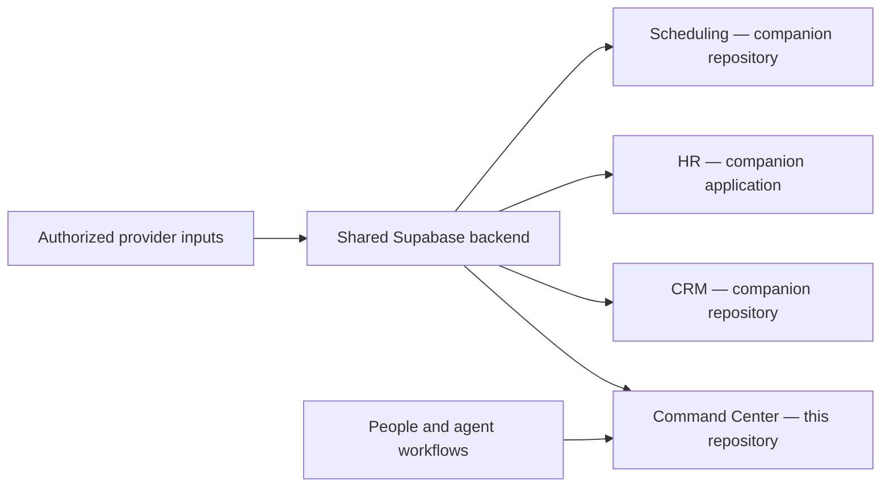

# A Roofer's Open Brain

A property-first operations and persistent-memory platform for roofing companies, built by [Cleverwork](https://cleverwork.io) and used by Pro Exteriors.

This repository contains the **Command Center** web application and shared backend, ingestion, integration and agent-governance infrastructure. CRM, HR and scheduling also have companion applications with their own source and release boundaries.

Knowledge and operational evidence attach to the physical property, with provenance and the era of practice preserved. People review consequential decisions; agent roles help capture, retrieve, prepare and audit the work.



## What is here

- **Accounting:** vendor invoice audits, negotiated-price agreement workflows, credit-memo review, Friday WIP/AR, cash-flow and export preparation.
- **Operations and property work:** order and estimate audits, territory/property review, source-backed queues and integration health.
- **Executive and system surfaces:** pipeline and cash visibility, runtime/sync status, review queues and the living design system.
- **Shared infrastructure:** property-first SQL migrations, Supabase Edge Functions, provider adapters, operational scripts and deployment configuration.
- **Agent operating model:** five department roles and eight infrastructure roles, with charters, recipes, provenance and human approval boundaries. Thirteen roles do not imply thirteen independently deployed services.

Capabilities and provider commissioning vary. The current provider scope names HailRecon, CompanyCam, AccuLynx, QuickBooks Online and NWS/NOAA; ABC/SRS/QXO remain accounting inputs. A retained adapter directory is not evidence that its provider is active. See the [integration catalog](integrations/bridges/README.md) and [sync coverage limits](docs/129-sync-verification-gaps.md).

## Applications and ownership

| Surface | Source | Boundary |
| --- | --- | --- |
| Command Center | [`app/command-center/`](app/command-center/) | Implemented here; production uses WorkOS authentication. |
| CRM | [Clvrwrk/CRM_PWA](https://github.com/Clvrwrk/CRM_PWA) | Separate application/release, sharing authorized backend and identity contracts. |
| HR | `apps/hr` in [CRM_PWA](https://github.com/Clvrwrk/CRM_PWA/tree/main/apps/hr) | Separately deployed app; the observed release is an HR shell, not a completed payroll system. |
| Project management / scheduling | [Clvrwrk/pm.proexteriorsus.net](https://github.com/Clvrwrk/pm.proexteriorsus.net) | Separate web/API/worker repository; the observed live hostname is `scheduler.proexteriorsus.net`. |
| Admin | Host application features and access/configuration workflows | No standalone Admin app is established by this repository. |

The knowledge MCP under [`server/`](server/) is **uncommissioned scaffold**. Current Command Center and ingestion paths use Supabase server-side. Cross-application propagation and staff/device acceptance remain separate verification steps.

The CC/CRM contract includes shared property identity, database readers, WorkOS session compatibility and a path-scoped Sales companion. Read the [companion-system boundary](docs/111-crm-pwa-companion-repo.md) before changing shared infrastructure.

## Try the Command Center locally

Use **Node.js 22** and npm. There is no root `package.json`; run app commands inside `app/command-center`.

```bash
git clone https://github.com/Clvrwrk/a-roofer-open-brain.git a-roofers-open-brain
cd a-roofers-open-brain/app/command-center
npm ci
npm test
npm run build

# Foreground SSR server, bound to this computer only; background loops disabled.
HOST=127.0.0.1 PORT=4399 \
COMMAND_CENTER_SLACK_RUNTIME=off COMMAND_CENTER_PREWARM=off \
npm run start:web
```

Open [localhost:4399](http://127.0.0.1:4399). Stop the foreground process with Ctrl-C.

Without credentials, the app starts in a limited local mode: data-backed pages can show unavailable or empty sections. This exercises rendering and tests, not production data or provider readiness. `npm run dev` is available for interactive development; the built server is useful for checking the no-secret path without Vite's error overlay.

For approved live-data development, obtain the appropriate isolated configuration; variable names are in [`config/.env.example`](config/.env.example). The runtime reads process environment and ancestor `.env`/`.env.local` files. A company configuration may connect to shared production. Keep credentials server-side and keep local writes away from production workflow tables.

`npm start` also supervises runtime processes and can start Slack listeners. Use the foreground web-only command above for a basic local review. Full operator provisioning is a separate process: the historical `new-client.sh` and `verify-deployment.sh` scripts are not a validated installer/verifier for today's complete production stack.

## Repository map

| Path | Purpose |
| --- | --- |
| [`app/command-center/`](app/command-center/) | Astro SSR application, API routes, runtime supervisors and app tests. |
| [`schemas/`](schemas/) | Vendored base schemas and roofing-specific SQL migrations. |
| [`supabase/functions/`](supabase/functions/) | Ingestion, webhook and sync Edge Functions. |
| [`integrations/bridges/`](integrations/bridges/) | Provider adapters, mappings and commissioning notes. |
| [`deployment/`](deployment/) | Remote runtime, systemd, proxy and retained legacy/local deployment material. |
| [`scripts/`](scripts/) | Operations, verification, import/export, monitoring and maintenance tools. |
| [`docs/`](docs/) | Architecture, contracts, decisions, delivery evidence and handoffs. |
| [`agents/`](agents/), [`skills/`](skills/), [`recipes/`](recipes/) | Workforce charters and reusable workflows. |
| [`config/`](config/), [`standards/`](standards/), [`proposals/`](proposals/) | Client customization, design/quality standards and reviewed proposals. |
| [`context/`](context/) | Curated agent context; excludes secrets and raw customer exports. |

Local-only imports, private data, generated exports, caches and nested checkouts are not automatically part of the product or this repository's source history.

## Contributing and operating safely

Start with [`AGENTS.md`](AGENTS.md), [`CONVENTIONS.md`](CONVENTIONS.md) and the [current handoff](docs/handoffs/current.md). Handoffs are dated evidence; verify current Git and deployment state before relying on them.

Use a scoped worktree, preserve others' edits, and run the relevant tests plus the Command Center build for app changes. Keep shared schemas, authentication and companion routing contracts explicit. File relocation needs a reviewed move manifest and a dependency/rollback assessment.

Production rules include additive migrations, property identity preservation, server-side credentials, vendor/office/time/UOM pricing boundaries and **read-only QuickBooks Online access**. External messages and consequential business actions retain their human approval boundaries. See [security guidance](SECURITY.md), [pricing rules](docs/105-price-agreement-silo-rules.md) and the [self-healing loop](docs/127-self-healing-loop.md).

A green local build does not establish a deployed release, successful provider activation or staff acceptance. Production health identity and authenticated workflow checks are separate evidence.

## Documentation and help

- [Command Center setup and routes](app/command-center/README.md)
- [Architecture brief](docs/00-architecture-brief.md) — original design context; use current source/contracts for implementation status
- [CRM and shared-system contract](docs/111-crm-pwa-companion-repo.md)
- [Living design system](docs/112-design-system-site.md)
- [Current integration scope and gaps](docs/129-sync-verification-gaps.md)
- [Troubleshooting](docs/TROUBLESHOOTING.md)
- [Cleverwork](https://cleverwork.io) — project maintainer

Report vulnerabilities through the private reporting channel in [`SECURITY.md`](SECURITY.md), rather than a public issue.

## License and acknowledgments

Cleverwork-original work is MIT-licensed; see [`LICENSE`](LICENSE). Vendored materials retain their own notices, including the OB1 schemas' FSL-1.1-MIT terms and the DESIGN.md specification's Apache-2.0 license. See [`LICENSE.md`](LICENSE.md) and individual source notices; do not assume every retained third-party file shares the root license.

The project builds on concepts and attributed work from Nate B. Jones / OB1, Dynamous, InfraNodus, Andrej Karpathy's LLM Wiki and Google Labs' DESIGN.md. Preserve upstream attribution when redistributing applicable material.
