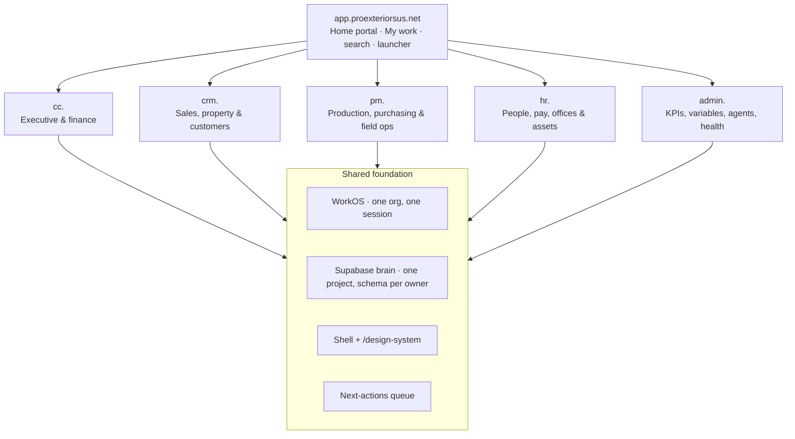

# 127 · Platform surfaces & sitemap (app · cc · crm · pm · hr · admin)

**Status:** proposed · 2026-10-21 · owner: Chris Hussey
**Design canvas:** [People & Payroll Workspace](https://claude.ai/artifact/K6pnJN7XMnDWaJuHUC4SnS), row 9 (platform map) and rows 1–8, 10 (hr.)
**Supersedes in part:** the three-surface split in `CRM_PWA/docs/architecture/PE-OS-SHARED-DATA-CONTEXT.md` (CRM · Scheduler · Command Center). The Scheduler becomes `pm.`.

## Diagram

## The decision

One home portal and five team surfaces over one shared data spine. **A surface is a team's way of working with shared records, never a second copy of them.** Each record has exactly one surface that creates and changes it; every other surface reads it or deep-links to it.

| Surface | Host | Team | State today |
|---|---|---|---|
| Home portal | `app.proexteriorsus.net` | Everyone | Planned |
| Command Center | `cc.proexteriorsus.net` | Executive, Accounting | Live |
| CRM | `crm.proexteriorsus.net` | Sales, Marketing | Live |
| Production | `pm.proexteriorsus.net` | Production, Purchasing, Field | Planned; absorbs the planned `scheduler.proexteriorsus.net` |
| HR & Payroll | `hr.proexteriorsus.net` | HR, Payroll, Office admin | Designed (canvas rows 1–8, 10) |
| Admin | `admin.proexteriorsus.net` | Platform owner | Planned |

## Sitemap (top-level menus)

- **app.** Home (My work from every surface) · Search · Notifications · Launcher · My profile & devices · Help
- **cc.** Territory map · Executive (Pipeline review, Cash runway, Fixed costs, Office P&L) · Accounting (Invoice audit, Credit memos, Friday WIP/AR, 13-week cash flow, QB bank export) · Price agreements · Audits (Estimate, Order, Fleet, Tools, Expenses) · KPI dashboards
- **crm.** Today · Customers · Properties · Jobs (sales side: inspection, estimate, contract, supplements, financing, client comms) · Marketing (Hail zones, Market proof, campaigns, reviews) · Reports · Weekly WIP/AR
- **pm.** Production board · Schedule · Purchasing · Catalog · Field ops · Crews · Yard material stock
- **hr.** People · Hiring & onboarding · Payroll (PEO) & commissions · Contractors & crews · Time off · Compliance · Safety · Titles & access · Offices (leases, licensing, utilities, maintenance, security, listings, documents) · Assets (vehicles, tools, owned equipment, storm housing)
- **admin.** KPIs · App variables · Access roles & capabilities · AI agents · App health · Audit trail · Design system · Builds

## Who owns what

| Record | Owner | Readers |
|---|---|---|
| Customers & contacts | crm | app, cc, pm |
| Properties (record lives in the brain, `public.properties`) | crm (editing surface) | app, cc, pm |
| Job · lead → contract | crm | app, cc, pm |
| Job · ready → complete | pm | app, cc, crm |
| Job · invoicing, AR, P&L | cc | app, crm, pm |
| Schedule & crew assignments | pm | crm, hr; app (own) |
| Material orders, deliveries, returns | pm | cc, crm |
| Catalog & UOM map | pm | cc, crm, admin |
| Price agreements & invoice audit | cc | pm |
| Yard material stock | pm | cc, hr |
| People, seats, titles, access assignments | hr | cc, crm, pm, admin; app (own) |
| Crews & subs · paperwork & pay approval | hr | cc, crm, pm |
| Commission plans & statements, payroll (PEO), 1099s | hr | cc; app (own) |
| Offices · address, lease, licensing, facilities | hr | everyone |
| Vehicles, tools, owned equipment | hr | cc (fleet/tools audits), pm; app (own) |
| Storm housing · rentals & owned properties | hr | cc (storm cost center), pm; app (own) |
| Access role & capability definitions | admin | hr assigns them |
| KPI definitions & targets, app variables, AI agents | admin | everyone reads KPIs/agents |
| Next actions & notifications | each surface publishes | app shows all |

## Rules

1. **One record, one home.** No surface keeps its own copy of a customer, property, person, office or asset.
2. **One sign-in, one shell.** One WorkOS organization and one session across every subdomain; one top bar (app switcher, global search, notifications, office picker); one design system (`cc /design-system`).
3. **Links carry context.** Cross-surface links carry the record and office in the URL (UX-04). An out-of-scope record shows an honest empty state.
4. **To-dos are published, not copied.** Each surface writes its next actions to a shared queue; `app.` shows them and links back to where the work is done.
5. **Access is defined once.** `admin.` defines roles and capabilities; `hr.` assigns them; every surface checks the same list. A title never grants access (canvas 6.1).
6. **QuickBooks stays read-only everywhere** (hard rule 13). Approvals route to Accounting; no surface posts to QBO.

## What moves where

| Today | Moves to | Why |
|---|---|---|
| cc Operations · Overview, Scheduling (soon), Inventory/Warehouse (soon) | pm | Production work |
| cc Operations · Estimate audit, Order audit | stays cc | Money checked against agreements |
| cc Operations · Property review, Client portal/comms (soon) | crm | Customer and property work |
| cc Operations · HR & compliance, 1099 Employee Mgmt (soon) | hr | People and contractor paperwork |
| cc Sales (already served by the CRM container), cc Marketing | crm | cc keeps a read-only Pipeline review |
| cc AI Agents (monitor, design system, work queue, builds, bugs), cc `/system` | admin | Platform tools used by every surface |
| crm Team (staff directory, org chart, office assignment, rep access, readiness) | hr | crm keeps a read-only "my team" |
| crm Admin (CRM variables, diagnostics, audit trail, view as) | admin | One place for settings and audit |
| crm Schedule (stub), Scheduler app (planned) | pm | One production surface, not two |
| hr Inventory · material stock (canvas 8.6) | pm | Stock follows jobs; equipment stays in hr Assets |
| cc Accounting · Fleet audit, Tools audit (soon) | stays cc | Reads the hr asset register |
| cc Territory map | stays cc + shared component | Embedded in crm and pm |

## Integrations

| System | Owner | Notes |
|---|---|---|
| WorkOS | admin | Shared `WORKOS_CLIENT_ID` / cookie password across containers (docs/110) |
| AccuLynx | crm | pm and cc read the mirror |
| QuickBooks Online | cc | Read-only mirror |
| PEO | hr | Payroll, benefits, workers' comp |
| ABC · SRS · QXO | pm (orders) · cc (audit) | |
| CompanyCam | pm | |
| GoHighLevel | crm | |
| Google Business Profile | hr (address truth) · crm (reviews) | |
| Sentry · Coolify | admin | |

## Open questions

1. **Session across subdomains.** No explicit cookie `Domain` was found; sessions are probably host-scoped today. One sign-in across `*.proexteriorsus.net` needs a parent-domain cookie (or the WorkOS hosted session) — confirm before building `app.`.
2. **Scheduler repo.** `Clvrwrk/scheduler.proexteriorsus.net` is planned for Operations. Confirm it becomes `pm.` (rename + absorb purchasing, catalog, field ops) rather than a sixth surface.
3. **Property master.** `public.properties` is CC-owned in the schema while crm is the editing surface. Decide whether writes go through a brain RPC both surfaces call.
4. **Design system packages.** CRM has its own `packages/design-system`; this proposal assumes `cc /design-system` stays the source of truth with CRM consuming its tokens.
5. **Role systems.** Three exist today (CRM `memberships.role`, CC env email lists, `position_titles.access_level`). The access-role catalog in admin replaces all three; migration is canvas 6.7.

## Next steps

- Confirm this doc with the CRM owner, then add a pointer from `CRM_PWA/docs/architecture/PE-OS-SHARED-DATA-CONTEXT.md`.
- Build the shared shell (top bar + switcher) as a package both Astro apps import.
- Stand up `app.` with the next-actions queue once the session question is settled.
