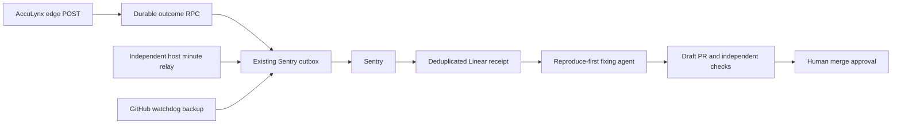

# Sync verification and delivery continuity — 2026-10-24

CompanyCam has a route monitor in the provisioner. The runtime board falls back to a direct gate check for each missing monitor, even when other Better Stack monitors exist. A 401 proves the gate, not photo delivery; production verification also reads one photo through the authorized API and fetches its private signed thumbnail without retaining the URL.

NWS/NOAA uses the six active office coordinates from `office`, rounded to four decimals. No customer coordinates, user URLs or credentials leave the app. The fixed api.weather.gov points response supplies an allowlisted HTTPS grid forecast URL; redirects are refused. Requests identify the app, use a six-second timeout and at most three concurrent offices. The five-minute shared cache is refreshed by the watchdog and read by `/api/weather`. Missing/stale forecasts stay red and produce an ordinary sync-health failure. This is a current forecast feed, not an archive or severe-weather guarantee.

The four AccuLynx edge handlers share `_shared/edge-observer.ts`. Successful and failed POST completions record through the existing service-role-only `record_integration_probe` RPC under `api.edge.<function>`. Expected validation/auth denials, previews, idempotent/replay acknowledgements and safe health GETs do not clear failed execution state. An HTTP-200 body with status failed and a caught enqueue/audit-persistence failure are recorded as failures while preserving the provider response. Thrown exceptions return a sanitized 500. Failure of observability preserves an already completed business response, emits a sanitized Sentry fallback and never induces an unsafe write retry. No new database tables, grants or write permissions are introduced.

GET `?health=1` exercises only the handler/database path. It returns an observer version marker and never executes a provider call. JWT verification stays enabled on the three existing JWT-gated functions; webhook authenticity checks stay intact. The board distinguishes readiness with no POST receipt from a successful invocation; on-demand writes are not scheduled just to make monitoring green. Health checks use separate `api.edge-health.*` keys, so they cannot overwrite actual POST outcomes.

## Independent delivery

Measured GitHub watchdog run intervals were 8–56 minutes in the inspected sample, despite a five-minute cron. The new host timer relays the durable outbox every 60 seconds plus up to five seconds jitter. It uses the auditor credential already present on that host. At the approved installation step, a root-only helper encrypts a same-host copy into systemd credentials. The relay runs as a dynamic user with only that credential, cannot read the root environment, and loads no database/admin credential. The fixed existing ExecStopPost reporter remains a separate privileged helper. No token is transferred from GitHub or 1Password. It does not impersonate a GitHub commit attestation. GitHub stays the independent backup/triage path. Detection, delivery, triage and remediation are separate stages; no component promises universal real-time repair.

## Release gate and rollout

Human approval before merge remains mandatory. After exact-head CI and human approval: merge, deploy the four instrumented edge functions first (same JWT settings), deploy Command Center, then install/enable the host relay service and timer. Register its minute heartbeat (60-second period, 120-second grace) through the existing runtime heartbeat pump and add the matching 180-second runtime expectation; preserve all other registrations. Provision only the missing first-party monitors. Read `/healthz` for the exact commit; read `/api/weather` and the restricted runtime/sync-health APIs; verify all four observer markers, current office forecasts, private CompanyCam thumbnail and alert-outbox drain. Do not execute a provider write for this drill.

Rollback: stop/disable the new host timer; redeploy the preceding CC commit cde40fdef7fc491c645b223cc6a9f2b062ca6b71; restore the saved edge preimages with their original JWT settings. Preserve all outcome/history rows. Monitor creation is reversible by pausing the exact new monitor.

## PEC-442 result

Agent run 40065919193 returned `needs_human`, with no draft PR. The old readiness-check GET 503 did not reproduce on main. Current main has a GET contract/caller mismatch: the office-config handler accepts POST on `/readiness-checks` and GET on `/readiness-checklist`. The independent job intentionally refused a non-fixed outcome before applying a patch; no application test regression is asserted. The issue remains assigned to Christopher. A product/contract decision and scoped production readback remain outstanding; no Sentry issue was closed based on the agent's inference.
