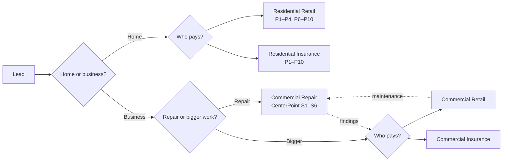

# 132 — Sales process wiki (five tracks on the ten-phase journey)

**Date:** 2026-11-25 · **Asked by:** Chris · **Status:** first draft, published as a private artifact (https://claude.ai/artifact/XA6offidN8jJ2idW4FTe4w); source in [`docs/wiki/sales-process/index.html`](wiki/sales-process/index.html)

## What it is

A company wiki page that lays out every sales track from lead to closed file. Each track has a flow diagram and a deep dive per stage: what happens, who owns, supports, approves and assists, the gates to leave the stage, documents (DOC-01 to DOC-22), systems, clocks and what to watch for. Extra views: a track-by-phase matrix, the residential responsibility matrix, the documents and glossary, and open questions.

## Sources and confidence

| Track | Basis | Confidence |
|---|---|---|
| Residential Retail, Residential Insurance | CRM job journey gate list v1 (CRM_PWA `docs/design/CRM-JOB-JOURNEY.md`, approved 2026-10-05), Readiness Policy v1, Sales Playbook, R4 supplement readiness, SOP mapping and journey-logic proposals; live `crm.journey_roles` | Approved working list; the 80 client requirements are still pending; most clocks are proposed |
| Commercial Repair | CenterPoint mirror (`work_jobs`, `mv_work_job_money`, docs/78): statuses, work types, NTE, prices, cycle time | Steps as recorded; roles and SLAs proposed |
| Commercial Retail | AccuLynx categories, CenterPoint Sales book, docs/114; stage content is standard commercial practice | **Proposed**, confirm before training |
| Commercial Insurance | Residential P5 gates reused; 1 of 942 commercial AccuLynx jobs has a claim record | **Not tracked in any system**; proposed |

## Findings worth acting on (snapshot 2026-11-25)

- 884 of 1,026 open CRM jobs (86%) have funding path `undetermined`; 141 insurance, 1 retail. Retail jobs cannot skip P5 automatically until P2 sets the path.
- Commercial claims are not recorded anywhere (1 claim record across 942 commercial jobs).
- Kansas City, Multi-Family/Commercial, Insurance Program and Florida still have no office seat holders in owner roles.
- AccuLynx milestone to phase as imported today: Lead → P1 (P3 when an estimate exists), Prospect → P2/P3, Approved → P4–P6, Completed → P8, Invoiced → P9.

## Live team folder

The published page declares the `mcp` capability for the **github** connector (`get_file_contents` only) and reads `docs/wiki/sales-process/pages/` live: on open, then every two minutes while open. It reads `main`, falling back to `claude/sales-process-wiki-fdacec` until this branch merges. A Markdown file there becomes a page; front matter `track` (`rr`, `ri`, `cr`, `ci`, `svc`) and `stage` (`p1`–`p10`, `s1`–`s6`) also place it inside that track or stage. Other files are listed with a GitHub link. How-to: [`pages/README.md`](wiki/sales-process/pages/README.md). Readers without the GitHub connector or repo access see only the published wiki. Markdown is rendered with marked 12.0.2 and sanitized with DOMPurify 3.1.6; mermaid 10.9.1 loads only when a page has a diagram.

## Updating the built-in content

Edit `docs/wiki/sales-process/index.html` (content lives in the `TRACKS`, `resBase()`, `COM_RETAIL`, `COM_INS` and `SERVICE` objects), then republish to the same artifact URL. No customer or staff names appear on the page; lead-source names that are individuals were deliberately left out.
