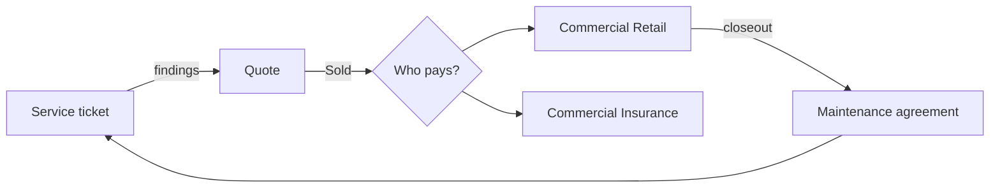

# Commercial pages: questions to confirm

The Commercial Retail and Commercial Insurance pages are a proposed draft. The company SOPs cover residential work only. Operations should answer these before the pages are used for training.

1. **Owner of a commercial job.** Is it one commercial sales consultant from lead to final walk, or does an estimator hand off to a project manager at contract?
2. **Where commercial jobs live.** AccuLynx (Commercial and Property Management categories), CenterPoint (Sales book), or both? Which is the system of record once the CRM takes over?
3. **Bid approval.** What price or margin exception needs Sales Manager approval on a commercial bid?
4. **Billing.** Do commercial jobs use a schedule of values and retainage as standard, and who prepares pay applications?
5. **Commercial insurance.** Where should claims, adjuster meetings and supplements be recorded? Today only 1 of 942 commercial jobs carries a claim record.
6. **Service response times.** What response time applies to an active leak, and to a routine repair ticket?
7. **Seats.** Who holds the owner roles for the Multi-Family/Commercial office?

