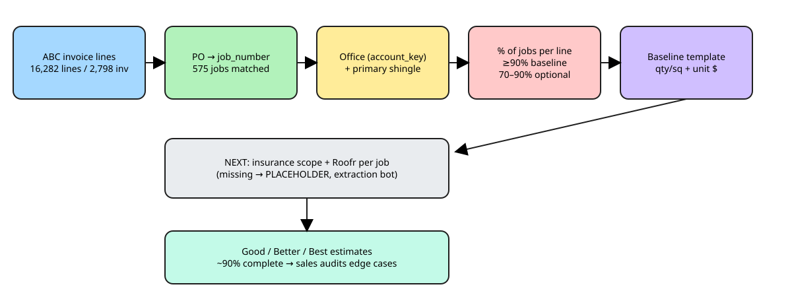

# Baseline estimate templates from invoice line items (2026-10-30)

Chris (t59u): for each office's shingle, which invoice lines appear on ≥90% of jobs? Those lines are the baseline template. All work was **read-only** (Supabase project "Pro Exteriors LLC - Agent Workforce"). No writes, no money spent, no outside messages.

## 1. Where the invoice line items live
| Source | What it is | Used? |
|---|---|---|
| `public.abc_line_items` (16,282 lines, 2,798 ABC supplier invoices, Jan 2023 to May 2026) | Itemized **material** invoices from ABC Supply. Each has a qty, UoM, $ and brand line. | **Yes.** This is the template source. |
| `public.acculynx_invoices.raw->sections->items` (1,966 invoices on 1,095 jobs) | AccuLynx **customer** invoices. These are lump-sum scope lines ("R&R Roofing System", "ACV", "Debris Removal") with no quantities. | Coverage only. No line reaches 50% in any office (Wichita's top is 47%), so there's no baseline here. |
| `public.acculynx_invoice_lines` | Intended line table | **Empty (0 rows)** |

**Job link:** the ABC `customer_po` is normalized (`TX216`, `tx - 216`, `CO-189: name` → `TX-216`/`CO-189`) and matched exactly to `acculynx_jobs.job_number`. 1,930 of 2,798 invoices (12,399 lines) match 575 jobs with **0 duplicate matches**. Credits and returns are excluded. That leaves 9,424 job×item rows on 572 jobs. The 3,642 lines whose PO has no office prefix (house numbers or names only) are **not linked**. **Office** = AccuLynx `account_key` (texas = Richardson).

**Primary shingle** = the field-shingle line with the largest $ on the job's ABC invoices. Starter, hip & ridge and Seal-A-Ridge lines are excluded. **Squares** = shingle bundles ÷ bundles-per-sq (taken from the description, default 3).

**Normalization:** use ABC's `product_brand_line` when it's specific. It already merges colors and sizes ("Malarkey Vista", "ABC Coil Nails - Catalog"). Otherwise use the description, uppercased, with color words (Natural Wood, Storm Grey, Brill Blck, Weatherwood, …) stripped and whitespace collapsed. Generic "Miscellaneous …" brand lines keep the cleaned description as a suffix. UoM aliases: BDL→BD, PC/PCS→EA. Jobs with several invoices (supplements, returns) are combined into one job before counting. % = jobs containing the line ÷ jobs in the group.

**Caveat:** these are supplier material lines. Labor, tear-off, dump, permit and overhead are **not** on ABC invoices. They have to come from the labor/sub side or the price agreements (next phase).

## 2. Coverage
| Office | Jobs with any invoice | Jobs with ABC material invoice lines | …with primary shingle found | AccuLynx customer invoice | Insurance doc in Supabase | Measurement doc | Roofr report/row |
|---|---|---|---|---|---|---|---|
| Wichita KS | 223 | 121 | 104 | 221 | 28 | 29 | 5 |
| Richardson TX | 410 | 149 | 132 | 409 | 4 | 4 | 0 |
| Denver CO | 304 | 261 | 225 | 301 | 0 | 0 | 0 |
| Multi-family/Commercial | 70 | 15 | 6 | 70 | 0 | 0 | 0 |
| Atlanta GA | 41 | 16 | 6 | 40 | 0 | 0 | 0 |
| Kansas City MO | 13 | 8 | 7 | 13 | 4 | 4 | 0 |
| Insurance program | 16 | 0 | 0 | 16 | 7 | 10 | 1 |
| Pensacola FL | 26 | 2 | 0 | 25 | 0 | 0 | 0 |

- **Gaps:** Pensacola (2 ABC jobs, 0 with shingle), Insurance program (0), Atlanta (16 jobs / 6 with shingle), Multi-family (15 / 6) and Kansas City (8 / 7) are too thin to template. They likely use other suppliers (SRS, Beacon, local) or POs without a prefix.
- 92 matched jobs have no field shingle on their ABC invoices (accessory or re-order invoices only).
- Insurance docs, Roofr reports and other measurement docs are in Supabase for only ~45 jobs. Every gap is a **PLACEHOLDER** row (`status=missing, source=AccuLynx (not yet extracted)`) in `job-document-status.csv`. A gap is never counted as zero.

## 3. Group summary
| Office | Shingle | n jobs | Baseline lines (≥90%) | Common optional (70–90%) | Confidence |
|---|---|---|---|---|---|
| Atlanta GA | NO SHINGLE ON INVOICE | 10 | 0 | 0 | ok |
| Atlanta GA | GAF Timberline HDZ | 5 | 2 | 4 | LOW (n<10) |
| Atlanta GA | CertainTeed Landmark | 1 | 24 | 0 | LOW (n<10) |
| Denver CO | Malarkey Vista AR | 199 | 8 | 8 | ok |
| Denver CO | NO SHINGLE ON INVOICE | 36 | 0 | 0 | ok |
| Denver CO | Malarkey Legacy | 18 | 6 | 7 | ok |
| Denver CO | OC Duration | 5 | 4 | 8 | LOW (n<10) |
| Denver CO | Tamko Titan XT | 2 | 1 | 0 | LOW (n<10) |
| Denver CO | GAF Timberline HDZ | 1 | 35 | 0 | LOW (n<10) |
| Kansas City MO | Malarkey Highlander NEX AR | 4 | 11 | 3 | LOW (n<10) |
| Kansas City MO | Malarkey Vista AR | 3 | 9 | 0 | LOW (n<10) |
| Kansas City MO | NO SHINGLE ON INVOICE | 1 | 3 | 0 | LOW (n<10) |
| Multi-family/Commercial | NO SHINGLE ON INVOICE | 9 | 0 | 0 | LOW (n<10) |
| Multi-family/Commercial | Malarkey Vista AR | 3 | 1 | 0 | LOW (n<10) |
| Multi-family/Commercial | GAF Timberline HDZ | 2 | 2 | 0 | LOW (n<10) |
| Multi-family/Commercial | Atlas Pinnacle | 1 | 37 | 0 | LOW (n<10) |
| Pensacola FL | NO SHINGLE ON INVOICE | 2 | 0 | 0 | LOW (n<10) |
| Richardson TX | Malarkey Vista AR | 98 | 7 | 4 | ok |
| Richardson TX | NO SHINGLE ON INVOICE | 17 | 0 | 0 | ok |
| Richardson TX | Malarkey Highlander NEX AR | 11 | 4 | 6 | ok |
| Richardson TX | Tamko Heritage | 7 | 2 | 5 | LOW (n<10) |
| Richardson TX | Atlas Pinnacle | 4 | 1 | 0 | LOW (n<10) |
| Richardson TX | GAF Timberline HDZ | 4 | 1 | 0 | LOW (n<10) |
| Richardson TX | Malarkey Legacy | 3 | 13 | 0 | LOW (n<10) |
| Richardson TX | Tamko Titan XT | 3 | 8 | 0 | LOW (n<10) |
| Richardson TX | IKO | 1 | 4 | 0 | LOW (n<10) |
| Richardson TX | OC Duration | 1 | 18 | 0 | LOW (n<10) |
| Wichita KS | Malarkey Highlander NEX AR | 44 | 7 | 5 | ok |
| Wichita KS | Malarkey Vista AR | 36 | 8 | 2 | ok |
| Wichita KS | GAF Timberline NS AR | 19 | 9 | 1 | ok |
| Wichita KS | NO SHINGLE ON INVOICE | 17 | 0 | 5 | ok |
| Wichita KS | Malarkey Legacy | 2 | 8 | 0 | LOW (n<10) |
| Wichita KS | OC Duration | 1 | 17 | 0 | LOW (n<10) |
| Wichita KS | Tamko Heritage | 1 | 12 | 0 | LOW (n<10) |
| Wichita KS | Tamko Titan XT | 1 | 16 | 0 | LOW (n<10) |

## 4. Baseline (≥90%) and common-optional (70–90%) lines
Median qty/sq is per roof square of the primary shingle. The shingle itself is 3.0 BD/sq by definition. Unit $ is the ABC invoiced price (cost side).

### Denver CO · Malarkey Vista AR (n=199 jobs)
| Line (normalized) | % jobs | Band | UoM | Median qty/sq | Median unit $ |
|---|---|---|---|---|---|
| MALARKEY VISTA | 100.0% | **baseline** | BD | 3.0 | 44.0 |
| ABC PRO GUARD 20 SYNTH UNDERLAYMENT | 99.5% | **baseline** | RL | 0.107 | 100.99 |
| MALARKEY SMART START | 99.0% | **baseline** | BD | 0.115 | 76.2 |
| ABC TOUCH-UP PAINT | 98.0% | **baseline** | CN | 0.15 | 12.36 |
| MALARKEY 401 ARCTIC SEAL | 97.0% | **baseline** | RL | 0.222 | 102.0 |
| JURISDICTION DELIVERY FEE | 94.5% | **baseline** | EA | 0.041 | 0.29 |
| MALARKEY 227 12" SBS MOD H&R | 93.5% | **baseline** | BD | 0.155 | 84.5 |
| ABC COIL NAILS - CATALOG | 91.0% | **baseline** | BX | 0.083 | 54.0 |
| MISCELLANEOUS ROOF FLASHING AND ACC: FLASHING GALV MULTI-SIZE 1.5 2 3" | 89.4% | common optional | EA | 0.164 | 13.99 |
| GENERIC SCREWS | 88.4% | common optional | EA | 0.067 | 44.99 |
| FUEL SURCHARGE | 87.4% | common optional | EA | 0.041 | 150.0 |
| LOMANCO GALV ROOF VENTS | 82.4% | common optional | EA | 0.208 | 38.99 |
| GALVANIZED STEEL STEP FLASHING | 81.4% | common optional | BD | 0.05 | 97.99 |
| MULEHIDE WATERPROOF SEALANTS | 79.4% | common optional | TB | 0.28 | 6.99 |
| GAF MISCELLANEOUS ROOF VENTS | 77.9% | common optional | EA | 0.053 | 78.99 |
| GALVANIZED STEEL DRIP APRON | 75.9% | common optional | EA | 1.381 | 15.82 |

### Denver CO · Malarkey Legacy (n=18 jobs)
| Line (normalized) | % jobs | Band | UoM | Median qty/sq | Median unit $ |
|---|---|---|---|---|---|
| ABC TOUCH-UP PAINT | 100.0% | **baseline** | CN | 0.111 | 13.58 |
| MALARKEY LEGACY 50 YR | 100.0% | **baseline** | BD | 3.0 | 39.75 |
| ABC COIL NAILS - CATALOG | 94.4% | **baseline** | BX | 0.065 | 70.99 |
| GALVANIZED STEEL DRIP APRON | 94.4% | **baseline** | EA | 0.989 | 18.4 |
| MALARKEY SMART START | 94.4% | **baseline** | BD | 0.075 | 80.99 |
| ABC PRO GUARD 20 SYNTH UNDERLAYMENT | 94.4% | **baseline** | RL | 0.072 | 106.99 |
| GALVANIZED STEEL STEP FLASHING | 88.9% | common optional | BD | 0.024 | 97.99 |
| MALARKEY 227 12" SBS MOD H&R | 83.3% | common optional | BD | 0.127 | 83.99 |
| LOMANCO GALV ROOF VENTS | 83.3% | common optional | EA | 0.125 | 40.99 |
| FUEL SURCHARGE | 83.3% | common optional | EA | 0.025 | 150.0 |
| GAF MISCELLANEOUS ROOF VENTS | 77.8% | common optional | EA | 0.034 | 83.99 |
| MALARKEY 401 ARCTIC SEAL | 77.8% | common optional | RL | 0.142 | 103.99 |
| CAULKS & SEALANTS | 72.2% | common optional | TB | 0.183 | 13.99 |

### Denver CO · OC Duration (n=5 jobs) **(LOW CONFIDENCE, n<10)**
| Line (normalized) | % jobs | Band | UoM | Median qty/sq | Median unit $ |
|---|---|---|---|---|---|
| ABC COIL NAILS - CATALOG | 100.0% | **baseline** | BX | 0.067 | 54.0 |
| ABC TOUCH-UP PAINT | 100.0% | **baseline** | CN | 0.133 | 12.36 |
| MISCELLANEOUS ROOF FLASHING AND ACC: FLASHING GALV MULTI-SIZE 1.5 2 3" | 100.0% | **baseline** | EA | 0.081 | 13.99 |
| JURISDICTION DELIVERY FEE | 100.0% | **baseline** | EA | 0.056 | 0.28 |
| MALARKEY SMART START | 80.0% | common optional | BD | 0.123 | 75.85 |
| ABC PRO GUARD 20 SYNTH UNDERLAYMENT | 80.0% | common optional | RL | 0.115 | 93.0 |
| MALARKEY 401 ARCTIC SEAL | 80.0% | common optional | RL | 0.154 | 104.02 |
| GALVANIZED STEEL DRIP APRON | 80.0% | common optional | EA | 1.451 | 17.93 |
| LOMANCO GALV ROOF VENTS | 80.0% | common optional | EA | 0.178 | 40.99 |
| MULEHIDE WATERPROOF SEALANTS | 80.0% | common optional | TB | 0.185 | 7.77 |
| FUEL SURCHARGE | 80.0% | common optional | EA | 0.061 | 150.0 |
| GALVANIZED STEEL STEP FLASHING | 80.0% | common optional | BD | 0.061 | 91.5 |

### Richardson TX · Malarkey Vista AR (n=98 jobs)
| Line (normalized) | % jobs | Band | UoM | Median qty/sq | Median unit $ |
|---|---|---|---|---|---|
| MALARKEY VISTA | 100.0% | **baseline** | BD | 3.0 | 40.95 |
| ABC CAP NAILS - CATALOG | 98.0% | **baseline** | BX | 0.057 | 17.3 |
| ABC TOUCH-UP PAINT | 98.0% | **baseline** | CN | 0.09 | 8.96 |
| MALARKEY 401 ARCTIC SEAL | 96.9% | **baseline** | RL | 0.053 | 107.42 |
| MALARKEY SMART START | 96.9% | **baseline** | BD | 0.08 | 81.95 |
| ABC COIL NAILS - CATALOG | 94.9% | **baseline** | BX | 0.071 | 54.0 |
| MULEHIDE WATERPROOF SEALANTS | 94.9% | **baseline** | TB | 0.164 | 8.8 |
| MALARKEY 227 12" SBS MOD H&R | 88.8% | common optional | BD | 0.201 | 95.65 |
| MISCELLANEOUS ROOF FLASHING AND ACC: FLASHING GALV MULTI-SIZE 1.5"-3" | 88.8% | common optional | EA | 0.142 | 7.8 |
| ABC PRO GUARD 20 SYNTH UNDERLAYMENT | 86.7% | common optional | RL | 0.099 | 89.1 |
| ACM GALVANIZED STEEL DRIP EDGE | 79.6% | common optional | EA | 0.941 | 9.6 |

### Richardson TX · Malarkey Highlander NEX AR (n=11 jobs)
| Line (normalized) | % jobs | Band | UoM | Median qty/sq | Median unit $ |
|---|---|---|---|---|---|
| MALARKEY NEX HIGHLANDER 242 | 100.0% | **baseline** | BD | 3.0 | 36.67 |
| ABC COIL NAILS - CATALOG | 90.9% | **baseline** | BX | 0.079 | 54.0 |
| MULEHIDE WATERPROOF SEALANTS | 90.9% | **baseline** | TB | 0.218 | 8.7 |
| ACM GALVANIZED STEEL DRIP EDGE | 90.9% | **baseline** | EA | 0.901 | 9.6 |
| ABC CAP NAILS - CATALOG | 81.8% | common optional | BX | 0.049 | 17.3 |
| ABC TOUCH-UP PAINT | 81.8% | common optional | CN | 0.095 | 8.96 |
| MALARKEY 227 12" SBS MOD H&R | 81.8% | common optional | BD | 0.211 | 104.0 |
| MISCELLANEOUS ROOF FLASHING AND ACC: FLASHING GALV MULTI-SIZE 1.5"-3" | 81.8% | common optional | EA | 0.132 | 8.4 |
| MALARKEY 401 ARCTIC SEAL | 72.7% | common optional | RL | 0.057 | 99.0 |
| MALARKEY SMART START | 72.7% | common optional | BD | 0.083 | 89.05 |

### Richardson TX · Tamko Heritage (n=7 jobs) **(LOW CONFIDENCE, n<10)**
| Line (normalized) | % jobs | Band | UoM | Median qty/sq | Median unit $ |
|---|---|---|---|---|---|
| TAMKO HERITAGE 30YR | 100.0% | **baseline** | BD | 2.869 | 33.0 |
| MULEHIDE WATERPROOF SEALANTS | 100.0% | **baseline** | TB | 0.156 | 6.6 |
| ABC COIL NAILS - CATALOG | 85.7% | common optional | BX | 0.062 | 54.0 |
| ABC CAP NAILS - CATALOG | 85.7% | common optional | BX | 0.056 | 17.3 |
| ABC TOUCH-UP PAINT | 85.7% | common optional | CN | 0.065 | 8.96 |
| ACM GALVANIZED STEEL DRIP EDGE | 85.7% | common optional | EA | 0.928 | 9.6 |
| MISCELLANEOUS ROOF FLASHING AND ACC: FLASHING GALV MULTI-SIZE 1.5"-3" | 71.4% | common optional | EA | 0.136 | 8.4 |

### Wichita KS · Malarkey Highlander NEX AR (n=44 jobs)
| Line (normalized) | % jobs | Band | UoM | Median qty/sq | Median unit $ |
|---|---|---|---|---|---|
| ABC COIL NAILS - CATALOG | 100.0% | **baseline** | BX | 0.079 | 49.12 |
| ABC CAP NAILS - CATALOG | 100.0% | **baseline** | BX | 0.056 | 19.5 |
| ABC TOUCH-UP PAINT | 100.0% | **baseline** | CN | 0.062 | 8.95 |
| MALARKEY NEX HIGHLANDER 242 | 100.0% | **baseline** | BD | 3.0 | 40.0 |
| MALARKEY 227 12" SBS MOD H&R | 100.0% | **baseline** | BD | 0.133 | 91.25 |
| MULEHIDE WATERPROOF SEALANTS | 100.0% | **baseline** | TB | 0.067 | 8.9 |
| GAF PRO-START | 95.5% | **baseline** | BD | 0.094 | 55.1 |
| GAP WATERGUARD UNDERLAYMENT | 88.6% | common optional | RL | 0.056 | 82.27 |
| ROOFNADO ANCHORDECK SYN UNDERLAYMNT | 88.6% | common optional | RL | 0.107 | 75.0 |
| AIRVENT GALV ROOF VENTS | 79.5% | common optional | EA | 0.273 | 27.5 |
| ALUMINUM DRIP EDGE | 77.3% | common optional | EA | 0.569 | 7.25 |
| GALVANIZED STEEL DRIP APRON | 77.3% | common optional | EA | 0.62 | 7.0 |

### Wichita KS · Malarkey Vista AR (n=36 jobs)
| Line (normalized) | % jobs | Band | UoM | Median qty/sq | Median unit $ |
|---|---|---|---|---|---|
| ABC COIL NAILS - CATALOG | 100.0% | **baseline** | BX | 0.078 | 49.12 |
| ABC CAP NAILS - CATALOG | 100.0% | **baseline** | BX | 0.064 | 19.5 |
| ABC TOUCH-UP PAINT | 100.0% | **baseline** | CN | 0.06 | 8.95 |
| MALARKEY VISTA | 100.0% | **baseline** | BD | 3.0 | 43.75 |
| GAF PRO-START | 97.2% | **baseline** | BD | 0.1 | 55.1 |
| MULEHIDE WATERPROOF SEALANTS | 97.2% | **baseline** | TB | 0.076 | 8.9 |
| MALARKEY 227 12" SBS MOD H&R | 94.4% | **baseline** | BD | 0.136 | 91.25 |
| GAP WATERGUARD UNDERLAYMENT | 94.4% | **baseline** | RL | 0.064 | 82.27 |
| ALUMINUM DRIP EDGE | 88.9% | common optional | EA | 0.627 | 7.25 |
| GALVANIZED STEEL DRIP APRON | 75.0% | common optional | EA | 0.675 | 7.0 |

### Wichita KS · GAF Timberline NS AR (n=19 jobs)
| Line (normalized) | % jobs | Band | UoM | Median qty/sq | Median unit $ |
|---|---|---|---|---|---|
| ABC COIL NAILS - CATALOG | 100.0% | **baseline** | BX | 0.079 | 49.12 |
| ABC TOUCH-UP PAINT | 100.0% | **baseline** | CN | 0.067 | 8.95 |
| TAMKO ELITE GLASS SEAL | 100.0% | **baseline** | BD | 0.133 | 33.0 |
| GAF TIMBERLINE NATURAL SHADOW | 100.0% | **baseline** | BD | 3.0 | 34.0 |
| GAF PRO-START | 100.0% | **baseline** | BD | 0.094 | 55.1 |
| ROOFNADO ANCHORDECK SYN UNDERLAYMNT | 100.0% | **baseline** | RL | 0.115 | 75.0 |
| ABC CAP NAILS - CATALOG | 94.7% | **baseline** | BX | 0.051 | 19.5 |
| GAP WATERGUARD UNDERLAYMENT | 94.7% | **baseline** | RL | 0.065 | 82.27 |
| MULEHIDE WATERPROOF SEALANTS | 94.7% | **baseline** | TB | 0.08 | 8.9 |
| AIRVENT GALV ROOF VENTS | 89.5% | common optional | EA | 0.28 | 27.5 |

### Kansas City MO · Malarkey Vista AR (n=3 jobs) **(LOW CONFIDENCE, n<10)**
| Line (normalized) | % jobs | Band | UoM | Median qty/sq | Median unit $ |
|---|---|---|---|---|---|
| ABC COIL NAILS - CATALOG | 100.0% | **baseline** | BX | 0.077 | 49.99 |
| ABC CAP NAILS - CATALOG | 100.0% | **baseline** | BX | 0.05 | 28.45 |
| ABC TOUCH-UP PAINT | 100.0% | **baseline** | CN | 0.077 | 9.16 |
| MALARKEY VISTA | 100.0% | **baseline** | BD | 3.0 | 41.67 |
| GAF PRO-START | 100.0% | **baseline** | BD | 0.08 | 52.02 |
| ROOFNADO ANCHORDECK SYN UNDERLAYMNT | 100.0% | **baseline** | RL | 0.115 | 76.0 |
| MISCELLANEOUS ROOF FLASHING AND ACC: IPS 4N1 FLASHING ALUM | 100.0% | **baseline** | EA | 0.08 | 13.39 |
| LOMANCO GALV ROOF VENTS | 100.0% | **baseline** | EA | 0.231 | 24.07 |
| MULEHIDE WATERPROOF SEALANTS | 100.0% | **baseline** | TB | 0.077 | 11.11 |

### Atlanta GA · GAF Timberline HDZ (n=5 jobs) **(LOW CONFIDENCE, n<10)**
| Line (normalized) | % jobs | Band | UoM | Median qty/sq | Median unit $ |
|---|---|---|---|---|---|
| GAF TIMBERLINE HD | 100.0% | **baseline** | BD | 3.0 | 33.0 |
| GAF SEAL-A-RIDGE | 100.0% | **baseline** | BD | 0.148 | 59.25 |
| ABC COIL NAILS - CATALOG | 80.0% | common optional | BX | 0.066 | 48.0 |
| GAF PRO-START | 80.0% | common optional | BD | 0.062 | 52.0 |
| ABC PRO GUARD 20 SYNTH UNDERLAYMENT | 80.0% | common optional | RL | 0.094 | 60.0 |
| GAF COBRA 3 RIDGE VENT | 80.0% | common optional | EA | 0.414 | 9.3 |

### ALL OFFICES · Malarkey Vista AR (n=339 jobs)
| Line (normalized) | % jobs | Band | UoM | Median qty/sq | Median unit $ |
|---|---|---|---|---|---|
| MALARKEY VISTA | 100.0% | **baseline** | BD | 3.0 | 43.23 |
| ABC TOUCH-UP PAINT | 97.3% | **baseline** | CN | 0.12 | 12.36 |
| ABC COIL NAILS - CATALOG | 92.9% | **baseline** | BX | 0.077 | 54.0 |
| MALARKEY 227 12" SBS MOD H&R | 91.7% | **baseline** | BD | 0.167 | 91.25 |
| MALARKEY SMART START | 86.4% | common optional | BD | 0.103 | 79.99 |
| MULEHIDE WATERPROOF SEALANTS | 85.8% | common optional | TB | 0.204 | 7.99 |
| MALARKEY 401 ARCTIC SEAL | 85.3% | common optional | RL | 0.175 | 103.99 |
| ABC PRO GUARD 20 SYNTH UNDERLAYMENT | 83.5% | common optional | RL | 0.103 | 100.99 |

### ALL OFFICES · Malarkey Highlander NEX AR (n=59 jobs)
| Line (normalized) | % jobs | Band | UoM | Median qty/sq | Median unit $ |
|---|---|---|---|---|---|
| MALARKEY NEX HIGHLANDER 242 | 100.0% | **baseline** | BD | 3.0 | 40.0 |
| ABC COIL NAILS - CATALOG | 98.3% | **baseline** | BX | 0.079 | 49.12 |
| MULEHIDE WATERPROOF SEALANTS | 98.3% | **baseline** | TB | 0.074 | 8.9 |
| ABC CAP NAILS - CATALOG | 96.6% | **baseline** | BX | 0.056 | 19.5 |
| ABC TOUCH-UP PAINT | 96.6% | **baseline** | CN | 0.067 | 8.95 |
| MALARKEY 227 12" SBS MOD H&R | 96.6% | **baseline** | BD | 0.139 | 91.25 |
| GAF PRO-START | 81.4% | common optional | BD | 0.097 | 55.1 |
| ROOFNADO ANCHORDECK SYN UNDERLAYMNT | 72.9% | common optional | RL | 0.107 | 75.0 |

### ALL OFFICES · Malarkey Legacy (n=23 jobs)
| Line (normalized) | % jobs | Band | UoM | Median qty/sq | Median unit $ |
|---|---|---|---|---|---|
| ABC TOUCH-UP PAINT | 100.0% | **baseline** | CN | 0.109 | 12.36 |
| MALARKEY LEGACY 50 YR | 100.0% | **baseline** | BD | 3.0 | 39.75 |
| ABC COIL NAILS - CATALOG | 95.7% | **baseline** | BX | 0.059 | 59.49 |
| MALARKEY SMART START | 91.3% | **baseline** | BD | 0.067 | 80.99 |
| MALARKEY 227 12" SBS MOD H&R | 87.0% | common optional | BD | 0.133 | 84.5 |
| ABC PRO GUARD 20 SYNTH UNDERLAYMENT | 87.0% | common optional | RL | 0.071 | 100.99 |
| GALVANIZED STEEL DRIP APRON | 82.6% | common optional | EA | 0.965 | 18.4 |
| MALARKEY 401 ARCTIC SEAL | 78.3% | common optional | RL | 0.128 | 103.99 |

### ALL OFFICES · GAF Timberline NS AR (n=19 jobs)
| Line (normalized) | % jobs | Band | UoM | Median qty/sq | Median unit $ |
|---|---|---|---|---|---|
| ABC COIL NAILS - CATALOG | 100.0% | **baseline** | BX | 0.079 | 49.12 |
| ABC TOUCH-UP PAINT | 100.0% | **baseline** | CN | 0.067 | 8.95 |
| TAMKO ELITE GLASS SEAL | 100.0% | **baseline** | BD | 0.133 | 33.0 |
| GAF TIMBERLINE NATURAL SHADOW | 100.0% | **baseline** | BD | 3.0 | 34.0 |
| GAF PRO-START | 100.0% | **baseline** | BD | 0.094 | 55.1 |
| ROOFNADO ANCHORDECK SYN UNDERLAYMNT | 100.0% | **baseline** | RL | 0.115 | 75.0 |
| ABC CAP NAILS - CATALOG | 94.7% | **baseline** | BX | 0.051 | 19.5 |
| GAP WATERGUARD UNDERLAYMENT | 94.7% | **baseline** | RL | 0.065 | 82.27 |
| MULEHIDE WATERPROOF SEALANTS | 94.7% | **baseline** | TB | 0.08 | 8.9 |
| AIRVENT GALV ROOF VENTS | 89.5% | common optional | EA | 0.28 | 27.5 |

Full detail (≥50% band too, all groups) is in `baseline-templates.csv`.

## 5. Next-phase inventory: insurance docs and Roofr (counts only)
- `acculynx_job_documents`: 1,220 docs on ~110 jobs. Types: insurance 106 docs / 55 jobs, measurement 202 / 64, material 105 / 35, contract 134 / 56, unsorted 371 / 54. Most have extracted text.
- `roofr_measurements`: **5 rows** (2 link to an invoiced job via property).
- `acculynx_job_insurance` has a row for nearly every job, but `has_paperwork` is true on only ~170. The claim fields are unreliable as a "doc exists" signal.
- So matching insurance docs and Roofr reports to the template jobs needs the extraction bot below first.

## 6. Spec: AccuLynx document-extraction bot (to train next)
Key everything on `job_number` (with `acculynx_job_id` and `account_key`). Store in Supabase, read by the estimate agent.

**Table `estimate_training_documents`** (one row per job × doc): `job_number, acculynx_job_id, account_key, doc_type (enum below), status (present|missing|unreadable), source (acculynx|roofr_api|gaf|eagleview|drone|abc|manual), source_document_key, storage_path, sha256, page_count, text_content, extracted_at, extractor_version, confidence`.

| doc_type | Fields to extract (child table) |
|---|---|
| `supplier_material_invoice` (ABC, SRS, Beacon) | `doc_lines`: invoice_number, invoice_date, supplier, item_number, description, brand_line, color, qty, uom, unit_price, ext_price, po_number |
| `customer_invoice` / `final_invoice` | invoice_number, date, total, balance, lines(name, qty, unit, price), supplements |
| `insurance_scope` (Xactimate / carrier estimate) | carrier, claim_number, date_of_loss, price_list (e.g. TXDF8X_OCT26), RCV, ACV, depreciation, deductible, O&P flag; lines: xact_code (e.g. RFG 300S), description, qty, unit, unit_price, RCV, depreciation, ACV, section (roof/gutters/siding) |
| `roofr_report` / `eagleview` / `gaf_quickmeasure` / `drone` | report_id, total_sqft, pitched/flat sqft, squares @0/10/15% waste, predominant_pitch, pitch_breakdown, facets, eaves/rakes/ridges/hips/valleys/step & wall flashing LF, stories, layers |
| `contract` / `proposal` | signed_date, price, selected option (good/better/best), shingle product+color, line items |
| `supplement` | requested items, approved items, delta $ |
| `work_order` / `material_order` | order lines (as supplier lines), delivery date |

Rules: write a `status=missing` placeholder for every expected type per sold job, so gaps stay visible. Normalize lines with the same rules as §1. Never overwrite source data. Use a doc-type classifier first, then type-specific extraction, then a human audit queue for confidence < 0.8.

## Evidence
Read-only queries: 12,399 matched ABC lines → 1,930 invoices → 575 jobs (572 after excluding credits). Customer invoices: 1,966 on 1,095 jobs. Docs: 1,220. Roofr rows: 5. Scripts: `analyze.py`, `build.py`.
