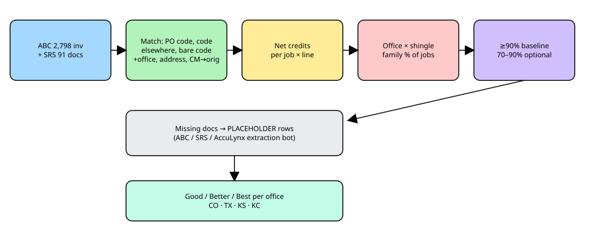

# Baseline estimate templates v2: full-invoice rematch + SRS (2026-10-30)

Chris t73u: "Look at the entire invoice. There may be a reference to a job if these are credit memos. On every invoice there is an office of purchase, which establishes the location, and a jobid code." He also asked to include SRS and to scope this to **Denver, Richardson, Wichita and Kansas City**. Pensacola, Multi-family, Insurance and Atlanta are skipped. Everything here is READ-ONLY.

## 1. Fields found on the full invoice
| Need | Field (Supabase) |
|---|---|
| Office of purchase / location | `abc_line_items.branch_number` + `branch_state`; header `abc_invoices.raw->branch` (number, name, city, state). The ABC sub-account `abc_account_name` is the office account: *Denver Co Account* (2036874-9) = Denver, *DFW Account* (-2) = Richardson, *Storm/wichita* (-16) = Wichita, *STORM North KC* (-20) = Kansas City, *Commercial* / *Texas Motor Speedway* = MF. Generic "PRO EXTERIORS LLC / 930014…" accounts fall back to the branch state (MO → KC). |
| Job ID code | `customer_po` (main), header `purchase_order_number`, `order_name`, line `job_name`. Codes appear as `CO-189`, `TX216`, `AUSTINTX-318`, `PO 188: NAME`, or a bare `180` with the office implied. |
| Credit memo → original | `abc_invoices.is_credit_memo`, `original_invoice_reference` (`2005594507-1` → invoice `2005594507-001`), `raw.creditRebillReason`. Only 83 headers carry a reference, and the header table covers only part of the line data. |
| Address | `abc_line_items.shipping_address`, header `raw.shipTo.addressLine1` (often the office address, so it's used only after the job code). |
| SRS | `vendor_invoices` + `vendor_invoice_lines` (vendor = SRS Distribution): **91 docs (59 invoices, 32 credits), 726 lines, 2026-06-18 → 2026-10-20**. `po_number` holds the job code. `branch_key` (DJWIC = Wichita, AMDEN/SHCOL/SSCOP = Denver, CDFTW/SSMEL = DFW). Also `qbo_registers."SRS Distribution"` (91 register rows, no item lines). |

**AccuLynx note:** 6,088 of 7,419 jobs in `acculynx_jobs` have a **blank job_number** (leads that never got a number). Only numbered jobs can match. Kansas City's prefix is **`KC-`** (verified), not MO.

## 2. Match rates (ABC, 2,798 invoices)
| Method | ABC invoices matched | % of 2,798 |
|---|---|---|
| M2 job code elsewhere on invoice | 24 | 0.9% |
| M1 PO job code (prefixed) | 1928 | 68.9% |
| M3 bare job code + office of purchase | 36 | 1.3% |
| M4 job address (street no.+name) | 111 | 4.0% |
| unmatched | 699 | 25.0% |

- Order of methods: M1 → M2 → M3 (a bare code turned into `PREFIX-n` using the office of purchase, accepted only if that job exists) → M4 (house number + street name match AccuLynx `location_street1`, unique within the office) → M5 (credit memo inherits the job of its original invoice).
- **Linked: 2099 / 2,798 invoices (v1: 1,930), giving 639 jobs.**
- **Still unmatched (699):** Will Call 211, Delivery 168, Express Pickup 124, Adjustment 112, Credit Memo 80, Debit Memo 4. By office: Richardson 466, Denver 106, MF 62, Atlanta 29, Wichita 25, unknown 11. Most have a person's name, "SHOP"/"RUSH", or a house address with no matching AccuLynx job number. Those jobs are likely un-numbered leads or shop stock.
- **SRS:** 88 of 91 docs matched by PO job code, 1 by address, 2 unmatched.
- Medium confidence: M3 (36) and M4 (111). Spot-check these before training.

**Credit netting:** credit-memo and SRS-credit lines are negative and summed per job × line before counting. A line counts as "present" only if its net qty > 0. Some jobs are fully reversed by a credit and drop out, which is why "no shingle" jobs rose (Wichita 17 → 49, mostly accessory-only and return-netted jobs).

## 3. Coverage (in-scope offices)
| Office | Jobs with any invoice | Jobs with supplier lines (ABC+SRS) | …with SRS lines | Primary shingle found | Insurance doc | Roofr |
|---|---|---|---|---|---|---|
| Richardson TX | 404 | 163 | 2 | 142 | 4 | 0 |
| Denver CO | 300 | 270 | 3 | 227 | 0 | 0 |
| Kansas City MO | 13 | 8 | 0 | 7 | 4 | 0 |
| Wichita KS | 223 | 158 | 35 | 109 | 28 | 5 |

**Change vs v1:**
| Office | v1 supplier-line jobs → v2 | v1 shingle jobs → v2 |
|---|---|---|
| Denver CO | 261 → 270 | 225 → 227 |
| Richardson TX | 149 → 163 | 132 → 142 |
| Wichita KS | 121 → 158 | 104 → 109 |
| Kansas City MO | 8 → 8 | 7 → 7 |

**Kansas City is still too thin:** 8 jobs with supplier lines, 7 with a shingle (Vista and Highlander have fewer than 5 each). KC POs mostly use the generic accounts or carry no code. Getting KC to n≥10 needs AccuLynx job numbers on KC POs, or the extraction bot below (material orders and work orders attached in AccuLynx).

## 4. Group summary (product level, in scope)
| Office | Shingle | n | Product baseline lines | Common optional | Confidence |
|---|---|---|---|---|---|
| Denver CO | Malarkey Vista AR | 200 | 7 | 9 | ok |
| Denver CO | NO SHINGLE ON INVOICE | 43 | 0 | 0 | ok |
| Denver CO | Malarkey Legacy | 19 | 5 | 6 | ok |
| Denver CO | OC Duration | 5 | 4 | 8 | LOW (n<10) |
| Kansas City MO | Malarkey Highlander NEX AR | 4 | 9 | 5 | LOW (n<10) |
| Kansas City MO | Malarkey Vista AR | 3 | 10 | 0 | LOW (n<10) |
| Richardson TX | Malarkey Vista AR | 103 | 7 | 4 | ok |
| Richardson TX | NO SHINGLE ON INVOICE | 21 | 0 | 0 | ok |
| Richardson TX | Malarkey Highlander NEX AR | 12 | 4 | 6 | ok |
| Richardson TX | Tamko Heritage | 8 | 2 | 5 | LOW (n<10) |
| Richardson TX | Malarkey Legacy | 5 | 1 | 3 | LOW (n<10) |
| Richardson TX | Atlas Pinnacle | 4 | 1 | 5 | LOW (n<10) |
| Richardson TX | GAF Timberline HDZ | 4 | 1 | 0 | LOW (n<10) |
| Richardson TX | Tamko Titan XT | 3 | 8 | 0 | LOW (n<10) |
| Wichita KS | NO SHINGLE ON INVOICE | 49 | 0 | 0 | ok |
| Wichita KS | Malarkey Highlander NEX AR | 45 | 7 | 4 | ok |
| Wichita KS | Malarkey Vista AR | 36 | 7 | 3 | ok |
| Wichita KS | GAF Timberline NS AR | 18 | 5 | 5 | ok |
| Wichita KS | IKO | 5 | 0 | 2 | LOW (n<10) |

## 5. Templates. Family level (cross-supplier: ABC + SRS map to the same function family) is the template the estimate agent uses; product level is in the CSV.
SRS names are mapped to families with the same rules (e.g. TOP SHIELD STARTER STRIP → Starter, TS20 SYNTHETIC → Synthetic underlayment, ICE & WATER DEFENDER → Ice & water, METAL EDGE → Drip edge). The shingle family is identified with the same shingle regex, so `MALARKEY VISTA AR … 3 BD/SQ` → Malarkey Vista AR.

### Denver CO · Malarkey Vista AR (n=200)
| Family | % jobs | Band | Top product | UoM | Median qty/sq | Median unit $ |
|---|---|---|---|---|---|---|
| Field shingle | 100.0% | **baseline** | MALARKEY VISTA | BD | 3.0 | 44.0 |
| Hip & ridge | 99.5% | **baseline** | MALARKEY 227 12" SBS MOD H&R | BD | 0.161 | 84.5 |
| Starter | 99.5% | **baseline** | MALARKEY SMART START | BD | 0.117 | 76.2 |
| Drip edge / apron | 98.0% | **baseline** | GALVANIZED STEEL DRIP APRON | EA | 1.438 | 15.82 |
| Ice & water underlayment | 98.0% | **baseline** | MALARKEY 401 ARCTIC SEAL | RL | 0.222 | 102.0 |
| Flashing (other) | 96.5% | **baseline** | MISCELLANEOUS ROOF FLASHING AND ACC: FLASHING | EA | 0.183 | 13.99 |
| Coil nails | 96.5% | **baseline** | ABC COIL NAILS - CATALOG | BX | 0.085 | 59.55 |
| Synthetic underlayment | 96.0% | **baseline** | ABC PRO GUARD 20 SYNTH UNDERLAYMENT | RL | 0.107 | 100.99 |
| Delivery / fees | 95.0% | **baseline** | JURISDICTION DELIVERY FEE | EA | 0.085 | 75.14 |
| Touch-up paint | 94.0% | **baseline** | ABC TOUCH-UP PAINT | CN | 0.143 | 12.36 |
| Roof vents | 93.5% | **baseline** | GAF MISCELLANEOUS ROOF VENTS | EA | 0.319 | 47.11 |
| Sealant / caulk | 91.5% | **baseline** | MULEHIDE WATERPROOF SEALANTS | TB | 0.261 | 6.99 |
| Cap nails | 90.0% | **baseline** | GENERIC SCREWS | EA | 0.063 | 44.99 |
| Step flashing | 77.5% | optional | GALVANIZED STEEL STEP FLASHING | BD | 0.051 | 91.49 |

### Denver CO · Malarkey Legacy (n=19)
| Family | % jobs | Band | Top product | UoM | Median qty/sq | Median unit $ |
|---|---|---|---|---|---|---|
| Flashing (other) | 100.0% | **baseline** | MISCELLANEOUS ROOF FLASHING AND ACC: FLASHING | EA | 0.107 | 14.99 |
| Field shingle | 100.0% | **baseline** | MALARKEY LEGACY 50 YR | BD | 3.0 | 39.75 |
| Starter | 100.0% | **baseline** | MALARKEY SMART START | BD | 0.081 | 80.99 |
| Hip & ridge | 100.0% | **baseline** | MALARKEY 227 12" SBS MOD H&R | BD | 0.146 | 83.99 |
| Cap nails | 100.0% | **baseline** | ABC CAP NAILS - CATALOG | EA | 0.043 | 48.99 |
| Coil nails | 100.0% | **baseline** | ABC COIL NAILS - CATALOG | BX | 0.065 | 70.99 |
| Drip edge / apron | 100.0% | **baseline** | GALVANIZED STEEL DRIP APRON | EA | 0.901 | 18.4 |
| Ice & water underlayment | 94.7% | **baseline** | MALARKEY 401 ARCTIC SEAL | RL | 0.181 | 103.49 |
| Touch-up paint | 94.7% | **baseline** | ABC TOUCH-UP PAINT | CN | 0.149 | 13.58 |
| Synthetic underlayment | 94.7% | **baseline** | ABC PRO GUARD 20 SYNTH UNDERLAYMENT | RL | 0.075 | 106.99 |
| Delivery / fees | 94.7% | **baseline** | FUEL SURCHARGE | EA | 0.049 | 95.12 |
| Sealant / caulk | 89.5% | optional | CAULKS & SEALANTS | TB | 0.221 | 12.76 |
| Step flashing | 89.5% | optional | GALVANIZED STEEL STEP FLASHING | BD | 0.027 | 97.99 |
| Roof vents | 84.2% | optional | GAF MISCELLANEOUS ROOF VENTS | EA | 0.237 | 47.01 |

### Richardson TX · Malarkey Vista AR (n=103)
| Family | % jobs | Band | Top product | UoM | Median qty/sq | Median unit $ |
|---|---|---|---|---|---|---|
| Field shingle | 100.0% | **baseline** | MALARKEY VISTA | BD | 3.0 | 41.24 |
| Coil nails | 98.1% | **baseline** | ABC COIL NAILS - CATALOG | BX | 0.071 | 54.0 |
| Starter | 98.1% | **baseline** | MALARKEY SMART START | BD | 0.082 | 81.95 |
| Ice & water underlayment | 97.1% | **baseline** | MALARKEY 401 ARCTIC SEAL | RL | 0.057 | 107.42 |
| Flashing (other) | 97.1% | **baseline** | MISCELLANEOUS ROOF FLASHING AND ACC: FLASHING | EA | 0.152 | 8.4 |
| Hip & ridge | 97.1% | **baseline** | MALARKEY 227 12" SBS MOD H&R | BD | 0.25 | 95.65 |
| Cap nails | 97.1% | **baseline** | ABC CAP NAILS - CATALOG | BX | 0.058 | 17.3 |
| Touch-up paint | 96.1% | **baseline** | ABC TOUCH-UP PAINT | CN | 0.092 | 8.96 |
| Synthetic underlayment | 95.1% | **baseline** | ABC PRO GUARD 20 SYNTH UNDERLAYMENT | RL | 0.1 | 89.1 |
| Sealant / caulk | 95.1% | **baseline** | MULEHIDE WATERPROOF SEALANTS | TB | 0.163 | 8.8 |
| Roof vents | 91.3% | **baseline** | AIRVENT ALUM ROOF VENTS | EA | 0.175 | 35.02 |
| Drip edge / apron | 77.7% | optional | ACM GALVANIZED STEEL DRIP EDGE | EA | 0.957 | 9.6 |

### Richardson TX · Malarkey Highlander NEX AR (n=12)
| Family | % jobs | Band | Top product | UoM | Median qty/sq | Median unit $ |
|---|---|---|---|---|---|---|
| Coil nails | 100.0% | **baseline** | ABC COIL NAILS - CATALOG | BX | 0.082 | 54.0 |
| Field shingle | 100.0% | **baseline** | MALARKEY NEX HIGHLANDER 242 | BD | 3.0 | 36.67 |
| Starter | 91.7% | **baseline** | MALARKEY SMART START | BD | 0.081 | 89.0 |
| Drip edge / apron | 91.7% | **baseline** | ACM GALVANIZED STEEL DRIP EDGE | EA | 0.957 | 9.6 |
| Flashing (other) | 91.7% | **baseline** | MISCELLANEOUS ROOF FLASHING AND ACC: FLASHING | EA | 0.167 | 9.05 |
| Cap nails | 91.7% | **baseline** | ABC CAP NAILS - CATALOG | BX | 0.054 | 17.3 |
| Sealant / caulk | 91.7% | **baseline** | MULEHIDE WATERPROOF SEALANTS | TB | 0.211 | 8.7 |
| Ice & water underlayment | 91.7% | **baseline** | MALARKEY 401 ARCTIC SEAL | RL | 0.054 | 99.0 |
| Hip & ridge | 83.3% | optional | MALARKEY 227 12" SBS MOD H&R | BD | 0.254 | 85.97 |
| Touch-up paint | 83.3% | optional | ABC TOUCH-UP PAINT | CN | 0.105 | 8.96 |
| Synthetic underlayment | 83.3% | optional | ABC PRO GUARD 20 SYNTH UNDERLAYMENT | RL | 0.108 | 87.05 |

### Richardson TX · Tamko Heritage (n=8) **LOW CONFIDENCE**
| Family | % jobs | Band | Top product | UoM | Median qty/sq | Median unit $ |
|---|---|---|---|---|---|---|
| Field shingle | 100.0% | **baseline** | TAMKO HERITAGE 30YR | BD | 3.0 | 33.0 |
| Sealant / caulk | 100.0% | **baseline** | MULEHIDE WATERPROOF SEALANTS | TB | 0.123 | 6.6 |
| Touch-up paint | 87.5% | optional | ABC TOUCH-UP PAINT | CN | 0.067 | 8.96 |
| Roof vents | 87.5% | optional | LOMANCO TURBINE VENTS | EA | 0.076 | 40.71 |
| Cap nails | 87.5% | optional | ABC CAP NAILS - CATALOG | BX | 0.056 | 17.3 |
| Coil nails | 87.5% | optional | ABC COIL NAILS - CATALOG | BX | 0.066 | 54.0 |
| Drip edge / apron | 87.5% | optional | ACM GALVANIZED STEEL DRIP EDGE | EA | 0.867 | 9.6 |
| Starter | 87.5% | optional | TAMKO UNIVERSAL STARTER SHINGLE | BD | 0.083 | 64.3 |
| Flashing (other) | 87.5% | optional | MISCELLANEOUS ROOF FLASHING AND ACC: FLASHING | EA | 0.141 | 8.4 |
| Synthetic underlayment | 87.5% | optional | ABC PRO GUARD 20 SYNTH UNDERLAYMENT | RL | 0.099 | 85.0 |

### Wichita KS · Malarkey Highlander NEX AR (n=45)
| Family | % jobs | Band | Top product | UoM | Median qty/sq | Median unit $ |
|---|---|---|---|---|---|---|
| Coil nails | 100.0% | **baseline** | ABC COIL NAILS - CATALOG | BX | 0.079 | 49.12 |
| Field shingle | 100.0% | **baseline** | MALARKEY NEX HIGHLANDER 242 | BD | 3.0 | 40.0 |
| Sealant / caulk | 100.0% | **baseline** | MULEHIDE WATERPROOF SEALANTS | TB | 0.079 | 8.9 |
| Flashing (other) | 97.8% | **baseline** | MISCELLANEOUS ROOF FLASHING AND ACC: IPS MULT | EA | 0.133 | 24.0 |
| Hip & ridge | 97.8% | **baseline** | MALARKEY 227 12" SBS MOD H&R | BD | 0.136 | 91.25 |
| Starter | 97.8% | **baseline** | GAF PRO-START | BD | 0.094 | 55.1 |
| Cap nails | 97.8% | **baseline** | ABC CAP NAILS - CATALOG | BX | 0.056 | 19.5 |
| Touch-up paint | 95.6% | **baseline** | ABC TOUCH-UP PAINT | CN | 0.062 | 8.95 |
| Drip edge / apron | 93.3% | **baseline** | ALUMINUM DRIP EDGE | EA | 1.038 | 7.14 |
| Roof vents | 91.1% | **baseline** | AIRVENT GALV ROOF VENTS | EA | 0.289 | 27.5 |
| Ice & water underlayment | 82.2% | optional | GAP WATERGUARD UNDERLAYMENT | RL | 0.061 | 82.27 |
| Synthetic underlayment | 82.2% | optional | ROOFNADO ANCHORDECK SYN UNDERLAYMNT | RL | 0.106 | 75.0 |

### Wichita KS · Malarkey Vista AR (n=36)
| Family | % jobs | Band | Top product | UoM | Median qty/sq | Median unit $ |
|---|---|---|---|---|---|---|
| Drip edge / apron | 100.0% | **baseline** | ALUMINUM DRIP EDGE | EA | 1.101 | 7.15 |
| Coil nails | 100.0% | **baseline** | ABC COIL NAILS - CATALOG | BX | 0.078 | 49.12 |
| Field shingle | 100.0% | **baseline** | MALARKEY VISTA | BD | 3.0 | 43.75 |
| Starter | 100.0% | **baseline** | GAF PRO-START | BD | 0.1 | 55.1 |
| Hip & ridge | 100.0% | **baseline** | MALARKEY 227 12" SBS MOD H&R | BD | 0.139 | 91.25 |
| Sealant / caulk | 100.0% | **baseline** | MULEHIDE WATERPROOF SEALANTS | TB | 0.082 | 8.9 |
| Touch-up paint | 100.0% | **baseline** | ABC TOUCH-UP PAINT | CN | 0.057 | 8.95 |
| Cap nails | 97.2% | **baseline** | ABC CAP NAILS - CATALOG | BX | 0.065 | 19.5 |
| Flashing (other) | 94.4% | **baseline** | MISCELLANEOUS ROOF FLASHING AND ACC: IPS MULT | EA | 0.157 | 28.09 |
| Synthetic underlayment | 94.4% | **baseline** | ROOFNADO ANCHORDECK SYN UNDERLAYMNT | RL | 0.106 | 75.0 |
| Ice & water underlayment | 91.7% | **baseline** | GAP WATERGUARD UNDERLAYMENT | RL | 0.065 | 82.27 |
| Roof vents | 91.7% | **baseline** | AIRVENT GALV ROOF VENTS | EA | 0.312 | 27.5 |
| Delivery / fees | 72.2% | optional | GROUND DROP DELIVERY CHARGE | EA | 0.033 | 75.0 |

### Wichita KS · GAF Timberline NS AR (n=18)
| Family | % jobs | Band | Top product | UoM | Median qty/sq | Median unit $ |
|---|---|---|---|---|---|---|
| Field shingle | 100.0% | **baseline** | GAF TIMBERLINE NATURAL SHADOW | BD | 3.14 | 33.96 |
| Flashing (other) | 100.0% | **baseline** | MISCELLANEOUS ROOF FLASHING AND ACC: IPS 4N1  | EA | 0.16 | 25.58 |
| Starter | 100.0% | **baseline** | GAF PRO-START | BD | 0.095 | 55.1 |
| Sealant / caulk | 94.4% | **baseline** | MULEHIDE WATERPROOF SEALANTS | TB | 0.076 | 8.9 |
| Coil nails | 94.4% | **baseline** | ABC COIL NAILS - CATALOG | BX | 0.081 | 49.12 |
| Roof vents | 88.9% | optional | AIRVENT GALV ROOF VENTS | EA | 0.325 | 25.95 |
| Synthetic underlayment | 88.9% | optional | ROOFNADO ANCHORDECK SYN UNDERLAYMNT | RL | 0.119 | 75.0 |
| Touch-up paint | 88.9% | optional | ABC TOUCH-UP PAINT | CN | 0.062 | 8.95 |
| Cap nails | 83.3% | optional | ABC CAP NAILS - CATALOG | BX | 0.059 | 19.5 |
| Ice & water underlayment | 83.3% | optional | GAP WATERGUARD UNDERLAYMENT | RL | 0.067 | 82.27 |
| Drip edge / apron | 77.8% | optional | ALUMINUM DRIP EDGE | EA | 1.109 | 7.29 |

### Kansas City MO · Malarkey Vista AR (n=3) **LOW CONFIDENCE**
| Family | % jobs | Band | Top product | UoM | Median qty/sq | Median unit $ |
|---|---|---|---|---|---|---|
| Synthetic underlayment | 100.0% | **baseline** | ROOFNADO ANCHORDECK SYN UNDERLAYMNT | RL | 0.12 | 76.0 |
| Roof vents | 100.0% | **baseline** | MISCELLANEOUS ROOF VENTS: AIRVENT TYPE B ADJ  | EA | 0.25 | 29.94 |
| Field shingle | 100.0% | **baseline** | MALARKEY VISTA | BD | 3.0 | 41.67 |
| Delivery / fees | 100.0% | **baseline** | DELIVERY CHARGE | EA | 0.077 | 65.0 |
| Coil nails | 100.0% | **baseline** | ABC COIL NAILS - CATALOG | BX | 0.077 | 49.99 |
| Sealant / caulk | 100.0% | **baseline** | MULEHIDE WATERPROOF SEALANTS | TB | 0.08 | 11.11 |
| Hip & ridge | 100.0% | **baseline** | MALARKEY 227 12" SBS MOD H&R | BD | 0.188 | 79.19 |
| Drip edge / apron | 100.0% | **baseline** | GALVANIZED STEEL DRIP APRON | EA | 1.0 | 7.81 |
| Starter | 100.0% | **baseline** | GAF PRO-START | BD | 0.115 | 52.02 |
| Flashing (other) | 100.0% | **baseline** | MISCELLANEOUS ROOF FLASHING AND ACC: IPS 4N1  | EA | 0.08 | 13.39 |
| Touch-up paint | 100.0% | **baseline** | ABC TOUCH-UP PAINT | CN | 0.08 | 9.16 |

### Kansas City MO · Malarkey Highlander NEX AR (n=4) **LOW CONFIDENCE**
| Family | % jobs | Band | Top product | UoM | Median qty/sq | Median unit $ |
|---|---|---|---|---|---|---|
| Sealant / caulk | 100.0% | **baseline** | MULEHIDE WATERPROOF SEALANTS | TB | 0.068 | 10.79 |
| Starter | 100.0% | **baseline** | GAF PRO-START | BD | 0.101 | 52.02 |
| Hip & ridge | 100.0% | **baseline** | MALARKEY 227 12" SBS MOD H&R | BD | 0.148 | 79.19 |
| Synthetic underlayment | 100.0% | **baseline** | ROOFNADO ANCHORDECK SYN UNDERLAYMNT | RL | 0.101 | 76.0 |
| Touch-up paint | 100.0% | **baseline** | ABC TOUCH-UP PAINT | CN | 0.052 | 9.16 |
| Field shingle | 100.0% | **baseline** | MALARKEY NEX HIGHLANDER 242 | BD | 3.0 | 38.46 |
| Ice & water underlayment | 100.0% | **baseline** | RESISTO ICE & WATER UNDERLAYMENTS | RL | 0.12 | 66.25 |
| Flashing (other) | 100.0% | **baseline** | MISCELLANEOUS ROOF FLASHING AND ACC: IPS 4N1  | EA | 0.106 | 13.39 |
| Delivery / fees | 100.0% | **baseline** | DELIVERY CHARGE | EA | 0.081 | 65.0 |
| Roof vents | 100.0% | **baseline** | LOMANCO GALV ROOF VENTS | EA | 0.197 | 26.35 |
| Cap nails | 75.0% | optional | ABC CAP NAILS - CATALOG | BX | 0.06 | 38.09 |
| Drip edge / apron | 75.0% | optional | GALVANIZED STEEL DRIP APRON | EA | 0.84 | 7.77 |
| Coil nails | 75.0% | optional | ABC COIL NAILS - CATALOG | BX | 0.074 | 49.99 |

**Changes at product level vs v1 (n≥10):**
- Dropped below 90%:
  - Denver Vista: ABC coil nails (87.5%; now covered at family level 96.5% via other nail SKUs).
  - Denver Legacy: Pro Guard 20 (89.5%).
  - Wichita Vista: GAP Waterguard (88.9%).
  - Wichita GAF NS: Roofnado, touch-up paint, Waterguard, cap nails (78–89%). SRS jobs use Top Shield equivalents, which the **family** view fixes.
- At family level, most groups now have 10–13 baseline families (Denver Vista 13, Wichita Vista 12, Richardson Vista 11).

## 6. Placeholders and the extraction-bot spec (update to v1 §6)
- `job-document-status-v2.csv` has one row per in-scope job × doc type: `supplier_material_invoice_abc`, `supplier_material_invoice_srs`, `customer_invoice_lines`, `insurance_scope`, `roofr_report`. Missing docs are written as `status=missing`, `source=<ABC|SRS|AccuLynx> (not yet extracted)`, never as zero.
- Add to the bot spec:
  - **SRS** as a supplier source: `vendor_invoices`/`vendor_invoice_lines` already exist (since 2026-06-18). Backfill SRS history before June 2026 from the SRS portal or PDFs into the same tables.
  - Map `branch_key` → office in `vendor_branch_code_map`.
  - Require `po_number` = AccuLynx job number at order time (the forward fix).
  - Pull AccuLynx **job numbers** for the 6,088 un-numbered jobs if they're assigned later.

## Evidence
Read-only queries over `abc_line_items` (16,282 lines / 2,798 invoices), `abc_invoices` (1,216 headers, 274 credit memos, 83 with an original reference), `vendor_invoices`/`vendor_invoice_lines` SRS (91 / 726) and `acculynx_jobs` (7,419; 1,331 numbered). Scripts: `analyze2.py`, `build2.py`.
